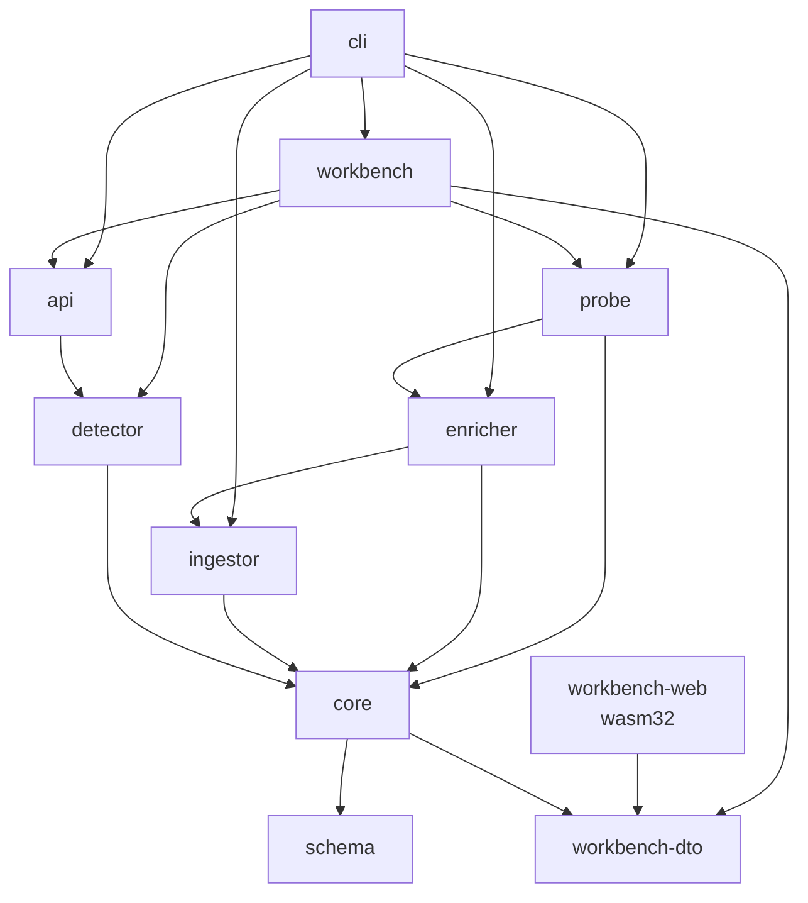

<!-- generated-by: gsd-doc-writer -->
# Architecture

<!-- GSD-MANAGED-DOC: architecture -->

## Overview

UrbanIntegrity is a streaming graph analytics engine implemented as a **Cargo workspace** of 13 Rust crates (see *Crate Dependency Map*). Two front doors sit on the same stores: the `urban-integrity-cli` binary, and — through that binary's `workbench` subcommand — a browser-based analyst workbench. Data flows from three UK public API sources through a mutation pipeline into a sharded in-memory graph, which is periodically snapshotted into an immutable CSR (Compressed Sparse Row) format for concurrent motif detection. A daily OSINT enrichment layer resolves cross-registry entity identities — using **exact-identifier joins only** (exact CH company number, exact normalised-name equality) — and stages links for analyst review or automatic graph promotion. Phase 17 adds CH exact-join adapters (PSC beneficial ownership and disqualified directors) that consume shared streaming primitives extracted into `crates/core`, and surfaces the resulting intelligence through the CLI `verify` and `entity` commands. Phase 18 adds property ownership intelligence via a Land Registry CCOD bulk-CSV adapter (`LandRegistryCcodAdapter`, PROP-01/PROP-04), London Gazette insolvency monitoring (`LondonGazetteAdapter`, PROP-02), and a Property Accumulation Anomaly detector (`run_property_accumulation_detector`, PROP-03) that fires HIGH alerts when an active entity's land holdings disproportionately exceed its awarded-contract value. Phase 19 introduces three multi-registry OSINT adapters: Charity Commission bulk-data (FUZ-02), OpenSanctions/yente PEP and sanctions screening (FUZ-03), and ICIJ Offshore Leaks (FUZ-04). Phase 20 adds the political-corruption pipeline: Electoral Commission donations (POL-01), Council Registers of Interest (POL-02), and OpenCorporates cross-jurisdiction lookup (POL-03), together with the Donation Correlation post-adapter detector (POL-04). The **v4.0 "Data Activation" milestone (Phases 21–23, shipped 2026-06-20)** adds: HM Land Registry OCOD overseas-ownership ingestion (`LandRegistryOcodAdapter`, PROP-05/PROP-06) alongside the existing CCOD UK-company adapter; a Land Registry PPD (Price Paid Data) staging adapter (`LandRegistryPpdAdapter`, FLIP-01) that loads raw property transactions into a `ppd_transactions` staging table; the **Pre-Permission Land Flip detector** (`crates/enricher/src/land_flip.rs`, FLIP-02–FLIP-05), a security-critical three-gate detector that writes MEDIUM-ceiling candidates to a `land_flip_candidates` review queue and **never** to `graph_events`/alerts; a relation-schema migration (`migrate` command) that adds IN/OUT constraints to every relation table (11 of them then, 12 today); and an orphan-property purge (`purge-orphans` command). Post-v4.0 hardening (2026-07) adds the **analysis lifecycle** layer — named, content-addressed analysis databases (`an_<slug>_<hash8>`) registered in a `_catalog` SurrealDB database, provisioned/cloned/retired via the `analysis` CLI command and selected per-invocation with the global `--analysis` flag — together with detection-quality and fail-loud persistence fixes: CH status transitions via `GraphMutation::UpsertNode`, ward + IMD alert attribution, address-cluster noise suppression, paginated fail-loud WAL replay, projector edge-drop accounting, and schema-conformant batched ICIJ writes. The **v6.0 “Data Quality & Compliance” work (2026-07 → 2026-08)** hardens what those layers assert rather than adding new sources: a startup **jurisdiction gate** that derives the analysis nation from its ward codes and refuses a configuration that cannot be right for it; deprivation weighting that claims a fraction of an alert's remaining *headroom* instead of multiplying the score (with per-nation ward indices built offline); **evidence-keyed officer identity** (`director:{slug}-b{YYYYMM}` / `-o{id}`) behind resumable `backfill cessation` and `backfill officers` subcommands; a `data_anomalies` table and `anomalies` CLI for inputs the pipeline refused to guess at; fail-loud `require_*` field accessors replacing `unwrap_or(0)`; and an alert read path ordered by **severity over the whole corpus** rather than by recency over a window. The most recent increment (phase 28, 2026-08) adds the **purge subsystem** — the two destructive `graph_events` maintenance commands (`purge-orphans`, `purge-ocod-owners`) and the shared safety layer they both run through, which exists because an append-only log cannot merge anything by re-emitting under a corrected key (see *Destructive Maintenance*). The **v7.0 “Rust Probe Port & Verdict Correctness” milestone (phases 31–36, shipped 2026-08-31)** moves the forensic probe battery out of `scripts/analyst_probe.py` and into the Rust CLI: a construction-invariant `Verdict` / `Coverage` / `Finding` vocabulary in `crates/schema`, an ordered `Probe` / `Strategy` dispatch loop, **22 registered probes** (7 Tier-1, 12 Tier-2, 3 Cluster-A anchors) behind a new `probe` subcommand that also renders a deterministic `evidence-report.md`, a `detector_runs:current` marker that keeps *“the detector found nothing”* distinguishable from *“the detector never ran”*, paged `identity_links` / `land_flip_candidates` reads, and a query-shape guard widened from `graph_events` alone to nine watched tables (see *Probe Battery*). The **v8.0 “Independent Verification & Verdict Gating” milestone (phases 37–41, shipped 2026-09-04)** adds a *second, deliberately independent* way to count the same things: `export-graphml --reachable-from-wards`, which restricts an export to the weakly-connected component reachable from a set of ward seeds (phase 37); the `persistence::oracle` counting path together with the `probe-oracle` command that runs the real battery, recomputes every checkable probe's declared population from raw `graph_events` by an unrelated route, and prints the disagreements (phase 38); a `PopulationSource` provenance value computed for every probe and rendered in the report itself, so a reader sees whether the oracle corroborated a population or the probe merely self-reported it, without having to run a second command (phase 39); the adjudication of the three differential findings the two implementations disagreed on, recorded durably in `docs/ADJUDICATIONS.md` and pointed at from `probe-oracle`'s own output whenever a probe disagrees (phase 40); and **verdict-gated orchestration** (phase 41, 2026-09-03) — a startup-validated probe dependency graph with a stable topological dispatch order, a gate predicate that runs a probe only when its upstreams found signal, a seventh `Verdict::Skipped` variant carrying a typed `SkipCause`, and `--full-battery` as the ungated escape hatch (see *Population Oracle & `probe-oracle`* and *Verdict-Gated Dispatch*).

The **v9.0 “Fraud Analyst Workbench”** work (in progress as of 2026-09-24) puts a browser in front of all of the above without adding a second source of truth. It adds four crates: `probe` (the forensic battery, lifted out of `crates/cli` so a second caller can run it in-process), `workbench-dto` (the serde-only wire types shared by server and browser), `workbench` (an Axum server that replays `graph_events` into a read-only coordinator and serves JSON endpoints plus the embedded frontend), and `workbench-web` (a Leptos 0.8 client-side-rendered app compiled to `wasm32-unknown-unknown` with Trunk). The UI covers the probe findings, the alert/motif triage inbox, entity profiles with neighbourhood pivots, an interactive graph canvas with in-browser-triggered graph algorithms, and **saved investigations** persisted in the analysis database. See *Analyst Workbench*.

> **Data-integrity invariant (2026-06-13):** All in-app fuzzy / phonetic name matching has been **removed** from the enricher. There is no composite confidence scorer, no Jaro-Winkler similarity, and no DoubleMetaphone phonetic matching in the codebase. Identity links are emitted **only** from exact-identifier joins — exact CH company number or exact normalised-name equality. The OpenSanctions adapter delegates PEP/sanctions screening to an external self-hosted `yente` sidecar (kept); the score thresholds it applies are yente's, not an in-app fuzzy scorer's.

> **Coverage:** **69.3%** workspace line coverage (19,802 / 28,574 lines) across unit, integration,
> hybrid-validation, live-API, and in-process HTTP server tests. **That figure is dated:** it comes
> from a maintainers' `cargo llvm-cov` run on **2026-06-20** (report not published), which executed
> 862 tests. `crates/` now carries **2,797** `#[test]` / `#[tokio::test]` attributes (counted 2026-09-24) and the
> report has not been regenerated since, so treat 69.3% as a historical measurement rather than
> the current figure (`docs/TESTING.md`). A full `URBAN_DB_TESTS=1 cargo test --workspace` at
> commit `10dfed2` (2026-09-01) reported **1,655 passed, 0 failed, 10 ignored**; the ungated run
> reports the identical numbers, because the DB gate is a skip-**by-return** and duration is the
> only evidence the gated tests executed.

> **Toolchain:** Rust workspace with the local and CI toolchain pinned to **1.96.0** via `rust-toolchain.toml` (channel + `clippy`/`rustfmt` components) — pinning eliminates clippy-lint drift between contributors and the CI `-D warnings` gate. **No MSRV is declared or enforced:** neither the workspace `Cargo.toml` nor any of the 13 crate manifests carries a `rust-version` key, so the "1.87+" floor quoted elsewhere in the project is prose only. Async runtime is **Tokio**.

---

## Repository Layout

```
urban-integrity/
├── Cargo.toml            workspace manifest — the 13 members and every shared dependency version
├── rust-toolchain.toml   pinned toolchain (1.96.0) for local dev AND CI, so clippy cannot drift
├── config.toml           all runtime defaults; secrets and per-env values come from URBAN__* env vars
├── crates/               the Rust workspace (see *Crate Dependency Map* below)
│   └── workbench/dist/   Trunk build output of workbench-web, embedded by rust-embed — gitignored
├── scrapling-sidecar/    the LIVE Python FastAPI scraping sidecar (sidecar.py, :8765)
├── services/             one superseded copy of the sidecar — see the warning below
├── scripts/              operator shell scripts + the offline Python forensic pipeline
├── docs/                 this document and its siblings (API, CONFIGURATION, TESTING, PROJECTION, …)
├── data/                 runtime working directory — gitignored, and NOT a source of truth
└── .github/workflows/    ci.yml — the single workflow: test, lint, and wasm-frontend jobs
```

Why it is shaped this way:

- **`crates/` is split by mutation rate, not by layer.** The streaming ingest path
  (`ingestor`), the daily OSINT batch path (`enricher`) and the detection path (`detector`)
  change for unrelated reasons and are deployed by the same binary, so they are separate
  compilation units with `core` as their only shared machinery and `schema` as their only
  shared vocabulary. `schema` depends on nothing so that a type change cannot cascade.
- **Python is out-of-process on purpose.** `scrapling-sidecar/` is not a workspace member and
  is never linked; the Rust side talks to it over HTTP and treats it as optional. `scripts/`
  is likewise offline — those tools drive SurrealDB directly and are never on the real-time
  path.
- **The browser crate is fenced off mechanically.** `workbench-web` may depend only on
  `workbench-dto` plus the Leptos / wasm-bindgen stack. `scripts/check-wasm-boundary.sh`, run
  by CI's wasm job, fails the build if `schema`, `core`, `detector`, `surrealdb`, `tokio`,
  `petgraph` or `rayon` ever enter its dependency graph — so no server-side type, and no
  database client, can reach the browser by accident.
- **`data/` is gitignored, contents and all** (`.gitignore`: `data/*`, with two committed
  reference tables re-included by exception — `country_incorporation_canonical.json` and
  `formation_agent_postcodes.txt`, both read at build or run time). Everything else there —
  bulk downloads, caches, the RocksDB store, the deprivation ward indices, logs — is
  regenerable and **does not arrive with a clone**. A doc or config that names a file under
  `data/` is naming something the reader must build, not find.

> **⚠ Two sidecar copies exist and only one is live.** `scripts/sidecar-start.sh` launches
> `scrapling-sidecar/sidecar.py` (1,413 lines: portal-type routing, the Idox three-tier
> fallback, the Arcus/Salesforce path). `services/scrapling-sidecar/main.py` is a 96-line
> generic-CSS ancestor last touched 2026-05-09 that nothing starts and nothing tests. Read
> the top-level one; the `services/` copy will answer a `/scrape` request with a different
> contract if it is ever started by hand.

---

## Crate Dependency Map

Verified against the thirteen `Cargo.toml` manifests. Arrows point from dependant to
dependency; only `[dependencies]` path edges are shown (dev-dependencies are listed separately
below). `stats` and `test-support` are omitted from the diagram and covered in the table.



`schema` and `workbench-dto` are the two leaves: `schema` has no workspace dependency, and
`workbench-dto` depends on `serde` alone, which is what lets it compile for both the native
server and the wasm browser bundle. `core → workbench-dto` exists so the `Provenance` and
temporal wire types an entity-profile row carries have exactly one definition, shared by the
producer in `core` and the renderer in the browser. Most crates also depend on `schema`
directly; those edges are left out of the diagram to keep it readable.

| Crate | Path dependencies (non-dev) |
|-------|-----------------------------|
| `schema` | — (the root; no workspace dependencies) |
| `workbench-dto` | — (only `serde`) |
| `core` | `schema`, `workbench-dto` |
| `ingestor` | `schema`, `core` |
| `detector` | `schema`, `core` |
| `stats` | `schema`, `core` — declared, but the crate contains no code that uses them |
| `enricher` | `schema`, `core`, **`ingestor`** (the ENR-01 violation — see below) |
| `api` | `schema`, `core`, `detector`, **`stats`** |
| `probe` | `schema`, `core`, `enricher` |
| `workbench` | `schema`, `core`, `api`, `probe`, `detector`, `workbench-dto` |
| `workbench-web` | `workbench-dto` only (plus Leptos, wasm-bindgen, web-sys, gloo-net) |
| `cli` | `schema`, `core`, `detector`, `ingestor`, `enricher`, `api`, `probe`, `workbench`, **`stats`**, **`test-support`** |
| `test-support` | `schema` |

> **⚠ ENR-01 isolation invariant — documented but VIOLATED in the code.** The stated constraint is that `crates/enricher` has **zero import dependency** on `crates/ingestor`, so OSINT enrichment can run and be tested without pulling in any streaming ingest machinery. **It does not hold.** `crates/enricher/Cargo.toml:10` declares `urban-integrity-ingestor = { path = "../ingestor" }`, and three call sites import from it: `crates/enricher/src/land_flip.rs:41` (`address::normalise_postcode`), `land_flip.rs:42` (`address::planning::parse_planning_address`), and `crates/enricher/src/adapters/land_registry_ppd.rs:30` (`address::{extract_house_number, normalise_postcode}`). The dependency arrived with commit `d3a4ec7` in Phase 23 (2026-06-18), so the invariant has been false since **v4.0** — this is not a branch regression. `crates/enricher/tests/hot_path.rs` still describes itself as proving the isolation structurally, but it only shows that *that one test file* imports nothing from the ingestor; it cannot fail while the crate-level dependency exists. Treat ENR-01 as an invariant to **restore** (lift the shared address helpers into `urban-integrity-core`), not as a property anything currently relies on.

> **⚠ `stats` is an empty crate that two other crates depend on.** `crates/stats/src/lib.rs` is still the untouched `cargo new` template — 14 lines holding `pub fn add(left: u64, right: u64)` and its `it_works` test. It contains **no scoring code of any kind**, nothing imports from it, and yet `api` and `cli` both declare a path dependency on it. All `P_c` scoring lives in `crates/detector/src/scoring/` (`formula.rs`, `imd.rs`, `registry.rs`). Do not go looking in `stats` for scoring behaviour, and do not add scoring code there without wiring something to consume it.

> **`test-support` is no longer dev-only.** It is a dev-dependency of `core`, `ingestor`, `enricher`, `api`, `probe`, `workbench` and `cli`, and additionally a **normal** dependency of `cli`, because `fixture seed --planted` writes the planted fixture (`test-support::planted`) from a shipped code path. That path only accepts an analysis provisioned with `analysis create --fixture`, so the shipped CLI can seed a fixture but only into a fixture analysis. Other dev-only edges: `core` dev-depends on `detector`, `api` on `ingestor`, `ingestor` on `cli`, and `cli` on `workbench-dto`.

> **Why `probe` is its own crate.** The battery used to live in `crates/cli/src/commands/probe/`. The workbench has to run it in-process, and `workbench` cannot depend on `cli` because `cli` depends on `workbench`. Moving the battery, its dependency graph, the population-source partition and the Markdown report writer into `crates/probe` breaks the would-be cycle: `cli` and `workbench` now both call `urban_integrity_probe::run::execute`. `probe` keeps its own copy of the two `_catalog` queries it needs (`crates/probe/src/registry.rs`) rather than reaching back into `cli`.

| Crate | Path | Role |
|-------|------|------|
| `urban-integrity-schema` | `crates/schema` | Shared node/edge types, `EntityId`, `EntityStatus`, `CHNumber`, the `Nation` / `Jurisdiction` types, `DataAnomaly`, serde derives, the `Verdict` / `Coverage` / `Finding` probe vocabulary (`types::verdict`), and the SurrealDB schema definitions (`SCHEMA_DEF`, plus `CATALOG_SCHEMA` for the `_catalog` analyses registry) |
| `urban-integrity-core` | `crates/core` | Graph storage, CSR snapshots, WAL pipeline, SurrealDB persistence (`persistence::{surreal, queries, scan, oracle, traversal, checkpoint, wal, dead_letter, detector_runs, land_flip_runs, land_flip_capability}`), config, shared CH streaming primitives (`stream::`), pure analysis-naming module (`analysis::naming`) |
| `urban-integrity-ingestor` | `crates/ingestor` | CH stream client, CF REST poller, Scrapling sidecar bridge (with Firecrawl fallback), address normalisation (`address::`), CQRS projector, and the `backfill::` subsystem (ch, ward, planning, cessation, officers) |
| `urban-integrity-stats` | `crates/stats` | **Empty `cargo new` template (14 lines).** No scoring, no IMD loading, no pressure weighting — see the warning above |
| `urban-integrity-detector` | `crates/detector` | Motif detectors (`motif::{phoenix, cluster, nepotism}`), alert cache, result schema, and **all `P_c` scoring** (`scoring::{formula, imd, registry}`) including post-detection ward + deprivation attribution |
| `urban-integrity-api` | `crates/api` | tonic gRPC + async-graphql over Axum |
| `urban-integrity-cli` | `crates/cli` | clap CLI — **23 subcommands** (report, alerts, anomalies, status, entity, graph-path, serve, ingest-planning, backfill, project, export-graphml, verify, enrich, links, flips, migrate, purge-orphans, purge-ocod-owners, analysis, fixture, probe, probe-oracle, workbench) plus the startup jurisdiction `preflight`, the `_catalog` `registry`, a thin `probe` wrapper (argument parsing, table output and file writing around `urban_integrity_probe::run::execute`), the population-oracle comparison command (`commands::probe_oracle`), and the `workbench` launcher, which resolves the analysis and canonical population and then hands off to `urban_integrity_workbench::boot` |
| `urban-integrity-probe` | `crates/probe` | The 22-probe forensic battery: the `Probe` trait and `Strategy`, one module per probe, the dependency graph and gated dispatch (`graph`), `PopulationSource` partitioning (`population_source`), the `run::execute` entry point both front ends call, and the `evidence-report.md` renderer (`report::`) |
| `urban-integrity-workbench-dto` | `crates/workbench-dto` | Serde-only wire types for the workbench HTTP API — report/verdict views, alerts, entity profile, neighbourhood, algorithm requests and outcomes, canvas filters, investigations, provenance, temporal ranges, paging caps. Compiles natively and to wasm |
| `urban-integrity-workbench` | `crates/workbench` | The native half of the analyst workbench: replay-only engine boot (`boot`), the merged Axum router, JSON handlers (`analysis`, `alerts`, `entity`, `graph`, `investigation`, `home`, `status`, `population`), graph algorithms over the CSR snapshot (`graph::algorithms` — paths, community, k-core, betweenness, ward subgraph), Arrow IPC population export, `workbench_report:latest` persistence, and the `rust-embed` static-asset handler for `dist/` |
| `urban-integrity-workbench-web` | `crates/workbench-web` | Leptos 0.8 CSR frontend built by Trunk (`Trunk.toml` writes straight into `crates/workbench/dist/`). Pages for home, analysis findings, finding detail, alerts and alert detail, graph canvas (Cosmograph through a vendored JS shim), entity search and profile, saved investigations, and help/glossary |
| `urban-integrity-enricher` | `crates/enricher` | OSINT enrichment engine — exact-join identity resolution, `identity_links` table, `EnricherAdapter` trait (Phase 16); CH PSC + Disqualified adapters (Phase 17); Land Registry CCOD + London Gazette + property accumulation detector (Phase 18); Charity Commission + OpenSanctions/yente + ICIJ Offshore Leaks adapters (Phase 19); Electoral Commission + Council Registers + OpenCorporates adapters + Donation Correlation detector (Phase 20); Land Registry OCOD overseas-ownership adapter + PPD staging adapter + Pre-Permission Land Flip detector (Phases 21–23, v4.0); `wal_writer` module for direct `graph_events` WAL writes from the CLI drain task |
| `urban-integrity-test-support` | `crates/test-support` | Shared SurrealDB test harness — `TestNs` / `NsGuard` throwaway namespaces that `REMOVE NAMESPACE` on drop — plus the **planted fixture** (`planted`, a small graph whose algorithm answers are known in advance) and `events` helpers. Linked into the CLI binary for `fixture seed --planted` (see *Test Harness & Namespace Hygiene*) |

> **No `strsim` / `rphonetic` dependencies:** `crates/enricher/Cargo.toml` no longer lists `strsim` (Jaro-Winkler) or `rphonetic` (DoubleMetaphone). They were dropped when the fuzzy resolver was deleted (commit 43675f8, 2026-06-13).

---

## Key Abstractions

The types and seams worth knowing before changing anything. Each is the single place its
concern is expressed — a second implementation of any of them is a defect, and several of the
findings recorded later in this document are exactly that.

| Abstraction | Where | What it is |
|-------------|-------|------------|
| `EntityId` | `crates/schema/src/types/id.rs` | The domain key every node is addressed by — a newtype over `String`. Prefixes carry provenance: `GB-COH:` Companies House, `GB-MUT:` FCA registered society, `GB-ROE:` / `GB-OCOD:` overseas owner, `director:` officer, `PA:` political actor, `CF:` Contracts Finder contract, `ward:` ward |
| `NodeWeight` / `EdgeWeight` | `crates/schema/src/types/{node,edge}.rs` | The tagged unions the whole graph is made of — 11 node variants, 12 edge variants. Every edge weight embeds `EdgeMeta` (see *temporal edges* under *Node & Edge Schema*) |
| `EntityStatus` | `crates/schema/src/types/node.rs` | `Active` / `Dissolved(DateTime)` / `InLiquidation(DateTime)` — a typed status with its date, not a string. Phoenix's window is measured against it |
| `Nation` / `Jurisdiction` | `crates/schema/src/nation.rs` | Which UK nation an analysis, ward, index or data source belongs to, derived from the ONS GSS prefix. Gates both the deprivation index and adapter admission |
| `GraphMutation` | `crates/core/src/graph/types.rs` | The single message type crossing the ingest boundary — `AddNode`, `UpsertNode`, `AddEdge`, `UpdateNode`, `RemoveNode`. Everything that writes to the graph sends one of these; the coordinator turns each into a `GraphEvent` (`NodeAdded`, `NodeUpdated`, `EdgeAdded`, `NodeRemoved`, `MotifDetected`) on the WAL |
| `GraphStorage` | `crates/core/src/graph/storage.rs` | The 128-shard hot graph. The only mutable state |
| `CsrSnapshot` / `SnapshotHandle` | `crates/core/src/graph/snapshot.rs` | The immutable, read-only view detection runs against, rotated lock-free via `ArcSwap` |
| `persistence::scan` | `crates/core/src/persistence/scan.rs` | The **only** safe way to read `graph_events` in bulk. Every query shape that under-reads silently is banned here and enforced by `crates/core/tests/query_shape_guard.rs` |
| `persistence::oracle` | `crates/core/src/persistence/oracle.rs` | The **second, deliberately unrelated** way to count a population — `count_events`, `count_distinct_entities`, `count_distinct_edge_field`. It shares no implementation with `persistence::scan`, so a defect in either surfaces as a disagreement instead of as two modules agreeing on a wrong number |
| `resolve_entity` | `crates/core/src/persistence/queries.rs` | The single choke point turning a user-supplied string into entity ids |
| `select_alerts` / `AlertPage` | `crates/core/src/persistence/queries.rs` | Pure filter-order-page for alerts, plus the `total_matched` count that makes truncation visible |
| `MotifResult` / `ScoreBreakdown` | `crates/detector/src/alert/result.rs` | What a detection *is*, including its `unique_hash`, its score decomposition and its optional withdrawal |
| `scoring::formula` | `crates/detector/src/scoring/formula.rs` | `p_base`, the deprivation headroom uplift, and the reported `m_env`. The whole scoring policy, in 190 lines |
| `EnricherAdapter` | `crates/enricher/src/adapters/mod.rs` | The OSINT extension point: `name()`, `is_enabled()`, `coverage()`, `run()` |
| `ConfidenceScore` → `ConfirmedLink` | `crates/enricher/src/confidence.rs` | Type-level thresholds that make a sub-threshold link unrepresentable on the auto-link path |
| `DataAnomaly` | `crates/schema/src/anomaly.rs` | A refused input, made queryable — deliberately *not* an alert |
| `backfill::session::DbSession` | `crates/ingestor/src/backfill/session.rs` | The re-authenticating query wrapper every long-running backfill passes through |
| `backfill::require` | `crates/ingestor/src/backfill/require.rs` | Fail-loud field accessors. `require_u64(row, "timestamp")` errors where `unwrap_or(0)` invented a plausible number |
| `analysis::naming` | `crates/core/src/analysis/naming.rs` | Pure, DB-free rules producing the content-addressed `an_<slug>_<hash8>` database name |
| `Verdict` / `Coverage` / `Finding` | `crates/schema/src/types/verdict.rs` | The seven-value probe vocabulary. `Coverage`'s fields are private and its only constructor is inside `Verdict::classify`, so a verdict that claims a population it never measured is a compile error, not a review comment. `Skipped`'s `SkipCause` wraps a module-private inner enum, so the *cause payload* cannot be fabricated — though the constructors are `pub`, so a probe can still self-report a skip (see *Verdict-Gated Dispatch*) |
| `Probe` / `Strategy` / `run_probes` | `crates/probe/src/lib.rs` | The forensic battery, its per-probe declarations (`tier`, `hypothesis`, `depends_on`) and the flat unconditional dispatch loop `--full-battery` still uses |
| `run::execute` / `BatteryResult` | `crates/probe/src/run.rs` | The single entry point that builds the battery, dispatches it and attaches provenance. The CLI `probe` command and the workbench's `POST /api/analysis/run` both call it, so the two front ends cannot produce different findings |
| `DependencyGraph` | `crates/probe/src/graph.rs` | The startup-validated probe dependency graph, the gate predicate, and the stable topological dispatch order — the single place that decides *whether* a probe runs |
| `PopulationSource` | `crates/schema/src/types/verdict.rs` | Whether a reported population was independently recomputed by the oracle or self-reported by the probe. Carried on every `ReportEntry`, so provenance travels with the number |
| `persistence::detector_runs` | `crates/core/src/persistence/detector_runs.rs` | The append-only `detector_runs` history table (one `CREATE`d row per bake, keyed by `run_id`; written by `record_detector_run_history`, read by `list_detector_runs` and `detector_has_ever_run`) — the only thing separating “detection ran and found nothing” from “detection never ran” |
| `TestNs` / `NsGuard` | `crates/test-support/src/lib.rs` | The mandatory source of a throwaway SurrealDB namespace |
| `boot::build_engine` / `build_router` | `crates/workbench/src/boot.rs` | The workbench's replay-only `GraphCoordinator` (no detector, no mutation source) and the router that merges the workbench endpoints onto `api::core_router` |
| `WorkbenchState` | `crates/workbench/src/boot.rs` | Per-process state every workbench handler reads: the bound analysis database, cached report, population scope, label index and algorithm sessions. Handlers never let a request choose the database |
| `persistence::saved_investigations` | `crates/core/src/persistence/saved_investigations.rs` | The only write path for `saved_investigation` / `saved_investigation_pin`. Fail-loud: a rename or pin that matched no row returns `Err`, never `Ok` |
| `Provenance` / temporal wire types | `crates/workbench-dto/src/{provenance,temporal}.rs` | Defined once in the DTO crate and re-exported by `core::persistence::queries`, so the code that produces a profile row and the browser that renders it share one type |

---

## Data Pipeline

```
  ┌──────────────────────────────────────────────────────┐
  │ Ingestors (async Tokio tasks)                        │
  │  CH Stream ──►  ─────────────────────────────────►  │
  │  CF Poller ──►  GraphMutation channel (bounded 10k) ─┼─►  GraphCoordinator
  │  Scrapling ──►  ─────────────────────────────────►  │
  └──────────────────────────────────────────────────────┘
                                │
                         GraphCoordinator
                         (Tokio task loop)
                                │
                    ┌───────────┼───────────┐
                    ▼           ▼           ▼
               GraphStorage  WAL emit  Snapshot trigger
               (DashMap +    (crossbeam- (every N events
               128 shards)    channel)    or T seconds)
                    │                       │
                    ▼                       ▼
               SurrealDB            CsrSnapshot (petgraph Csr)
               (AIMD batch)         (ArcSwap, lock-free reads)
                                           │
                                    DetectorEngine
                                    (rayon parallel)
                                           │
                                    AlertCache → WAL
  ┌──────────────────────────────────────────────────────┐
  │ EnricherEngine (separate Tokio task, sleep-first)    │
  │  Phase 17: PscAdapter + DisqualifiedAdapter          │
  │  Phase 18: LandRegistryCcodAdapter                   │
  │            LondonGazetteAdapter                      │
  │  Phase 19: CharityCommissionAdapter (FUZ-02)         │
  │            OpenSanctionsAdapter (FUZ-03)             │
  │            IcijAdapter (FUZ-04)                      │
  │  Phase 20: ElectoralCommissionAdapter (POL-01)       │
  │            CouncilRegistersAdapter (POL-02)          │
  │            OpenCorporatesAdapter (POL-03)            │
  │  Phase 22: LandRegistryOcodAdapter (PROP-05/06)     │
  │  Phase 23: LandRegistryPpdAdapter (FLIP-01, staging)│
  │  Branch:   MutualsRegisterAdapter (FCA societies)   │
  │            PlanningIdentityAdapter (IDN-05 join)    │
  │  → identity_links (SurrealDB, exact-join only)       │
  │  ConfirmedLinks (score ≥ 0.85) → GraphMutation chan  │
  │  Post-adapter detectors (run unconditionally):       │
  │    EvasionDetector → graph_events MotifDetected (CRT)│
  │    PropertyAccumulationDetector → graph_events HIGH  │
  │    OffshoreShadowDetector (FUZ-05) → graph_events   │
  │    CharityCrossoverDetector (FUZ-06) → graph_events  │
  │    DonationCorrelationDetector (POL-04) → graph_evts │
  │    LandFlipDetector (FLIP-02) → land_flip_candidates │
  │      (review queue ONLY, never graph_events/alerts) │
  └──────────────────────────────────────────────────────┘

  ┌──────────────────────────────────────────────────────┐
  │ Backfills (offline CLI, resumable, rate-limited)     │
  │  backfill {ch, ward, planning, cessation, officers}  │
  │  → graph_events (repairing history the stream        │
  │    could never have delivered)                       │
  │  refusals → data_anomalies (queryable, not alerts)   │
  └──────────────────────────────────────────────────────┘
```

**Three write paths, one WAL.** The streaming ingestors, the daily enricher and the offline
backfills all converge on `graph_events`; nothing else is a source of truth. The native
SurrealDB tables are a *derived* view rebuilt by `project` (see *CQRS Projection Layer*), and
the hot graph is rebuilt from the same WAL on every `serve` start. Before any adapter runs, the
**jurisdiction gate** may refuse it outright — a source with no data for this analysis's nation
is skipped and counted, never reported as a zero result.

### Read side — three consumers, none of them writers of graph data

```
                    graph_events (WAL) + native tables + _catalog
                                    │
        ┌───────────────────────────┼─────────────────────────────┐
        ▼                           ▼                             ▼
  CLI read commands          probe::run::execute           workbench boot
  (report, alerts,           (22-probe battery)            replay_from_surreal
   entity, export-graphml,         │                        → read-only coordinator
   probe-oracle, …)                │                        → CsrSnapshot
                                   ├──► CLI `probe` →              │
                                   │    evidence-report.md         ▼
                                   └──► POST /api/analysis/run  Axum JSON API ──► workbench-web
                                        → workbench_report:latest   (+ saved_investigation*,
                                                                     alert withdraw)
```

The workbench writes to only three things: the cached probe report (`workbench_report:latest`), the saved-investigation tables, and alert withdrawals through the existing withdrawal path. It never writes `graph_events`, runs no ingestor, enricher or detector, and so cannot change what the graph says.

---

## `serve` Command — Full Ingestor Wiring

`cargo run -p urban-integrity-cli -- serve` (or `scripts/report.sh`) starts the graph engine with all ingestors wired. The startup sequence in `crates/cli/src/main.rs` is:

0. Run the **jurisdiction preflight** (`urban_integrity_cli::preflight::jurisdiction_preflight`, called from `main` in `crates/cli/src/main.rs`). This happens once in `main`, before *any* subcommand is dispatched — not only `serve` — and refuses a configuration that cannot be right for its own wards. See *Jurisdiction Gate* below.
1. Load `AppConfig` from `config.toml` + `URBAN__*` env overrides.
2. Create the bounded WAL channel (`wal_channel_capacity` from config).
3. Connect to SurrealDB as a **remote client** over WebSocket (`ws_url` from `config.toml` `[surreal]`, default `ws://localhost:8000`) — shared by the engine, API server, and CH cursor store. The handle is `surrealdb::Surreal<surrealdb::engine::any::Any>`; the `surrealdb` crate is built with **only** the `protocol-ws` + `protocol-http` features (no embedded `kv-*` storage engine), so the process is always a network client of a separately-launched server (see *SurrealDB Process & Storage Backend* below).
4. Spawn `GraphCoordinator` as a Tokio task.
5. Conditionally spawn each ingestor as a Tokio task:

| Ingestor | Condition | Types used |
|----------|-----------|------------|
| CH streaming — company profiles | `URBAN__INGEST__CH_API_KEY` env var is set | `ChStreamClient::new` + `SurrealCursorStore::new` (cursor `ch_cursor:ch_stream`) |
| CH streaming — officer appointments | same key | `ChStreamClient::new_officers` + `SurrealCursorStore::new_officers` (cursor `ch_cursor:ch_officers`) |
| Contracts Finder | Always spawned (public API, no key required) | `CfPoller` + `InMemoryCfCursor` |
| Planning portals | `config.ingest.planning_portals` is non-empty | `PlanningPoller` + `ScrapingSidecar` |

6. Start `EnricherEngine::start_background()` as a Tokio task (sleep-first scheduling, D-04). The engine is constructed with `config.surreal.clone()` so it can re-authenticate its own session. It registers adapters from `build_default_adapters()`: `PscAdapter` and `DisqualifiedAdapter` (Phase 17, CHA-03); `LandRegistryCcodAdapter` (Phase 18, PROP-01); `LondonGazetteAdapter` (Phase 18, PROP-02, always enabled); `CharityCommissionAdapter` (Phase 19, FUZ-02, OGL v3 open data); `OpenSanctionsAdapter` (Phase 19, FUZ-03, requires CC-BY-NC gate); `IcijAdapter` (Phase 19, FUZ-04, ODbL); `ElectoralCommissionAdapter` (Phase 20, POL-01, OGL v3); `CouncilRegistersAdapter` (Phase 20, POL-02, requires Scrapling sidecar); `OpenCorporatesAdapter` (Phase 20, POL-03, requires ODbL gate + monthly quota); `LandRegistryOcodAdapter` (Phase 22, PROP-05, overseas-ownership, registered always — `is_enabled()` false until an HMLR key is present, falling back to the shared `land_registry` key); `LandRegistryPpdAdapter` (Phase 23, FLIP-01, OGL v3 staging-only, disabled by default); `MutualsRegisterAdapter` (FCA Mutuals Public Register, enabled by default — the whole register is one unauthenticated CSV, so there is nothing to opt into); and `PlanningIdentityAdapter` (IDN-05), registered **last** so that societies and CH entities are already in the graph when its join runs. The engine is additionally constructed with `config.analysis_nation()?`, so an adapter whose source has no data for this analysis's nation is refused before it runs and counted as `skipped_out_of_jurisdiction` rather than reported as a zero-result run (see *Jurisdiction Gate*). Each adapter calls `is_enabled()` before consuming any data; disabled adapters skip silently with a `WARN` log. After all adapters complete, six post-adapter steps run: `run_evasion_detector` (D-10), `run_property_accumulation_detector` (PROP-03), `run_offshore_shadow_detector` (FUZ-05), `run_charity_crossover_detector` (FUZ-06), `run_donation_correlation_detector` (POL-04), and the Pre-Permission Land Flip detector `land_flip::run_detection` (FLIP-02, dispatched via `run_land_flip`).
7. Spawn a **periodic re-auth Tokio task** that calls `reauth_db` every 50 minutes — belt-and-suspenders against the ~1-hour SurrealDB HTTP session token expiry. The WAL writer also catches `401`/`Unauthorized` errors inline and re-authenticates before retrying the failed write.
8. Start the HTTP/GraphQL + gRPC API server via `start_server`.

If `URBAN__INGEST__CH_API_KEY` is absent, a `WARN` log is emitted and CH streaming is disabled — the engine continues running with CF and planning data only. If `planning_portals` is empty, a `INFO` log is emitted and the planning poller is not spawned. The `EnricherEngine` starts with CH adapters disabled if `URBAN__ENRICHER__CH__API_KEY` is absent, emitting a `WARN` log; it does not fail startup.

**Two CH streams, two cursors.** Officer appointments are published on a **separate** CH endpoint (`https://stream.companieshouse.gov.uk/officers`) from company profiles (`/companies`). `map_ch_event` had always handled `resource_kind: "officer-appointment"`, but nothing ever subscribed to the stream that emits it, so `map_officer` was unreachable in production: measured 2026-07-29 against `an_anglesey_aebaa785`, 358,829 `NodeAdded` events across 8 node types contained **not one** `Officer`. That single gap disabled far more than the `officer` table — Phoenix asserts on `NodeWeight::Officer` and so could never fire, `ch_disqualified` builds its candidate set from Officer nodes and recorded `candidates_found: 0` on every analysis, and `ch_psc`'s officer match fell through to a standalone `Psc` node with no identity link. `serve` now spawns both clients, each with its own cursor record — CH issues timepoints per stream, so a shared cursor row would make the two connections resume from each other's position and both skip events silently.

**Detector settings come from `config.toml`.** `serve` once constructed `DetectorConfig` from three inline literals (`phoenix_window_days: 730`, `phoenix_min_value: 10_000.0`, `imd_csv_path: None`), so the only process that runs detection ignored the entire `[detector]` block. Two live consequences: Phoenix ran a **730-day** window while the config file, `PhoenixConfig::default()`, and every doc said 180 — every Phoenix alert this project has ever produced used 730 — and `imd_csv_path: None` disabled deprivation weighting outright, pinning `m_env` to 1.0 and `imd_rank` to null on every alert, contradicting the load-bearing rule that `P_c` is deprivation-weighted. The wiring is now a named, testable function (`urban_integrity_cli::detector_config_from`) whose fallbacks match `DetectorConfigRaw::default()` (180 days / £10,000 / no index path), so an absent block behaves as documented rather than silently widening the window. Both halves matter downstream: the window value decides which Phoenix alerts in the store could legitimately have fired (see *Phoenix detection status*), and `imd_csv_path` decides whether any alert carries an `imd_rank` at all (see *Deprivation Weighting*).

**One resolved analysis database, handed to every re-auth.** `serve` resolves `--analysis` **once** at startup (`resolve_analysis_db`) and passes that database name to every subsequent re-authentication. Signing in again resets the connection's namespace/database selection, so a refresh that re-read `config.surreal.database` would silently move a long-running process onto a different analysis. `reauth_db` also changed shape: it returns `Result<Option<Surreal<Any>>>`, where `Ok(None)` means the ordinary in-place re-signin worked and `Ok(Some(new_db))` means the token had **fully** expired. That distinction is load-bearing — SurrealDB attaches a connection's current bearer token to *every* request from that connection, including `signin`, `invalidate`, and `authenticate`, so once a token is past its `DURATION FOR TOKEN` there is no request the same connection can send that recovers it (proven directly against a live 3.1.0-beta.2 instance). The only fix is a brand-new connection, which callers must then use for the retry.

**Startup WAL replay (paginated, fail-loud — 2026-07):** before serving, the engine rebuilds the hot graph from `graph_events` via `replay_from_surreal`. The load is paginated (`fetch_events_paged` in `crates/core/src/persistence/surreal.rs`: `ORDER BY id` + `LIMIT`/`START`, `REPLAY_PAGE_SIZE = 20_000`, no fixed cap) across all three passes — `NodeAdded`, `NodeUpdated`, and `EdgeAdded` — mirroring the projector's hardened load. A single unbounded `SELECT` previously failed on the multi-MB WebSocket response and the caller silently degraded to an empty graph, disabling all historical detection. On a replay error, `main.rs` now calls `count_graph_events` first and **panics** if any events exist — an empty graph is only legitimate when the table is genuinely empty. `NodeUpdated` events are folded over `NodeAdded` (the payload carries the full merged weight) so CH status transitions survive restart.

---

## Jurisdiction Gate

The four UK nations do not share data infrastructure, and several of this engine's sources
cover only part of the union. The gate establishes **which nation an analysis covers** and
refuses a configuration that cannot be right for it — before any subcommand runs.

**Nation is derived, not declared.** `Nation::from_gss_code` (`crates/schema/src/nation.rs`)
reads the ONS GSS prefix already present in every configured `ward_code`: `E…` England,
`W…` Wales, `S…` Scotland, `N…` Northern Ireland. `K` (UK-wide) and `U` are deliberately
**not** nations and return `None` rather than being folded into one. `AppConfig::analysis_nation`
(`crates/core/src/config.rs`) folds the configured wards into a single nation and returns:

| Configured wards | `[jurisdiction] nation` | Result |
|------------------|-------------------------|--------|
| none | absent | `Ok(None)` — nation unknown, nothing is gated |
| one nation | absent | that nation |
| one nation | agrees | that nation |
| one nation | disagrees | `Err(OverrideDisagreesWithWards)` — refused, never silently resolved |
| two or more nations | any | `Err(MixedNations)` unless `allow_mixed_nations = true`, which yields `Ok(None)` |

**What the gate refuses** (`jurisdiction_preflight`, `crates/cli/src/preflight.rs`, called from
`main.rs` before subcommand dispatch):

1. **Wards spanning two nations** — no deprivation index covers two nations, and the
   England-and-Wales registries would be right for only part of the corpus.
2. **A deprivation index from another nation** — it loads cleanly, matches none of the
   configured wards, and leaves every alert at `m_env = 1.0`, which in the payload is
   indistinguishable from "these wards are not deprived".

A **missing or unreadable** index is *not* refused: the detector already degrades to unweighted
scoring and says so, and hard-stopping there would break every analysis that has no index yet.

**What the gate reports rather than refuses.** `JurisdictionReport` also carries
`out_of_jurisdiction_sources` — the registered adapters whose source has no data for this
nation — and logs them as a `WARN` at startup, so a coverage gap is on the record *before* the
run instead of being inferred from empty results afterwards.

**Adapter admission.** `EnricherAdapter::coverage()` returns a `Jurisdiction` (a set of
nations), defaulting to `Jurisdiction::UK_WIDE`:

| Coverage | Adapters |
|----------|----------|
| `UK_WIDE` (default) | Companies House PSC + Disqualified, The Gazette (`all-notices` spans the London, Edinburgh and Belfast editions), Electoral Commission, OpenSanctions, ICIJ, OpenCorporates, Council Registers, Mutuals Register, Planning Identity |
| `ENGLAND_AND_WALES` | `LandRegistryCcodAdapter`, `LandRegistryOcodAdapter`, `LandRegistryPpdAdapter`, `CharityCommissionAdapter` |

`EnricherEngine` is constructed with the analysis nation and checks `adapter_admitted(coverage,
nation)` before every run; a refusal increments `skipped_out_of_jurisdiction` on
`EnrichmentStats` instead of producing a zero-count "success". An analysis whose nation is
**unknown** admits everything — refusing every regional source there would break single-source
runs that never had a geography.

**Why CCOD is the reason this refuses rather than warns.** The CCOD adapter filters rows on
`company_number` alone, with no geography test. A Scottish analysis would therefore receive
*real English property* for its Scottish companies, and the land-flip detector's gate-3 would
score that as local corroboration — a wrong answer that looks like evidence. Registers of
Scotland, Land & Property Services NI, OSCR and CCNI are not implemented.

**Configuration.** The `[jurisdiction]` block is normally **absent** — the wards already say
what nation this is. It exists for an analysis whose scope is not expressed as wards
(`nation = "scotland"`) and for the deliberate mixed-nation escape hatch
(`allow_mixed_nations = true`, which leaves the nation unknown and so admits every source).

---

## Graph Storage: Sharded Adjacency Model

`GraphStorage` (`crates/core/src/graph/storage.rs`) uses **128 independent shards** to eliminate global write lock contention:

```rust
pub struct GraphStorage {
    // Domain ID → (NodeIndex, NodeWeight, last_event_id)
    pub node_map: DashMap<EntityId, (NodeIndex, NodeWeight, u64)>,
    // (src_u32, dst_u32) → EdgeWeight — O(1) duplicate checks
    pub edge_map: DashMap<(u32, u32), EdgeWeight>,
    // Sharded adjacency: shard_idx = fxhash(src_idx) % 128
    pub shards: [RwLock<FxHashMap<NodeIndex, SmallVec<[EdgeEntry; 4]>>>; 128],
    pub event_count: AtomicU64,
}
```

- **Write path**: ingestion acquires only 1 of 128 shard locks
- **Read path (CSR bake)**: acquires shards 0→127 sequentially (incremental bake)
- **`SmallVec<[EdgeEntry; 4]>`**: nodes with ≤4 edges are stack-allocated (majority in council data)

### Status transitions — `UpsertNode` + `merge_node_weight` (2026-07)

`GraphMutation::UpsertNode` (`crates/core/src/graph/types.rs`) is the existence-aware counterpart of the insert-only `AddNode`. The streaming ingest pipeline emits it so a re-ingested Companies House status change (e.g. `Active → Dissolved`) merges into the existing node via `merge_node_weight` (`crates/core/src/graph/merge.rs`) instead of being silently dropped — previously the Phoenix detector, which keys on a dissolved predecessor, was blind to any company that dissolved after first sighting. The merge applies a **terminal-status precedence guard** and never nulls out enrichment fields (last-writer-wins for non-status fields; OSINT node variants never arrive via `UpsertNode`). The coordinator emits a `NodeUpdated` WAL event carrying the **full merged weight**, and `replay_from_surreal` folds `NodeUpdated` over `NodeAdded` so the transition survives restart. `AddNode` remains insert-only for the enricher adapters.

---

## CSR Snapshot & Detection

Every N events (configurable via `snapshot_every_n_events`), `bake_csr` produces an immutable `CsrSnapshot`:

```rust
pub struct CsrSnapshot {
    pub graph: petgraph::csr::Csr<NodeWeight, EdgeWeight>,
    pub baked_at_event: u64,
    pub node_event_ids: Vec<u64>,  // per-node last-modified event ID
    pub reverse_adj: Vec<Vec<u32>>, // incoming adjacency, built in the same pass
}
```

- Stored in `SnapshotHandle` (wrapping `arc_swap::ArcSwap`) — zero-copy reads via `.load()`
- `delta_since(prev_event) -> Vec<u32>` returns only nodes modified since last snapshot — enables incremental detection
- Detectors access node weights via `snapshot.graph[node_idx]` (CSR index operator)

### Reverse adjacency index

`petgraph::Csr` is directed and `neighbors_slice` yields **outgoing** edges only, so a multi-hop
motif whose hops run in opposite directions cannot be expressed against the forward graph at all.
Phoenix is exactly that shape — `seed → officer` then `officer → other_company` — and whichever
way `Directs` points, one of the two hops has no edge to follow. That is why Phoenix had never
fired, and why inverting the ingest direction does not help: it only moves the failure from hop 2
to hop 1 (verified live — a bake after inverting 22,807 edges still produced zero alerts).

`bake_csr` therefore builds `reverse_adj` alongside the forward graph in the **same single pass**
over the sorted edge list: bake cost is `O(E)` extra, memory is one `u32` per edge. Two accessors
sit on top of it:

| Method | Returns |
|--------|---------|
| `neighbors_in(idx)` | nodes with an edge pointing **at** `idx` (empty slice when out of range) |
| `neighbors_undirected(idx)` | every node adjacent in **either** direction, deduplicated |

`neighbors_undirected` is deliberately **not** the default traversal. `AddressCluster` and
`Nepotism` rely on outgoing-only semantics and keep them; only hops whose edge direction is not
guaranteed by ingest should use it. Direction-agnostic traversal is also the only shape robust to
the two ingest paths disagreeing about `Directs`: `ch_backfill.py` writes company → officer
(22,807 live edges) while `ch/mapper.rs` writes officer → company (8 live), and both appear in the
same graph. Making the traversal direction-agnostic tolerates that; picking a side does not.

---

## Motif Detectors

All detectors in `crates/detector/src/motif/`:

| Detector | Algorithm | Complexity |
|----------|-----------|------------|
| `PhoenixDetector` | 2-hop scan from delta seeds: `Active → Officer → Dissolved`. Both hops traverse `Directs` **undirected** via `neighbors_undirected` — the motif's two hops run in opposite directions over the same relation. Enforces a dissolution window (`detector.phoenix_window_days`, config default **180 days**) measured against the seed's **earliest parseable contract award date**; a seed with no dated contract is skipped rather than guessed at. Uses typed `EntityStatus` enum (`Active`, `Dissolved(DateTime<Utc>)`, `InLiquidation(DateTime<Utc>)`) for temporal comparisons | O(d²) where d = mean degree |
| `NepotismDetector` | BFS from every `PoliticalActor` node up to `max_hops` — fires at **1-hop** when `PA→OFF` direct edges are present (written by `pa_link_officers.py`); 528 detections across 51/72 Sandwell councillors with 1-hop edges in place <!-- VERIFY: 528 detections / 51 of 72 Sandwell councillors — runtime measurement against a live DB, not reproducible from repo contents --> | O(V + E) per actor |
| `ClusterDetector` | Degree scan on `Location` nodes — count `Entity` neighbors ≥ threshold. **Noise suppression (2026-07):** contracting authorities are excluded (any entity with an outgoing `IssuedBy` edge procures rather than bids — public buyers sharing government buildings dropped live alerts 2,328 → 135); formation-agent / virtual-office postcodes are suppressed via a curated exact-match allowlist embedded from `data/formation_agent_postcodes.txt` (`include_str!`, normalised-postcode match only, under-suppress over hide); and the Companies House default-address placeholder is suppressed by name marker (works across every registrar postcode). A second pass walks `Contract → LocatedAt → Location` and attributes each site back to the awarded applicant through a reverse `AwardedTo` lookup built while iterating entities' own outgoing edges — necessary because planning `LocatedAt` edges are now sourced from the Contract node rather than the applicant Entity (D-04). That path is deliberately *not* gated by the contracting-authority exclusion: planning applicants are never buyers in this domain | O(V) |

Each emits `MotifResult` with:
- `unique_hash` — xxh3_64-based deduplication key
- `risk_score` (P_c) — normalised by T-Digest, weighted by ward IMD rank
- `score_breakdown` — `ScoreBreakdown { s_phoenix, s_proximity, s_clustering, p_base, m_env, p_final, imd_rank, ward_code }`

**Phoenix detection status — one live alert, one correctly withdrawn.** Measured against
`an_anglesey_aebaa785`, the store holds two `PhoenixLoop` alerts out of 1,946 live alerts total:

```
PhoenixLoop  0.85  (live — withdrawn_at null, 2026-08-11 13:42Z)
EXAMPLE CARE (NORTH) LIMITED  ←  director:sample-alex-b197001  →  GB-COH:99000011 (failed)

PhoenixLoop  0.85  (withdrawn 2026-08-11 — false positive, 2026-08-10 21:14Z)
Example Tech Limited  ←  director:example-jordan  →  GB-COH:99000012 (failed)
```

Phoenix was structurally unable to fire for most of the project's life, through a chain of
independent causes each of which hid the next:

1. Officers were keyed per company (`OFF:{company_number}-{NAME}`), so a serial director's
   appointments were five unconnected nodes with no path between them.
2. The CH officer-appointment stream was never subscribed, so `Officer` nodes did not exist at all
   outside the Python backfill path (fixed — see *Two CH streams, two cursors*, above).
3. 4,929 of 5,552 Contracts Finder contracts carried no date: `tender.datePublished` is a
   Contracts Finder *extension* present on 17 of 100 live releases, while `release.date` — which
   OCDS makes mandatory — was present on 100 of 100. `cf/mapper.rs` now prefers the specific field
   and falls back to the standard one, so the `|award_date - dissolved_dt|` window can be
   evaluated at all.
4. The forward-only CSR could not express the motif (see *Reverse adjacency index*).

The two alerts fired a day apart, both under the **730-day** window `serve` had hardcoded against
a `config.toml` policy of 180. They differ in what is wrong with them, and the distinction
matters:

- The **withdrawn** one failed on *identity*, not the window: it rested on a name-only officer
  merge (`director:example-jordan`) that a Companies House audit disproved — the two
  appointments carried different dates of birth, so they were two different people. Its pair is 5 days apart, comfortably
  inside the configured 180-day policy; the identity was the defect, and the split retracted it.
- The **live** one, via `director:sample-alex-b197001` (identifiers here are illustrative), has never been
  withdrawn and is a real match on real data: the awarded company holds one Contracts Finder
  award (`date_published` 2026-07-01) and shares a director with a second company, which
  ceased 2025-12-23. **But that pair is 190 days apart**, so it could not have fired under
  the configured 180-day window and exists because `serve` was running 730. Read it as *the
  detector demonstrably reaching a qualifying pair on live data*, not as a finding under current
  policy: re-baked at 180 it stops firing. Both companies are care-home operators historically in
  the same group, so a shared director is unremarkable, and one serial failure is a failure rather
  than a pattern.

**The read path used to hide it, and that is fixed.** `query_alerts` fetched
`(limit * 10).min(10_000)` rows ordered `timestamp DESC` and filtered motif type in Rust *inside*
that window, so the 0.85 `PhoenixLoop` — sitting beneath 1,807 later `AddressCluster` rows — was
rank 1,570 of 1,571 and unreachable at every default. `alerts list --motif phoenix` returned `[]`,
which reads as "no such alerts exist". Three defects in one path, all now corrected — see *Alert
read path* below.

"Reachable, reproducible, and outside its own configured window" is the honest current state.

**Ward + deprivation alert attribution:** after each detection pass, `DetectorEngine` runs a central post-detection enrichment step (`enrich_alert`, `crates/detector/src/lib.rs`). Each alert's ward is resolved from the first `Contract` neighbour of any participant that carries a `ward_code`; then, **only when an index is loaded and that index actually covers the resolved ward**, `score_breakdown.imd_rank` is stamped and the score is lifted by the headroom formula (`p_final = p_base + (1 - p_base) × 0.3 × deprivation`), with `m_env` reported as the *effective* multiplier `p_final / p_base` after the fact. The coverage check is load-bearing: `deprivation()` returns 0.0 for an unknown ward, so applying it unconditionally would stamp a weighting on an alert the index has nothing to say about — indistinguishable from the least deprived ward in the country. Leaving `m_env` at 1.0 and `imd_rank` at `None` keeps the two apart, and the engine emits a `WARN` when fewer alerts were weighted than carried a ward. Before this stage existed every detector emitted `ward_code = None`, so `report --ward` returned 0 for every ward. See *Deprivation Weighting* below.

**Alert dedup gap:** `AlertCache` is a 1000-entry `moka::sync::Cache` (TinyLFU admission with size-aware eviction — not an LRU) with a 1-hour TTL, stored **in-memory only** (the `DetectorEngine::cache` field in `crates/detector/src/lib.rs`, `crates/detector/src/alert/cache.rs`). After a process restart, `NepotismBridge` (and other detectors) will re-emit alerts for matches that are still present in the graph until the cache warms up again. Historical deduplication against SurrealDB persisted alerts is not yet implemented.

**Run marker — `detector_runs` (2026-08).** A zero `MotifDetected` count is only honestly *clear* if the
detector actually ran, and nothing in the store said whether it had. `GraphCoordinator::bake_snapshot` now appends
a `detector_runs` history row (`DetectorRunRecord`: `run_id`, `started_at_ms`, `pipeline`, `motif_types`,
`motif_count`, `imd_loaded`, …) on the detector success path — one fresh `CREATE` per bake, never overwritten
(`record_detector_run_history` in `crates/core/src/persistence/detector_runs.rs`, called from `bake_snapshot` in
`coordinator.rs`). Two properties are deliberate:
the write is **WARN-only and non-fatal**, because it is a capability signal for a downstream probe rather than a
correctness-critical write on the hot ingest path; and a bake with **no detector configured** (`detector: None`)
leaves the table **completely untouched** — a row carrying `motif_count: 0` would be indistinguishable from “ran,
found nothing”, which is the exact ambiguity the marker exists to remove. `PrecomputedAlerts` reads it *before*
counting anything (see *Probe Battery*).

### Alert read path — severity over the whole corpus

`alerts list`, `report`, the GraphQL schema and the gRPC service all read through one function.
It had three defects at once, each of which independently hid the single live `PhoenixLoop`
alert, and together made "no such alerts exist" the answer to a query the store could answer:

| Defect | Was | Is |
|--------|-----|----|
| Ordering | `timestamp DESC` — most **recent**, not most **severe** | `score DESC`, then `detected_at DESC`, then `id` — a **total** order, so the same query over the same data returns the same sequence every time |
| Filter scope | filters applied inside a `(limit × 10).min(10_000)` recency window | filters applied over the **complete** `MotifDetected` set, loaded via the paginated `scan::scan_events_by_kind` |
| Truncation | `limit.clamp(1, 1000)`, silently — `--limit 2000` returned exactly 1,000 with no signal | `query_alerts` returns `AlertPage { alerts, total_matched }`; both CLI paths print "showing N of M" and `AlertPage::truncated()` names the condition |

The filtering logic lives in **`select_alerts`** (`crates/core/src/persistence/queries.rs`), a
pure function over `Vec<AlertRecord>` — no DB — so the real behaviour is unit-testable. The tests
it replaced asserted against a re-implementation of the filter written inside the test, which is
why an ordering bug survived them.

**Filters still cannot be pushed into SurrealQL, and the reason is structural:** the alert payload
lives in `result_json`, a JSON **string**, which SurrealDB cannot index into. That is the same
stringly-typed payload that lets fields vanish elsewhere in this codebase (see *Three dropped
`contract` fields*). Rust-side filtering over a **complete** scan is the correct answer until the
payload becomes a typed column; cost is bounded by the alert corpus (1,947 rows live), not by the
graph. `filter.limit == 0` means "no display limit".

### Alert withdrawal, not deletion

Detection upserts what it matches and never retracted what it stopped matching, so an alert
invalidated by a data correction outlived its own correction — distinguishable from a live finding
only by `last_seen_at`, which no consumer reads. `MotifResult` now carries `withdrawn_at` and
`withdrawn_reason`, both `#[serde(default)]` so the 1,432 alerts that predate the fields still
parse as live rather than being dropped. The withdrawal is stored **inside `result_json`**, so it
travels with the alert through every existing reader and `parse_alert_row` stays the single decode
point. `AlertFilter::include_withdrawn` gates them and defaults to `false` on every publishing
surface — `alerts list`, `report`, the GraphQL schema, and the gRPC service — while
`alerts list --include-withdrawn` still shows them for audit.

`alerts withdraw <id> --reason <text>` performs the marking and refuses to re-withdraw an already
withdrawn alert rather than silently overwriting the original reason and date. Marking is preferred
to deleting on purpose: a retracted false positive is evidence about detector quality, and this
project has destroyed that history once already (27,937 rows purged). Known limitation, accepted:
if the motif matches again the upsert overwrites `result_json` and clears the withdrawal — which is
correct, since it is then a live finding, but means a withdrawal is a retraction, not a permanent
suppression.

---

## Deprivation Weighting (the `m_env` half of `P_c`)

All scoring lives in `crates/detector/src/scoring/` — `formula.rs` (the policy), `imd.rs` (the
index loader), `registry.rs` (the T-Digest `ScoreRegistry` that normalises raw scores against
the observed distribution). **Nothing routes through the `stats` crate**, which is an empty
template (see the warning under *Crate Dependency Map*).

### The formula, and why the first two shapes were wrong

```text
p_base  = 0.50·s_phoenix + 0.30·s_proximity + 0.20·s_clustering
p_final = p_base + (1 - p_base) × IMD_WEIGHT × deprivation      // IMD_WEIGHT = 0.3
m_env   = p_final / p_base                                      // reported, not applied
```

Deprivation claims a fraction of the score's remaining **headroom** rather than multiplying it.
Two earlier multiplicative shapes were tried and measured:

- `p_base × m_env` with `m_env ∈ [1.0, 2.0]`, clamped at 1.0, **saturates** every base score above
  `1/m_env`. Live on `an_anglesey_aebaa785`, enabling a real index pushed **all 1,231 weighted
  alerts onto exactly 1.0** while the 548 with no ward data kept 0.9 — inverting the ordering the
  weighting exists to sharpen.
- Narrowing to `[1.0, 1.3]` does not fix it: the ceiling then binds above ≈0.77, and every live
  base score (0.85, 0.90, 0.95) is above that. *Any* upward multiplier saturates when base scores
  already sit near the ceiling; the width only changes how many.

The headroom form cannot exceed 1.0 by construction, so nothing clamps and no distinction is lost.
It remains an uplift — deprivation only ever raises a score — and it is a genuine tie-break: at
0.3, an alert scoring 0.85 in the most deprived ward in Wales reaches 0.888, still below one
scoring 0.95 in the least deprived. Widening `IMD_WEIGHT` is a scoring-policy change: it moves
every alert's score and therefore the T-Digest percentile thresholds derived from them.

### The index: one nation per file, denominator declared

`ImdIndex::load` (`crates/detector/src/scoring/imd.rs`) reads a CSV of `Ward Code`, `IMD Rank`
and — critically — `IMD Denominator`.

**The denominator is the load-bearing column.** `deprivation = (max_rank - rank) / max_rank`, so
`max_rank` sets the entire scale. It used to be the `max()` of whatever rows the file happened to
contain, which is correct only for a whole-index file: an extract of 14 Anglesey wards, whose
ranks live in Wales' 1..1,909 space, would normalise against its own worst ward and assert that
its least deprived ward is the least deprived place in Wales. When the column is present it wins,
with two guards — a rank above the denominator is rejected (it would DE-weight the alert below
1.0), and rows disagreeing about the denominator are rejected (a file splicing England's 32,844
onto Wales' 1,909 has no shared scale).

| Nation | Index | Small areas ranked | Denominator | Ward codes |
|--------|-------|--------------------|-------------|------------|
| England | IMD 2019 | 32,844 LSOAs | 32844 | `E05…` |
| Wales | WIMD 2019 | 1,909 LSOAs | 1909 | `W05…` |
| Scotland | SIMD 2020v2 | 6,976 data zones | 6976 | `S13…` |
| Northern Ireland | NIMDM 2017 | 890 SOAs, published at ward level | 462 (a **ward** count) | `N08…` |

All four rank 1 = most deprived, and none is comparable with another. `ImdIndex::nation()` reads
the nation off the ward-code prefixes so the startup preflight can refuse a mismatched file (see
*Jurisdiction Gate*).

### Building it — and why a clone has none

`scripts/build_deprivation_ward_index.py --nation {england|wales|scotland|northern-ireland}`
produces the file. For wales, england and scotland the nation alone is rejected — pass
`--lad <codes>` naming the local authorities (or `--all`, supported only for wales and
northern-ireland), because an analysis is ward-scoped and `--all` would page the entire
national postcode directory. For the three nations whose indices rank small areas rather than wards, it
bridges small area → current ward through the ONS Postcode Directory (ONS's own published
lookups stop at 2020 wards and so miss, for example, Anglesey's 2022 boundaries), excluding
terminated postcodes, and aggregates by **median** — a rank is ordinal, so a mean of ranks is not
a rank. Per-ward `Rank Min`/`Rank Max` spread is emitted for audit, because a ward covering ranks
168–1,325 is one number hiding two very different places. This deviates from MHCLG's official
rank-of-average-**score** method for summarising to larger areas, and is recorded as a known
deviation rather than hidden.

`config.toml` ships `imd_csv_path = "data/wimd_2019_wards.csv"`, but **`data/` is gitignored in
full**, so no index arrives with a clone. Until one is built, `serve` logs `IMD index load failed`
and every alert carries `m_env = 1.0` with a null `imd_rank` — un-weighted, but stated rather than
silent. That is the default state of a fresh checkout, and the reason the "P_c is IMD-weighted"
rule is best read as *the wiring is live; the data is yours to supply*.

## Officer Identity Keys

The intended key form is **`director:{slug}`**, where slug is the normalised officer name produced
by the shared `normalise_name` / `applicant_slug` functions. The key is global rather than per-LPA
or per-company by design: a serial director whose five appointments are five unconnected nodes is
invisible to Phoenix, which is precisely what per-company `OFF:{company_number}-{NAME}` keying
produced. Do not switch to per-LPA keying — it breaks the cross-LPA dedup invariant.

**The rule is not uniformly enforced in code.** Three production paths emit an officer-identity
key, and they do not agree:

| Emitter | Key written |
|---------|-------------|
| `crates/ingestor/src/backfill/officers.rs` — the `backfill officers` subcommand | `director:{slug}` with an **evidence suffix** — see *Evidence-keyed identity* below. This is the current rule |
| `crates/ingestor/src/planning/mapper.rs:70` — planning applicants | `director:{applicant_slug}`, on the provisional applicant `Entity` node. Name only: a planning portal publishes no date of birth |
| `crates/ingestor/src/ch/mapper.rs` — `map_officer`, reached from the `"officer-appointment"` arm of `map_ch_event` at `:62` | `director:{slug}` via the shared `planning::mapper::applicant_slug`, with no evidence suffix. It emitted `OFF:{company}-{NAME}` until 2026-08-14 |

So the Companies House **stream** and the planning mapper write the bare `director:{slug}` form,
while the **backfill** writes the
evidence-keyed form and the offline re-key scripts have already moved the existing nodes onto it.
The divergence is recorded here as observed; this document does not assert which side should
change. Before writing or querying an officer key, establish which path produced it.

The Companies House **enricher** adapters mint no officer key of their own — they are matchers,
not emitters. `crates/enricher/src/adapters/ch_psc.rs:160-163` constructs both
`OFF:{company_number}-{slug}` and `director:{slug}` as *lookup candidates* and tries them in that
order against nodes that already exist, returning the first that resolves;
`ch_disqualified.rs`'s `match_disqualified_officer` constructs only the `director:{slug}` candidate, because a
disqualification payload carries no company number and the composite form cannot be built from it.

**Name alone is too coarse a key, and the proven-false merges are now split.** Re-keying
22,807 officer nodes onto `director:{slug}` fused **531** groups on name alone; nothing in the
graph events establishes that two same-named officers are one person, because the events carry no
date of birth. A Companies House appointment audit (`scripts/officer_merge_audit.py`) proved **94**
of those groups combine distinct people. Those 94 are split and the 437 adjudicated-good groups
left untouched, with each appointment re-keyed on the strongest identifier CH publishes for it:

| Key form | Evidence | Appointments |
|----------|----------|--------------|
| `director:{slug}-b{YYYYMM}` | date of birth (month + year — CH publishes no day) | 213 |
| `director:{slug}-o{id}` | CH `officer_id` — used for secretaries, for whom CH publishes no DOB | 70 |
| `director:{slug}-c{number}` | company number — last resort, no CH appointment matched | 2 |

94 fused nodes became 229 distinct ones (274 `NodeAdded` and 274 `EdgeAdded` events rewritten, none
left on a fused key). The mapping unit is the **appointment**, not the company: `ch_backfill.py`
emits one event per appointment, and 14 companies hold several same-named appointments that are
genuinely different people — one company holds two identically named directors with different
dates of birth, whom even the old per-company `OFF:` key had fused. Splitting is safe in one direction by
construction: it can only remove motifs, never manufacture an accusation.

### Evidence-keyed identity (`backfill/officers.rs`)

The officer backfill exists because coverage is Phoenix's binding constraint —
`scripts/phoenix_funnel.py` measured **3,234 of 4,371** Contracts Finder awardees carrying no
`Directs` edge at all — and because the naive fix (fetch officers, key them by name) is the exact
defect the split above had to undo.

Companies House publishes two identity signals that `graph_events` does not carry, either of which
separates two humans who share a name: a per-person **officer id** embedded in
`links.officer.appointments`, and **`date_of_birth`** as `{month, year}`. Measured over the live
fetch cache (2026-08-18): 4,050 appointments, **100% carry an officer id** and 85% a date of birth.

`officer_key(name_slug, identity)` takes the established `-b{YYYYMM}` suffix where a DOB exists,
and `plan_keys` decides every collision **before anything is written**:

| Evidence on a colliding key | Outcome |
|-----------------------------|---------|
| one identity | one node, bare key |
| several officer ids, **agreeing** DOB | **one shared node** — CH fragments a single human across ids whenever their filings differ |
| several officer ids, **no** DOB anywhere (every secretary) | split, one `-o{id}` node each — an unproven merge is not made |
| several candidates, at least one with no officer id at all | **refused** — nothing can attribute it |

**Two officer ids on one key is not by itself two people**, and treating it as proof was itself a
defect: 99 of the 531 historical fusions were exactly CH's own fragmentation, and all **12** live
`officer_key_collision` anomalies in `an_anglesey_aebaa785`, re-measured against Companies House,
carry **no two distinct dates of birth** — five agree on a DOB and seven are secretaries CH
publishes no DOB for. Splitting those five would have shattered the multi-company directors
Phoenix exists to traverse.

Refusing *every* collision — the rule until 2026-08-20 — dropped both appointments and left the
officer absent from the graph, which reads as "holds no directorships": a wrong answer that logs
nothing. Only the last row above still refuses.

The write path goes through `KeyPlan::resolver`, so a caller cannot re-derive the bare key and
rebuild a mixed keyspace. `-o{id}` reuses the charset the 2026-08-11 split minted for its 70
secretary appointments (alphanumerics only, lowercased); emitting the raw id would have been a
third keyspace.

**Operator surface** (all of it dry-run by default):

| Command | Does |
|---------|------|
| `backfill officers` | fetches officers for CH entities that have none, keying on the evidence above; resumable via `backfill_cursors:officers`; `--max-fetches` bounds a first live pass |
| `backfill officers --audit` | checks the `director:` keys **already** in the graph against CH evidence and records an `officer_key_collision` anomaly per conflated key. No network key required |
| `backfill officers --split-collisions` | moves events off an uncorroborated colliding key, attributing each by company number, else by a unique `(appointed_on, officer_role)` match. Anything ambiguous is **left where it is and reported**, never guessed at. Rewrites `graph_events`, so run `project` afterwards |

Live result of the split: 16 events on 7 uncorroborated keys, 14 re-keyed, 2 left unattributable,
event totals unchanged. Splitting is safe in one direction by construction — it can only remove
motifs, never manufacture an accusation.

**Known gaps, both deliberate:**

- `scripts/ch_backfill.py` still keys officers on the name alone and would re-fuse all 94 groups on
  a re-run. Left unfixed because a partial fix produces a mixed keyspace, which is the failure the
  re-key existed to end. Treat that script as unsafe to re-run.
- `data_anomalies` has **no retraction path**: an audit that stops reporting a finding cannot
  withdraw the row it already wrote — the same shape as the alert problem solved by *Alert
  withdrawal, not deletion*, and not yet solved here.

---

## Backfill Subsystem

`crates/ingestor/src/backfill/` is where the engine repairs its own history. The streaming
ingest path only ever sees *changes*, so anything that happened before subscription — a company
dissolved in 2023, an officer appointed in 2019, a ward code never resolved — is absent from the
graph and cannot be streamed into it. Each backfill is a long-running, resumable, rate-limited
walk over an ordered candidate set.

| Job | What it repairs | Source | Cursor |
|-----|-----------------|--------|--------|
| `backfill ch` | planning applicants with no Companies House number | CH REST search (2 req/s) | `backfill_cursors:ch` |
| `backfill ward` | Contracts Finder contracts with no `ward_code` | postcodes.io bulk lookup | naturally re-entrant — a stamped contract leaves the candidate set |
| `backfill planning` | planning Contracts still attributed to `director:unknown-applicant`, and those predating `applicant_provenance` | Scrapling sidecar re-scrape (edge-scoped pass) + in-place stamp (bulk pass) | edge-scoped by ward |
| `backfill cessation` | entities whose dissolution date cannot be distinguished from an observation stamp, and `Active` entities that CH says are dissolved | CH REST company profile, read through the existing fetch cache | `backfill_cursors:cessation` |
| `backfill officers` | CH entities with no officers at all — Phoenix's missing middle hop | CH REST officer appointments | `backfill_cursors:officers` |
| `backfill psc-links` | the PSC↔officer identity join, re-run over data already staged | none — **no network calls** | idempotent; existing `ch_psc` links are skipped, not duplicated |

**Shared machinery.**

- **`session::DbSession`** — the single choke point every backfill query passes through. It
  re-signs in and retries once on an auth rejection, and refreshes proactively every 50 minutes
  (`REAUTH_INTERVAL`), because SurrealDB's HTTP session token expires after about an hour and a
  full pass takes several. `SessionCreds.database` holds the name `--analysis` **resolved to**, not
  `config.surreal.database`: re-signing in resets the connection's database selection, so
  restoring the config value would silently move a mid-flight backfill onto a different analysis.
- **`cursor::ResumeCursor`** — one row per job in `backfill_cursors`, recording how far the ordered
  candidate list was walked plus running totals, and nothing that could be mistaken for graph data.
  Deleting a cursor row costs repeated work, never correctness. `--restart` discards it.
  `backfill ch` is the reason it exists: its two *negative* verdicts (`NoMatch`, `Ambiguous`) leave
  the entity untouched, and 20,306 of 20,660 candidates ended in one of them, so a restart
  re-issued 20,306 CH lookups — roughly three hours of API budget spent re-learning nothing.
- **`require`** — fail-loud accessors (`require_u64`, `require_str`, …) for fields a caller cannot
  work without. See *Data-Quality Anomalies* below for what they replaced.
- **`anomaly_sink`** — turns a refusal into a queryable `data_anomalies` row and a number in the
  run's summary.

**Rate limiting is not advisory.** Companies House allows 600 requests per 5 minutes — 2/s. The
default was 5/s, which produced `CH API 429 rate limit` errors within the first minute of a live
run; the same run at 2/s logged zero 429s over an hour.

**Dry-run is the default posture.** Every job takes `--dry-run`, and for `backfill cessation` /
`backfill officers` a dry run answers only from the existing profile cache — uncached targets are
reported as *skipped* rather than fetched, and the resume cursor is neither read nor written,
because a run that changes nothing must not claim progress.

### `backfill cessation` — a suspicion, not a verdict

Phoenix windows on `|award_date − dissolved_dt|`, so a dissolution date that is really an
*observation* date would anchor the window in the wrong place and the motif could never match.
`classify(entity_id, status, event_day)` returns one of three needs:

| Need | Meaning |
|------|---------|
| `StampedDate` | the graph calls it ceased, but the date equals the day its own event was written — indistinguishable from an observation stamp by inspection alone |
| `CoverageCheck` | the graph calls it `Active`, but the stream only emits companies that *change*, so a company dissolved before subscription still reads active here |
| `None` | already carries a date that cannot have been stamped at write time |

The obvious alternative — blacklisting the one date 2,426 entities share — is wrong: `2026-07-28`
was a genuine national bulk-dissolution batch of **14,974** companies, so the blacklist would
mislabel 491 correct entities. Comparing against the event's own write day is the only rule that
survives contact with the data.

**The answer, measured exhaustively on 2026-08-18:** all 14,138 `GB-COH:` entities in
`an_anglesey_aebaa785` were checked against Companies House — every one, not a sample. Of the
1,966 whose dissolution date equals their own event day, CH confirms **1,966 of 1,966**. Zero
corrections were needed; same-day delivery makes the observation date and the true cessation date
identical, which is the stream working rather than failing. The genuine defect this ruled out was
masking a different one: **coverage**, which is what `backfill officers` and the `CoverageCheck`
class address.

**Only `GB-COH:` entities count.** Counting every dissolved entity in the graph gives 25,180 and
includes 22,670 `GB-MUT:` rows — the FCA Mutuals register — which carry dissolution dates from
that register but have **no officer edges at all**, so they sit on no Phoenix path. Fetching them
would spend CH quota on company numbers Companies House has never heard of. Never build this
target set without the prefix filter.

---

## Data-Quality Anomalies

**An anomaly is not an alert.** An alert says *"this looks like corruption"*; an anomaly says
*"this input could not be trusted, and here is exactly what was skipped"*. They are kept in
separate tables and separate CLI surfaces so that data-quality noise never enters an analyst's
corruption queue, and so a genuine finding cannot hide among parse failures.

**`data_anomalies`** (`SCHEMA_DEF`, `crates/schema/src/db.rs`) is SCHEMALESS with typed
fields — `kind`, `severity`, `subject`, `detail`, `evidence_json`, `source`, `detected_at`,
`status` — indexed on `kind` and `status`, with `idx_anomalies_unique` UNIQUE on
`(kind, subject, source)` so a re-run **overwrites** its own finding rather than accumulating
duplicates. Kinds currently emitted (`crates/schema/src/anomaly.rs`):

| Kind | Raised by |
|------|-----------|
| `officer_key_collision` | `backfill officers --audit` — a `director:` key that conflates people Companies House says are different |
| `missing_required_field` | any `require_*` accessor whose field was absent from the row it was handed |

**`anomalies` CLI** (`crates/cli/src/commands/anomalies.rs`): `list` (open rows, highest severity
first, `--kind` to filter, `--all` to include reviewed and dismissed), `show <id>` (full evidence),
`review <id> [--dismiss]` (adjudicated / not worth acting on).

### Fail-loud field access — what `require_*` replaced

`row["timestamp"].as_u64().unwrap_or(0)` reads as defensive. It is not: it converts *"the query
did not return this column"* into *"the value is zero"*, and zero is a perfectly plausible number
that flows onward and produces a wrong answer nothing logs. The same line has cost this project
twice:

1. `enricher/src/property_accumulation.rs` — the entity-status tie-break scored every row 0, so the
   winning status was whichever row happened to land last.
2. `backfill/cessation.rs` — `event_day` became `1970-01-01` for every row, and the classifier
   reported **2** stamped entities where the graph holds **1,966**. It passed all 16 unit tests,
   because every fixture supplied a timestamp the real query did not.

Both times the fix was to add the column to the `SELECT`, and both times the `unwrap_or(0)` was
left in place, still armed. `require_u64(row, field)` returns `Err` naming the field and the row,
so the third occurrence is an error at the moment it happens rather than a plausible number
discovered months later.

### Writes are verified to have happened

`anomaly_sink::record_anomaly` checks that its `UPSERT` returned a row and `bail!`s if it did not.
SurrealDB reports `status: OK` with an **empty result** for an UPSERT that matched nothing, and
this project has twice reported large phantom write counts against tables that stayed empty. The
write is all-`SET` with `detected_at = time::now()` rather than `CONTENT $r` with an RFC3339
string, because SurrealDB 3.x will not coerce a string into a `datetime` field — the same coercion
rule that once silently dropped 2.8M PPD rows. It surfaced here instead of vanishing only because
this function verifies its own write.

**Known gap:** there is no retraction path. An audit that stops reporting a finding cannot withdraw
the row it already wrote — the same shape as the alert problem solved by *Alert withdrawal, not
deletion*, and not yet solved here.

---

## Persistence: AIMD Elastic Batching

`BatchController` in `crates/core/src/persistence/surreal.rs` self-tunes SurrealDB write batch sizes:

```
if last_latency_ms < target_ms:  next_batch = current × 0.9   // latency low: reduce batch
else:                            next_batch = current × 1.25  // latency high: grow batch
next_batch.clamp(10, 5000)
```

- Target commit latency: **50ms**
- Bounds: **10** (high pressure) → **5000** (backpressure)
- Backpressure propagated via bounded WAL crossbeam channel (capacity from `wal_channel_capacity` config)

---

## SurrealDB Process & Storage Backend

The engine never embeds SurrealDB. The `surrealdb` workspace dependency is declared as `surrealdb = { version = "=3.1.0-beta.2", features = ["protocol-ws", "protocol-http"] }` in the root `Cargo.toml` — **no `kv-*` engine feature is enabled**, so every persistence handle is a remote `Surreal<engine::any::Any>` client. The server is a standalone `surreal start` process that the engine connects to over `ws://localhost:8000` (or `http://localhost:8000`).

### Isolated, memory-capped server (`scripts/surreal-start.sh`)

SurrealDB is launched by `scripts/surreal-start.sh`, which runs it as a **transient user systemd service** named `urban-surreal` (via `systemd-run --user`) rather than as a child of the calling shell. This detaches the server from the editor/terminal cgroup so that a database OOM reaps the database alone instead of taking the editor (or the host) down with it.

| Property | Value | Source |
|----------|-------|--------|
| Service unit | `urban-surreal` (user.slice) | `UNIT` in `surreal-start.sh` |
| Hard memory cap (`MemoryMax`) | `12G` | `URBAN_SURREAL_MEM_MAX` (default) |
| Soft cap (`MemoryHigh`) | `9G` | `URBAN_SURREAL_MEM_HIGH` (default) |
| Swap cap (`MemorySwapMax`) | `2G` | hard-coded |
| OOM policy | `stop` | hard-coded |
| Bind address | `[::]:8000` | `URBAN_SURREAL_BIND` (default) |
| Storage path | `rocksdb://data/surreal-rocks.db` | `URBAN_SURREAL_DB_PATH` (default) |
| Logs | `data/surreal.log` + `journalctl --user -u urban-surreal` | `StandardOutput/Error` |

The script is idempotent (a healthy running instance is a no-op), polls `GET /health` until ready, clears a stale storage `LOCK` file before launch, and kills any non-isolated `surreal start` started the old way to free the port.

### Storage backend: RocksDB (replaced surrealkv, 2026-06-17)

The on-disk store is **RocksDB** (`rocksdb://data/surreal-rocks.db`). It replaced the previous `surrealkv://data/surreal.db` backend on 2026-06-17: surrealkv held every touched key resident in RAM, which drove the server past 14 GB RSS and OOM-killed it during the HM Land Registry CCOD bulk ingest. RocksDB is an LSM-tree store with bounded memtables and a block cache that evicts to SST files on disk, so its resident set stays within the cgroup cap; the `MemoryHigh` soft cap nudges the engine to flush memtables before the hard wall is hit. The old surrealkv store was kept as a rollback backup until 2026-07-28, then deleted (5.6 GB) once RocksDB had been authoritative for six weeks.

---

## CQRS Projection Layer

The system maintains a full CQRS separation between its write model and read model.

> **New to projection? Read [PROJECTION.md](PROJECTION.md) first.** It states the model in
> one page: what `graph_events` is (an append-only event log, not a columnar store), why the
> read model exists, who reads it, and where the two models legitimately diverge. The rest of
> this section is the implementation detail.

**Write model — `graph_events` table (append-only WAL)**

`graph_events` is a SCHEMALESS table that serves as the source of truth for all graph mutations. Every ingestor write and motif detection appends a typed event row:

| Event kind | Payload fields |
|------------|----------------|
| `NodeAdded` | `entity_id`, `weight_json` |
| `NodeUpdated` | `entity_id`, `weight_json` — written by `LondonGazetteAdapter` to persist `InLiquidation` status changes (Phase 18, CR-01) and by the coordinator for `UpsertNode` status merges (carries the full merged weight, 2026-07) |
| `EdgeAdded` | `src_id`, `dst_id`, `weight_json` |
| `MotifDetected` | motif-specific payload |

**Read model — native SurrealDB tables**

Eleven SCHEMAFULL node tables (`entity`, `officer`, `location`, `contract`, `ward`, `political_actor`, plus the OSINT tables `psc`, `charity`, `property`, `offshore_entity`, `disqualification`) plus twelve RELATION tables (`directs`, `located_at`, `awarded_to`, `issued_by`, `represents`, plus the OSINT relations `controls`, `trustee_of`, `owns_property`, `offshore_link`, `donates_to`, `disqualified_from`, `declares_interest`) form the queryable read model. These tables are populated by the projector and support direct SurrealQL queries and graph traversal syntax.

**Projector (`crates/ingestor/src/projector.rs`)**

The `urban-integrity-cli project` CLI command materialises the read model from the WAL. Two properties of it govern everything below and are the first things to know:

1. **It is destructive-then-rebuild, not incremental.** There is no delta path. Every run wipes the native tables and re-derives them from the whole log; there is no way to project "just the new events".
2. **An interrupted run leaves a projection indistinguishable from a small, complete one** — no error, no log line, just fewer rows. That is not hypothetical: a run killed 12.6% into the edge stream left five relation tables empty and four partial, and it read as **nine separate per-table bugs for four days**. The only thing that tells partial from complete is
   `projection_runs:current.finished_at_ms` — **null means the run never finished**. Check it before believing any count taken from the native tables.

The steps:

0. Open the run marker: `projection_runs:current` is written with a null `finished_at_ms`
   **before anything is destroyed**, and stamped only after the final flush and the skip-ratio
   gate (`begin_run` / `finish_run`). A run that dies leaves it null forever — SIGKILL included,
   which no in-process signal handler could catch. Both writes go over the stateless raw HTTP
   path, not the SDK handle: the SDK's websocket session expires on a long run, and a 2h20m
   rebuild once completed all its work and then died stamping the marker with `401 Unauthorized`.
1. Wipe — **in two halves, each deferred until its own stream has loaded and been verified**
   (`wipe_node_tables` before step 4, `wipe_relation_tables` before step 6). A single up-front
   wipe destroyed both halves before a row was rebuilt, so any later failure left the database
   strictly worse than not running `project` at all.
2. Load **all** node-bearing events via raw HTTP POST to `/sql` (`load_node_rows_via_http`) — paginated `ORDER BY id LIMIT 50000 START n` with **no fixed cap**. This loads `NodeAdded` **and `NodeUpdated`**, as two separate equality predicates rather than `kind IN [..]`. Loading only `NodeAdded` meant **no status correction had ever reached the native tables**: on 2026-08-11 a backfill of 512 real `date_of_cessation` values left `graph_events` holding 2,477 dissolved entities while the projected `entity` table still reported 1,898, with 67 earlier transitions already lost the same way — the hot graph and the projected tables disagreeing silently, and the projected side is what reports and analyst probes read. `NodeUpdated` carries the full merged weight at update time with a later timestamp, so the highest-timestamp-per-entity dedup in step 3 reconstructs current state with no merge logic here. The earlier single `LIMIT 100000` was removed because once the node count crossed 100k it silently truncated the read model (~34k nodes plus their edges were lost); the raw-HTTP path also bypasses the flatbuffers SELECT codec mismatch (see below).
3. Deduplicate by `entity_id` — highest timestamp wins (same correction logic as `replay_from_surreal`).
4. Upsert each deduplicated node via `UPSERT type::record($table, $id) CONTENT $data` (through the SDK), routing to the table chosen by `table_for_weight` (covers all 11 node types including the OSINT `psc`/`charity`/`property`/`offshore_entity`/`disqualification`).
5. Load **all** `EdgeAdded` events via the same paginated raw HTTP `/sql` path (`load_edge_rows_via_http`, flatbuffers codec workaround — see below).
6. RELATE edges in batches of 200 statements (`BATCH_SIZE`) per HTTP POST to `/sql` with `RETURN NONE`, routing to the relation table chosen by `edge_rel_table` (all 12 relation types).

**Truncation guard.** Each paginated load counts its kind first (`SELECT count() … GROUP ALL`)
and **bails if fewer rows come back than the log holds**. The loop breaks on the first short
page, which is only sound if a short page really is the end of the stream — nothing guarantees
that, and the failure is silent: the projector rebuilds a *prefix* of the log and reports
success. The skip-ratio gate below cannot catch it, because it divides skips by rows
**iterated**: a run that loaded 62,777 of 498,986 edge rows and skipped 295 computes a 0.5% skip
ratio while 436,209 rows it never reached stay invisible to every counter in `ProjectionStats`.
Counting before reading means an append mid-load can only make the check pass, never fail it.

**Load order is `id` order, and `id` order is not time order.** `graph_events` carries two id
families — SurrealDB-random base36 from the CH/planning streams, and deterministic `EdgeAdded_*`
strings from the CF poller and enricher — which sort into separate lexical blocks, leaving the
two orders ~40% inverted. So an interrupted run does **not** leave a time prefix: it leaves a
scattered time sample in which some edge types are complete and others have not had a single
`RELATE` attempted. Any tool comparing the projection against the log must compare in load order
(and must use `record::id()`, not `<string>id`, which applies SurrealQL escaping and invents
missing rows for every id holding a control character or a quote).

**Fail-loud edge-drop accounting (2026-07):** edges whose endpoints have no projected node used to be skipped with one `warn!` per edge and then `Ok(stats)` — a real, large loss (342k of 581k edges on the national graph, ~59% historical debris from an old node cap) was simultaneously drowned in log noise and indistinguishable from a clean run. Now: per-edge skip logs are `debug!`; skip reasons are tracked on `ProjectionStats` (`edges_skipped_unknown_src` / `edges_skipped_unknown_dst`); a single aggregate `WARN` reports counts, reason breakdown, and skip ratio whenever any edge is dropped; and the projection **bails** when the skip ratio reaches **90%** (`MAX_EDGE_SKIP_RATIO`) — that signature means the node map failed to load (the replay/empty-graph class of bug) and the projection is untrustworthy.

**Three dropped `contract` fields.** `application_received_date`, `applicant_provenance`,
and `portal_detail_handle` are defined in `SCHEMA_DEF` but were absent from the projector's `json!`
literal, so they vanished on projection with no error anywhere: 30,836 events carried an
`application_received_date` while the projected `contract` table held **0**, which is what starved
the land-flip detector's gate-2 of its anchor date. All three now project — the date as a
`YYYY-MM-DD` string (`SCHEMA_DEF` types it `option<string>`; a `datetime` coercion would fail the
row silently) and `applicant_provenance` via its snake_case serde form (`published`,
`absent_at_source`, `fetch_failed`). A regression test pins the projected field set against
`SCHEMA_DEF`, so the next schema field cannot be silently omitted.

**Bisecting a rejected RELATE batch.** A non-2xx response used to write off the **entire**
200-statement batch, count it into `edges_skipped`, and touch none of the sub-counters — 9,000
edges (exactly 45 × `BATCH_SIZE`) vanished on 2026-07-28 under a summary line whose stated cause,
"endpoints with no projected node", explained none of them. One bad statement discarded 199 good
ones and the log named neither. A rejected chunk is now bisected down to the individual statement:
every statement SurrealDB will accept is written, only genuinely refused ones are counted as
rejected, and each is logged with the statement that caused it. Cost is bounded and confined to the
error path — a single bad statement in 200 converges in ~8 round-trips. A **transport** failure is
treated differently on purpose: nothing is known about those statements except that they were never
sent, and splitting a chunk the server cannot be reached for would only multiply the failure.

The core helper functions (`table_for_weight`, `node_data`, `edge_rel_table`, `edge_data`) are pure functions with no DB dependency — the projector has 53 unit tests (47 `#[test]` + 6 `#[tokio::test]`), all of which pass without a running SurrealDB instance — the file carries no `URBAN_DB_TESTS` gate.

**Export layer — `export-graphml` command**

The `urban-integrity-cli export-graphml` command writes a spec-compliant GraphML file. **`--source events` is the default as of 2026-08-25** (`722b568`): it reconstructs the graph directly from the `graph_events` WAL (`NodeAdded` + `EdgeAdded`, deduplicated highest-timestamp-per-entity) over raw HTTP `/sql`, needs no `project` run, and is type-agnostic — it reads whatever `"type"` the `weight_json` carries, so **every** node and edge kind in the log is exported, OSINT layer included. `--source native` reads the projected tables through the SurrealDB SDK and remains available for small graphs and for exporting exactly what `project` produced, but it is no longer the default because the SDK's flatbuffers codec fails to decode typed RecordId fields on large result sets — measured 2026-08-25, a 358k-node analysis errors with “Failed to deserialize flatbuffers payload”. The `GraphSource` enum is at `crates/cli/src/commands/export_graphml.rs`. **The table coverage below applies to the `native` path only.** It queries 6 node tables (`entity`, `officer`, `location`, `contract`, `ward`, `political_actor`) and 5 relation tables (`directs`, `located_at`, `awarded_to`, `issued_by`, `represents`) — the `NODE_TABLES` / `EDGE_TABLES` constants in `crates/cli/src/commands/export_graphml.rs` — using `in.entity_id AS src, out.entity_id AS dst` SurrealQL projection to resolve relation endpoints. **The OSINT layer is not exported.** Neither constant lists the enrichment tables: the `psc`, `charity`, `property` and `offshore_entity` node tables and the `controls`, `trustee_of`, `owns_property`, `offshore_link`, `donates_to` and `disqualified_from` relation tables are all absent, so an exported GraphML file carries only the core procurement graph. Those 4 node types and 6 edge types are omitted silently — the file is not marked as partial, and a reader who expects to analyse PSC control, charity trusteeship, property ownership or donation structure in Gephi will find nothing there rather than an empty set. Exporting the OSINT layer requires extending both constants. The in-memory representation is a `petgraph::graph::DiGraph<NodeAttrs, EdgeAttrs>`; dynamic attributes are declared as `<key>` elements in the GraphML header, and `data.*` sub-objects on edges are flattened into `data_<field>` attributes. All string values are passed through an `xml_esc()` helper before emission. The `native` path requires the projected tables to be populated (`urban-integrity-cli project`) first; the default `events` path does not.

**Type filters (2026-08-25).** `--node-type` / `--edge-type` (both repeatable, case-insensitive) and `--drop-isolated` reduce an export to a working subgraph: a full Anglesey export is 269 MB / 358,090 nodes and needs a raised JVM heap before Gephi will open it, while filtering to the Phoenix-detection subgraph (`--node-type Officer --node-type Entity --edge-type Directs`) gives 36,644 nodes / 24,277 edges at 17 MB, with the filtered edge count matching the unfiltered `Directs` total exactly. Filters compose — `petgraph::filter_map` drops edges whose endpoints did not survive the node filter. **An unrecognised type name is a hard error listing what is actually present**, never a silent empty export: `--node-type Offcier` would otherwise write a valid, empty GraphML indistinguishable from “this analysis has no officers”. A correctly-spelled type that legitimately matches nothing stays a normal empty result, and a test pins that distinction.

---

## Destructive Maintenance: the Purge Subsystem

`crates/cli/src/commands/purge.rs` holds the only two commands in this project that delete from
`graph_events`. They exist because of the two properties the section above establishes — the log
is append-only, and the projector is destructive-then-rebuild — and they run through one shared
safety layer.

### Why an append-only log needs a delete path at all

`graph_events` is append-only and the projector is destructive-then-rebuild, so **the read model
is a pure function of the log**. That is the property the whole design rests on, and it has a
consequence that is easy to miss: *a key-format fix cannot merge anything on its own*. Correcting
`owner_key` so one overseas company keys as `GB-OCOD:fc025391` instead of once per country
spelling changes what the adapter emits next — it does not change what the log already holds.
Re-running the adapter therefore **adds** a correctly-keyed node beside the fragmented ones, and
the next `project` faithfully materialises all three. The fix reads as successful in code review
and changes nothing in the graph.

Retiring the superseded events first is what turns a key fix into a merge. That is the entire
purpose of `purge-ocod-owners`, and `crates/ingestor/tests/projector_ocod_owner_merge.rs` proves
it load-bearing rather than assumed: it drives seed → purge → re-emit → project and asserts one
surviving `offshore_entity` row, and its sibling test asserts the three-row failure mode that
appears when the purge step is skipped.

### The two commands

| Command | Scope | Definition |
|---------|-------|------------|
| `purge-orphans` | Orphan `Property` `NodeAdded` rows + orphan `identity_links` left by the pre-fix CCOD ingest | A property is **owned** iff its id is the `dst_id` of some `OwnsProperty` edge. That is defined by ownership, not by id format, so it holds for both models — CCOD property owned by a `GB-COH:` company and OCOD property owned by a `GB-ROE:`/`GB-OCOD:` `OffshoreEntity`. The earlier format-derived definition classed **every** OCOD record an orphan: ~93k validated rows `--apply` would have deleted |
| `purge-ocod-owners` | Superseded `GB-OCOD:`-keyed `OffshoreEntity` `NodeAdded` rows and the `OwnsProperty` `EdgeAdded` rows sourced from them | Scope is deliberately **all** `GB-OCOD:`-sourced rows, not only the owners whose key text changes: the OCOD adapter has no incremental guard, so a full re-run re-emits every owner regardless, and purging only the merged subset would leave the unaffected properties with two ownership edges each. `GB-ROE:` keys are never touched (D-09 does not change them); `Property` nodes are left alone (the projector's `UPSERT` makes a re-emit a no-op) |

### The shared safety layer

Both commands are a single invocation with two passes: the read-only scan **is** the first pass,
and the delete works from the exact in-memory ids that scan produced — never a post-confirmation
re-scan. Neither has a `--yes`, a `--force`, or an env-var escape, and none should be added.

| Control | What it does |
|---------|--------------|
| Dry run by default | `--apply` is the only way to reach a delete; without it both commands count and report |
| Run-derived confirmation digest | `confirmation_digest` is a SHA-256 over the sorted, de-duplicated record ids of **this** scan, truncated to 12 hex chars, which the operator must type back exactly (trimmed, case-sensitive). Because it is derived from the run, it cannot be pre-baked into a script, an alias, or shell history — the exact bypass that defeated the surrealkv OOM fix five times in one day |
| Hard non-TTY refusal | `confirm_interactively` returns `Err`, not `Ok(false)`, when stdin is not a terminal, so "no confirmation possible" can never be read as "confirmation declined". CI, cron and scripts are categorically unable to reach the delete |
| Real removed-count | `delete_in_batches` issues `DELETE type::table($table) WHERE id IN $ids RETURN BEFORE` and counts `removed.len()` — the rows SurrealDB actually removed — never `chunk.len()`, the batch size sent. `DELETE_BATCH_SIZE = 10_000`, with a `yield_now` between batches so tombstone memtables flush |
| Hard error on mismatch | `check_delete_count` `bail!`s when removed ≠ sent. This is not theoretical: the first live `purge-ocod-owners` run reported *sent 10000 keys, SurrealDB removed 0* and aborted there. The cause was `record_key` leaving SurrealDB's display quoting (backticks / angle brackets) on the key, so `RecordId::new` addressed a key no row has |
| Blast-radius cap (`purge-orphans` only) | `blast_radius_exceeded` refuses `--apply` when orphans exceed `BLAST_RADIUS_MAX_RATIO = 0.01` of the scanned property population. The empty-owned-set guard alone would not have caught the historical misclassification — that owned set was non-empty, just wrong. Deliberately **not** applied to `purge-ocod-owners`, where selecting 100% of the `GB-OCOD:` rows is the correct scope and a ratio cap would fire on the success case |
| Empty-owned-set abort (`purge-orphans` only) | An empty `OwnsProperty` set means every property looks like an orphan, which is a failed query far more often than an intent — the run refuses before scanning |

The counting discipline is the same one two of this project's worst incidents taught: the ICIJ
adapter logged 814k rows written against an empty table, and PPD reported 2,795,151 written while
staging zero. Both were a request-side number reported as an outcome. Applied to a delete, that
shape destroys data instead of failing to save it.

### Scan discipline

Every `graph_events` read in this file goes through `scan::scan_events_by_type` — the owned-property
set, the property-node scan, and both halves of the OCOD scan. None of them pairs the indexed
`kind =` equality with an unindexed `CONTAINS`/`starts_with` predicate in one `WHERE`; the `kind`
filter and the `property:` / `GB-OCOD:` discrimination both run in Rust (see *Row-losing query
shapes and the `scan` module*). The purge is where a short read is worst: an under-scanned owned
set marks real property as orphaned, and a missed `OwnsProperty` edge survives a purge that removed
the owner it pointed at. The remaining direct SELECT — the `identity_links` scan — goes through
`fetch_all_paged` at `SCAN_PAGE_SIZE = 20_000`, keeping every response well under the ~55k-row
SDK wire-decode ceiling.

The scope-deciding logic is pure and DB-free so it is unit-testable without SurrealDB:
`property_is_orphan`, `stale_ocod_ids`, `blast_radius_exceeded`, `confirmation_digest`,
`digest_matches` and `check_delete_count` all take values and return values; only
`confirm_interactively` touches stdin and only `delete_in_batches` touches the database.

---

## SurrealDB 3.x Compatibility Workarounds

### Row-losing query shapes and the `scan` module

Two SurrealDB 3.x defects under-report **successfully**: the query returns `Ok`, with fewer rows
than exist, and no caller has any signal that something was missed. There is no runtime assertion
that catches them, so the only reliable defence is to make the shape itself impossible to write.

| Defect | Mechanism | Measured |
|--------|-----------|----------|
| **Planner bug** | `kind` is indexed (`idx_graph_events_kind`); pairing that equality with a `CONTAINS` on the unindexed `payload.weight_json` makes the planner take the index path and return a truncated, run-to-run non-deterministic row set — while `count()` on the identical predicate stays correct | 2026-07-29 vs `an_anglesey_aebaa785`: `count()` reported **14,198**, the identical `SELECT … LIMIT 5000` returned **39** |
| **Response truncation** | A single large `LIMIT` returns well below the requested count when `weight_json` is big, so a naive `LIMIT 50000` samples a fraction of the table and reports success | `LIMIT 65000` on a 358,829-row `NodeAdded` set returned exactly 65,000; a 6-page edge loop capped at 120,000 of 388,162 |

The project has paid for this three times: a CH backfill ran against **18%** of its input set
(6,033 rows where `count()` said 33,046); `ch_psc` enriched **0.27%** of its candidate companies
and recorded `candidates_found: 0` while reporting success; and the `officer` / `psc` tables sat
empty with no error anywhere in the logs.

`crates/core/src/persistence/scan.rs` is the single safe seam. It keeps `kind` **out** of the
`WHERE` clause and filters in Rust, and it advances `START` by the number of rows *actually
received* — a short page means truncation, not end-of-data, so the loop ends only on an empty page.
`SCAN_PAGE_SIZE = 20_000`; a `SCAN_MAX_ROWS = 2_000_000` safety cap logs a truncation warning rather
than looping forever.

| Function | Use |
|----------|-----|
| `scan_events_by_type(db, kind, marker)` | every row of `kind` whose `weight_json` contains `marker` |
| `find_event_by_type(db, kind, marker, pred)` | first matching row — pages until found, so a point read is not an `O(table)` materialisation |
| `scan_events_by_any_type` / `scan_events_of_kinds_by_type` | `OR`-of-markers and multi-`kind` forms, deduplicated by record id |
| `scan_events_by_kind` / `scan_events_by_kinds` | whole-kind scans (a lone indexed equality is safe; the bug needs an unindexed `CONTAINS` alongside it) |
| `scan_events_by_payload_contains`, `scan_weights_by_type`, `scan_entities_by_type` | payload-substring and weight-shaped variants |
| `scan_identity_links` / `scan_identity_links_paged` | every `identity_links` row for a status/source filter, paged — the fix for reads that stopped at an `ORDER BY confidence DESC LIMIT 100` ceiling |
| `identity_link_exists` | a deliberate `LIMIT 1` existence check, given its own function rather than an overloaded `limit` parameter so it can never be mistaken for, or reported as, a count |
| `scan_land_flip_candidates` / `_paged` | the same treatment for the land-flip review queue |

`crates/ingestor/src/backfill/mod.rs` carries the counterpart `scan_events_by_type` for the paths
that need the backfill's re-authenticating session wrapper. Between them, `queries.rs`,
`traversal.rs`, the enricher detectors and adapters, the CLI (`verify`, `purge`,
`ingest-planning`), and `export-graphml` now page to exhaustion instead of guessing a ceiling.

**The guard test.** `crates/core/tests/query_shape_guard.rs` is a source-level test, deliberately:
it walks every non-test Rust source, extracts SQL literals touching a watched table, and fails the
build on either shape — an indexed field's equality beside an unindexed predicate (Rule 1), or a
bare `LIMIT` at or above the table's threshold with no paging (Rule 2).

**It watches nine tables, not one** (`WATCHED_TABLES`, widened in Phase 31). Each entry carries its
own Rule-2 threshold and its own indexed-field list, and both halves of the guard drive off that one
list — previously each hard-coded `"from graph_events"` independently, a drift trap kept in sync by
hand:

| Table | Rule-2 threshold | Why |
|-------|------------------|-----|
| `graph_events` | 1,000 | sized for `weight_json` response-size risk — a single large response can truncate well under a full-table read |
| `identity_links` | 1 | any unpaged sample is suspect; every read was to be fixed, not sized to a “large” magnitude |
| `land_flip_candidates` | 1 | same |
| `enrichment_runs` | 1 | no indexes defined at all, so Rule 1 has no index path to misuse; the field list is empty on purpose |
| `oc_quota` | 1 | — |
| `ppd_transactions` | 1,000 | deliberately **not** 1: `land_flip.rs`'s legitimate `LIMIT 200` gate-1 join is Phase 34's to fix, not Phase 31's |
| `land_flip_runs` | 1 | single-record marker table with no indexes; the field list is empty on purpose |
| `land_flip_gate1_survivors` | 1 | mirrors `land_flip_candidates`'s indexed-field-list shape |
| `analyses` | 2 | deliberately **not** 1: `registry.rs`'s `WHERE db_name = $x LIMIT 1` is a genuine unique-key point lookup (`db_name` is UNIQUE) |

**The `ALLOWLIST` is no longer empty — it holds eight entries, and that is the point.** Each is a
`(path, query fragment, reason)` triple, keyed on a distinctive fragment rather than a line number, and
a companion test rejects an empty reason *and* a fragment that no longer matches anything, so a stale
exemption fails loudly instead of quietly widening the hole. Five of the eight are **deliberate pre-fix
baselines**: tests that issue the old row-losing shape *and* the fixed one against the same seeded data
and assert they disagree — rewriting them to the safe form would delete the evidence that the fix
changed real behaviour. The sixth is `scan.rs`'s `identity_link_exists`, whose `LIMIT 1` is the entire
semantics of an existence check. The last two are `persistence::oracle`'s dedup primitives
(`count_distinct_entities`, `count_distinct_edge_field`) — row-materialising inner SELECTs inside a
`count()` aggregate, accepted on a recorded live cross-check when the baseline was raised 6 → 8 on 2026-09-01. A separate test pins `ALLOWLIST.len() == ALLOWLIST_BASELINE`, so a new
entry cannot be added silently to make a probe pass — it takes an explicit, recorded decision.


### Legacy query workarounds (`crates/core/src/persistence/queries.rs`)

SurrealDB 3.x has two bugs that affect equality queries in the `graph_events` table:

**Bug 1 — RecordId coercion:** Field values whose string content matches the `table:key` pattern (e.g., `director:john-smith`, `ward:X05999001`) are auto-coerced to `RecordId` objects when stored via `CREATE … CONTENT`. On read-back, the Rust SDK receives a JSON object `{"tb":"director","id":{"String":"slug"}}` rather than a plain string. Equality comparisons using `WHERE payload.entity_id = $id` then fail because the stored type is `RecordId` while the bound `$id` is `String`.

Fields with table names containing hyphens (`GB-COH:`, `CF-PARTY:`, `CF:`, `OFF:`) are NOT coerced because the hyphen makes the prefix an invalid bare SurrealDB identifier.

**Bug 2 — CONTAINS + NodeAdded silent zero-rows:** Combining `kind = 'NodeAdded'` with a `CONTAINS` clause on the same `WHERE` predicate silently returns 0 rows for `SELECT *` (though `count()` reports the correct number).

**Workaround pattern.** The historical shape below is **no longer used, and is now unwritable**:
pairing indexed `kind` with an unindexed `CONTAINS`, or any bare `LIMIT` at or above 1,000, fails
`crates/core/tests/query_shape_guard.rs` (Rules 1 and 2). Every site in `queries.rs` routes through
the `scan` module instead (`scan::scan_events_by_kind` / `scan_events_by_type` / `scan_events_of_kinds_by_type` /
`find_event_by_type` in `query_alerts`, `overlay_node_update`, `query_entity_by_id`, `query_entity_by_name`,
`query_related_entities`, `contract_weight_map`, `resolve_entity`, …), which deliberately keeps `kind` **out** of the
`WHERE` clause and pages to exhaustion:

```
Instead of:
  WHERE payload.entity_id = $target

And no longer (banned by the guard test):
  WHERE kind = 'NodeAdded' AND payload.weight_json CONTAINS '"type":"Entity"' LIMIT 50000

Use:
  scan::scan_events_by_type(db, "NodeAdded", "\"type\":\"Entity\"")
  → pages on the CONTAINS predicate alone, filters kind Rust-side,
    then filters by entity_id after deserialisation
```

**Per-contract targeted query pattern — retired.** Contract node lookups in `assemble_entity_profile` and `query_entity_lpa_presence` now go through `contract_weight_map`: one paged `scan::scan_events_of_kinds_by_type(db, NODE_WEIGHT_KINDS, "\"type\":\"Contract\"")` marker scan, folded to the newest row per contract, then filtered to the wanted ids. The per-contract `LIMIT 5` loop below capped a contract's event history at five rows, skipped the fold, and cost one full-table scan per contract; it is kept here as history only:

```
Instead of:
  WHERE kind = 'NodeAdded' AND payload.weight_json CONTAINS '"type":"Contract"'

Use:
  WHERE payload.entity_id = '{contract_id}'   -- no kind filter in DB
  LIMIT 5
  → filter kind == 'NodeAdded' in Rust
```

This works because `payload.entity_id` equality functions correctly when used without the `kind` predicate — the CONTAINS bug only triggers when `kind = 'NodeAdded'` and `CONTAINS` are combined.

### Projection-layer workarounds (`crates/ingestor/src/projector.rs`)

Three additional breaking changes affect the CQRS projection layer:

**`type::record` rename:** SurrealDB 3.x renamed `type::thing()` to `type::record()`. All UPSERT statements in the projector use `UPSERT type::record($table, $id) CONTENT $data`.

**JSON null rejection:** SurrealDB 3.x SCHEMAFULL tables reject JSON `null` values for `option<string>` fields — the field must be absent rather than explicitly null for the NONE sentinel to apply. The `strip_nulls()` helper function removes all top-level null keys from the data map before every UPSERT call.

**Flatbuffers codec mismatch for RELATE:** SDK version 3.1.0-beta.2 paired with server 3.0.2 sends a newer flatbuffers encoding for RecordId fields in `in`/`out` positions that the server cannot decode. RELATE statements via the Rust SDK return a decode error. Workaround: edge rows are loaded via raw HTTP POST to `/sql` (bypassing SDK deserialization) and RELATEd via raw POST to `/sql` in batches of 200 statements per request with `RETURN NONE` to avoid the decode path entirely.

### `IS NOT NULL` does not filter an absent field

SurrealDB distinguishes **NONE** (the field is absent from the row) from **NULL** (the field is
present and set to null), and the projector omits an optional field entirely rather than writing
null (see *JSON null rejection* above). So `WHERE company_number IS NOT NULL` matches **every**
row: measured against `an_anglesey_aebaa785`, it returned all 72,123 `entity` rows, while
`IS NOT NONE` returns the 14,720 that actually carry a number.

The failure is quiet in the worst way — the Rust-side `as_str()?` discarded the other 57,403 rows
without a word, so the clause *read* as a filter, cost a full-table scan, and filtered nothing.
Prefer `IS NOT NONE` for optional fields, and treat a predicate whose row count equals the table's
row count as a bug rather than a coincidence.

### Enricher-layer workaround — `officer_node_exists` pattern

`officer_node_exists()` in `ch_psc.rs`, its differently-named counterpart `officer_node_exists_disq()` in `ch_disqualified.rs`, and `load_officer_status()` in `evasion.rs` all use the established two-step pattern to circumvent the RecordId coercion bug for `director:{slug}`-keyed entity IDs:

```
Step 1 (DB): a paged scan-module call — CONTAINS on payload.weight_json only,
             no `kind` in the WHERE clause, no LIMIT:
               ch_psc.rs officer_node_exists               scan::find_event_by_type(...)
               ch_disqualified.rs officer_node_exists_disq scan::scan_weights_by_type(...)
               evasion.rs load_officer_status             scan::scan_events_of_kinds_by_type(NODE_WEIGHT_KINDS, ...)
Step 2 (Rust): filter rows where row["payload"]["entity_id"] == target_entity_id
               (also checks .to_string().contains() for RecordId JSON representation),
               and filter on `kind` here too — the DB query no longer does
```

This avoids the RecordId coercion bug — `payload.entity_id` for `director:{slug}` values is coerced to RecordId type, making string equality via a bound parameter unreliable; `weight_json` is stored as a plain string and `CONTAINS` on it is safe.

**Phase 18 extension of this pattern:** `load_entity_weight_from_db()` in `london_gazette.rs` and the `src_id` extraction loop in `property_accumulation.rs` apply the same two-step pattern — scanning both kinds through the `scan` module (`scan_events_by_kinds` / `scan_events_of_kinds_by_type`, paged, no LIMIT) and filtering Rust-side with both `.as_str()` equality and `.to_string().contains()`. Including `NodeUpdated` is critical (Pitfall 5): entities whose status was promoted to `InLiquidation` by a Gazette run only exist as `NodeUpdated` rows, not `NodeAdded`.

### Two-hop evasion alert lookup (`crates/cli/src/commands/verify.rs`)

`check_active_evasion_alert()` in `verify.rs` uses a two-hop approach because evasion alerts key on `officer_id`, not `company_number`:

- **Hop 1:** `identity_links WHERE source='ch_psc'` → filter Rust-side for rows whose `source_node_id` or `target_node_id` contains `GB-COH:{company_number}` → collect officer entity IDs.
- **Hop 2:** `MotifDetected` events with `payload.result_json CONTAINS 'disqualified_director_evasion'` → filter Rust-side by checking whether `result_json` contains any of the collected officer IDs.

A direct `result_json CONTAINS company_number` check would always return `false` because `evasion.rs` writes `officer_id` in `result_json`, not `company_number`.

---

## Scrapling Sidecar & Firecrawl Fallback Cascade

The Python `scrapling-sidecar/` process (FastAPI, `localhost:8765`) handles planning portal scraping. It is a separate process — not in the Cargo workspace — and the Rust ingestor degrades gracefully if it is unreachable.

**Portal type routing** (`portal_type` field on every `POST /scrape` request):

| `portal_type` | Strategy | Status |
|---------------|----------|--------|
| `"idox"` | Three-tier fallback (see below) — `scrape_idox` | Live — ~69% of UK LPAs |
| `"arcus"` | Arcus Global / Salesforce Experience Cloud guest Aura JSON API — `scrape_arcus` (sidecar.py:1182): no browser; GET the register page for the Aura bootstrap ids, POST the ward-scoped guest search action, then batch `getRecord` per result for applicant/agent/received_date | **Live** — in use on the maintainers' reference analysis |
| `"swift_apas"` | SwiftLG / Swift APAS — `scrape_swift_apas`, ward taken from `?ward=` | Live — e.g. Dudley, Walsall |
| `"northgate"` | Northgate PlanningExplorer — `scrape_northgate_stub` | Not yet implemented (Birmingham) |
| `"wfs"` | Scotland Spatial Hub WFS — `scrape_wfs_stub` | Not yet implemented |
| `"planapi"` | PlanAPI commercial aggregator — `scrape_planapi_stub` | Not yet implemented (needs API key) |
| anything else | Generic CSS-selector fallback — `scrape_static_css`, driven by the request's `selectors` map | Live fallback |

The `portal_type` is set from `PlanningPortalConfig.portal_type` in `config.toml` (default: `"idox"`). Routing uses this field rather than URL pattern matching so that routing survives URL restructuring from council reorganisations.

**Idox three-tier fallback** (implemented in `scrape_idox()` in `scrapling-sidecar/sidecar.py`):

```
Tier 0 (primary) — Scrapling
  GET form_url → extract CSRF token + session cookie
  POST advancedSearchResults.do with ward + date range
  Parse li.searchresult rows (CSS selectors)
  For each result: GET detail page → extract Ward + Applicant Name
        │
        │  If scrapling raises or returns 0 results AND _firecrawl is not None:
        ▼
Tier 1 — Firecrawl stealth GET
  _firecrawl.scrape_url(url, formats=["html"])
  Parse raw HTML with scrapling.Selector (_parse_idox_html)
  Note: detail-page enrichment (Ward/Applicant) not performed at this tier
        │
        │  If Tier 1 html is None or parse yields 0 results:
        ▼
Tier 2 — Firecrawl browser actions
  _firecrawl.scrape_url(form_url, formats=["html"], actions=[...])
  Actions: wait 1500ms → write ward → click submit → wait 2000ms → scrape
  Parse resulting HTML with _parse_idox_html
        │
        │  If all tiers exhausted (or _firecrawl is None):
        ▼
  Return [] — WARN logged; Rust ingestor skips the portal silently
```

**Firecrawl activation**: the `_firecrawl` client is initialised at startup from `FIRECRAWL_API_KEY` env var. If the env var is absent or `firecrawl-py` is not installed, `_firecrawl` is `None` and both fallback tiers are skipped — only Tier 0 (Scrapling) runs. Firecrawl is a paid service; a 402 response disables the fallback for that request and emits a `WARN`.

**Rust client**: `ScrapingSidecar` in `crates/ingestor/src/planning/sidecar.rs` sends `POST /scrape` with `portal_type` and a selector hint map. On any network or sidecar error, it returns `vec![]` and logs a `WARN` — planning scraping is always best-effort.

---

## Phase 13: Cross-LPA Entity Correlation

Phase 13 added two capabilities: **LPA presence aggregation** on the `entity` command and a new **`graph-path` BFS command** for forensic path tracing.

### LPA Presence (`lpa_presence` query)

`query_entity_lpa_presence` in `crates/core/src/persistence/queries.rs` aggregates an entity's contracts into per-LPA buckets. It is called by the `entity` command and included in its JSON output under the `lpaPresence` key.

```rust
pub struct LpaPresence {
    pub lpa_code: String,           // ONS LPA code or "Unknown LPA"
    pub lpa_name: Option<String>,   // None until ONS name table loaded (D-03)
    pub contract_count: usize,      // Contracts Finder contracts
    pub planning_application_count: usize, // planning applications
}
```

**Bucketing logic:**
- Ward codes are resolved to LPA codes via the `config.ingest.planning_portals` map (ward → `lpa_code` field on each portal config entry).
- Contracts whose ward is absent from the map land in an `"Unknown LPA"` bucket — surfaced honestly rather than dropped.
- CF contracts (`tender_ref.is_some()`) typically have no `ward_code` and land in `"Unknown LPA"`, counted in `contract_count`.
- Planning applications (`application_ref.is_some()`) carry a `ward_code` and are counted in `planning_application_count`.
- Resolves contract nodes through `contract_weight_map` — one folded marker scan; the per-contract `LIMIT 5` workaround for the SurrealDB 3.x CONTAINS+NodeAdded bug was retired (see above).

The `entity` command table output includes an **LPA Presence** section rendered by `build_entity_lpa_presence_table`. The JSON output includes `lpaPresence` as a top-level key alongside the standard profile fields.

### `graph-path` BFS Command

`graph-path` (`crates/cli/src/commands/graph_path.rs`) finds the shortest path between any two entities in the HIN graph using breadth-first search, up to `MAX_HOPS = 6`.

```
urban-integrity-cli graph-path "Apex Build Ltd" "John Smith"
urban-integrity-cli graph-path GB-COH:12345678 director:john-smith
urban-integrity-cli graph-path "Apex Build Ltd" "John Smith" --output json
```

**Implementation details:**

- Both endpoints are resolved through the canonical `resolve_entity` seam (D-09) — supports names, slugs, and CH numbers.
- Multiple name matches trigger a disambiguation list and bail — exact slugs required for ambiguous inputs.
- Adjacency is bulk-loaded from SurrealDB in two static queries (no user values in WHERE clauses, D-01):
  - NodeAdded rows: `scan::scan_events_by_kind(db, "NodeAdded")` (traversal.rs:284) — paged to exhaustion. The former `LIMIT 65000` was removed: against a 358,829-row set it returned exactly 65,000 rows and reported success.
  - EdgeAdded rows: `scan::scan_events_by_kind(db, "EdgeAdded")` (traversal.rs:287) — paged to exhaustion. The former 6 × 20k page loop was removed: it capped at 120,000 of 388,162 edges.
- The adjacency map is **undirected** — both directions are inserted for every edge to allow forensic traversal regardless of edge polarity.
- BFS uses a parent-pointer map for path reconstruction. Paths exceeding `MAX_HOPS` return no result.
- Output: `--output table` renders `Name → EDGETYPE → Name → EDGETYPE → Name` with Unicode arrows; `--output json` emits `{ nodes: [{id, name}], edges: [{type}] }`.
- SurrealDB 3.x note: `kind = 'NodeAdded'` without a `CONTAINS` clause works correctly — the zero-rows bug only triggers when both predicates are combined.

### `resolve_entity` Seam (D-09)

`resolve_entity` in `crates/core/src/persistence/queries.rs` is the single choke-point for resolving a user-supplied string to entity node IDs. Used by both `graph-path` and the `entity` command:

- **Slug/ID path** (`is_slug_shape` returns true — input contains `-` or `:`): confirms the node exists via `query_entity_by_id` and returns the input as-is.
- **Name path**: scans Entity node-weight rows (`NodeAdded` + `NodeUpdated`) via `scan::scan_events_of_kinds_by_type(db, NODE_WEIGHT_KINDS, "\"type\":\"Entity\"")` and folds them to the newest row per entity with `fold_latest_node_rows` — type-filtered at DB level and paged to exhaustion, no LIMIT — then filters Rust-side by lowercased-name substring and returns up to 10 matching IDs.
- No row-count warning is emitted: the scan logs its row count at `debug!` only, and there is no ceiling left to approach.

The function is the extensibility seam (D-08) for the identity resolution layer: the enricher's `identity_links` exact-join cross-registry results are wired here so no callers need to change.

---

## Phase 16: OSINT Enrichment Layer

Phase 16 introduces `crates/enricher` — an isolated OSINT enrichment engine that runs on a separate daily cadence from the streaming ingest path.

### EnricherEngine

`EnricherEngine` (`crates/enricher/src/engine.rs`) orchestrates all registered OSINT adapters:

```rust
pub struct EnricherEngine {
    db: surrealdb::Surreal<surrealdb::engine::any::Any>,
    mutation_tx: Sender<GraphMutation>,
    adapters: Vec<Box<dyn EnricherAdapter>>,
    config: EnricherConfig,
    surreal_config: SurrealConfig,  // for session re-authentication
}
```

`surreal_config` holds the credentials and namespace/database identifiers from `AppConfig.surreal`. It is passed at construction time (`EnricherEngine::new(..., config.surreal.clone(), ...)`) so the engine can re-sign-in independently of any other DB handle in the process.

**Session re-authentication — `reauth()` method:**

```rust
pub async fn reauth(&self) -> anyhow::Result<()>
```

Re-signs `self.db` using `surrealdb::opt::auth::Root` credentials from `surreal_config.username` / `surreal_config.password`, then re-selects the namespace and database. This must operate on `self.db` directly — `Surreal::clone()` creates a new session UUID, so reauthenticating a cloned handle does NOT refresh the original. Called before each enrichment run in long-running background mode to guard against the ~1-hour SurrealDB HTTP session token expiry.

Three execution modes:
- **Background** (`start_background(self: Arc<Self>)`): wraps `self` in an `Arc`, spawns a Tokio task that **sleeps first** then loops — D-04 constraint prevents hammering external sources on restart. Interval is `EnricherConfig.enrich_interval_secs` (default `86400` = 24 hours, aligned with CH bulk export cadence).
- **On-demand** (`run_source(name)`): runs a single named adapter synchronously; used by CLI commands and tests.
- **All-enabled** (`run_all_enabled()`): runs all enabled adapters sequentially, then runs the six post-adapter steps (five detectors plus the Pre-Permission Land Flip detector).

Per-adapter errors are logged as `WARN` and the loop continues — a broken adapter never prevents other adapters from running.

**Registered adapters** (registration site: `build_default_adapters()` in `crates/enricher/src/engine.rs`). Every adapter resolves identity links through **exact-identifier joins only**:

| Adapter | Phase | Key required | Is-enabled gate | Join basis |
|---------|-------|--------------|-----------------|------------|
| `PscAdapter` | 17 (CHA-01) | `URBAN__ENRICHER__CH__API_KEY` | `ChEnricherConfig::is_enabled()` | exact company number + exact officer key |
| `DisqualifiedAdapter` | 17 (CHA-02) | `URBAN__ENRICHER__CH__API_KEY` | `ChEnricherConfig::is_enabled()` | exact normalised-name + DOB year (three-field minimum) |
| `LandRegistryCcodAdapter` | 18 (PROP-01) | `URBAN__ENRICHER__LAND_REGISTRY__API_KEY` | `LandRegistryConfig::is_enabled()` | exact company number |
| `LondonGazetteAdapter` | 18 (PROP-02) | None (public API) | Always `true` | exact company number |
| `CharityCommissionAdapter` | 19 (FUZ-02) | None (OGL v3 open data) | `enabled` config flag | exact company number |
| `OpenSanctionsAdapter` | 19 (FUZ-03) | None (self-hosted yente sidecar on `localhost:8766`) | `enabled && non_commercial_confirmed` | external yente screening |
| `IcijAdapter` | 19 (FUZ-04) | None (ODbL open data bulk download) | `enabled` config flag | exact normalised-name equality |
| `ElectoralCommissionAdapter` | 20 (POL-01) | None (OGL v3 open data) | `enabled` config flag | exact company number |
| `CouncilRegistersAdapter` | 20 (POL-02) | None (Scrapling sidecar required) | `lpa_codes` non-empty | exact councillor name |
| `OpenCorporatesAdapter` | 20 (POL-03) | None (free tier) | `enabled && oc_open_data_confirmed` | exact company number |
| `LandRegistryOcodAdapter` | 22 (PROP-05/06) | `URBAN__ENRICHER__OCOD__API_KEY` (falls back to `LAND_REGISTRY` key) | `LandRegistryOcodAdapter::is_enabled()` (HMLR key present) | exact company number (`OE######` → `GB-ROE:`; ROE/ICIJ name-match capped 0.65, `pending_review`) |
| `LandRegistryPpdAdapter` | 23 (FLIP-01) | None (OGL v3 open data) | `PpdConfig.enabled` flag (default `false`) | staging-only — UPSERT into `ppd_transactions`, no `GraphMutation`, no identity links |
| `PlanningIdentityAdapter` | IDN-05 | None (reads the graph only) | Always `true` | exact `normalise_name` equality, planning applicant → CH-sourced Entity/Officer; ambiguity resolves to **no** match |
| `MutualsRegisterAdapter` | Open Item 24 | None (public FCA bulk CSV) | `MutualsConfig.enabled` (default `true`) | ingest-only — emits `GB-MUT:{registration}` Entity + Location nodes; creates no identity link |

> **Jurisdiction, on top of `is_enabled()`.** `LandRegistryCcodAdapter`,
> `LandRegistryOcodAdapter`, `LandRegistryPpdAdapter` and `CharityCommissionAdapter` declare
> `coverage() == ENGLAND_AND_WALES`; every other adapter is UK-wide. An adapter outside the
> analysis's nation is refused before it runs and counted in `skipped_out_of_jurisdiction` —
> see *Jurisdiction Gate*.

**Post-adapter steps** (run unconditionally after all adapters, errors non-fatal):
1. `run_evasion_detector` (D-10) — CRITICAL alerts for live disqualification ban evasion.
2. `run_property_accumulation_detector` (PROP-03) — HIGH alerts for property-value anomalies.
3. `run_offshore_shadow_detector` (FUZ-05) — HIGH alerts when a contract-holder has a confirmed/auto-linked ICIJ offshore identity link.
4. `run_charity_crossover_detector` (FUZ-06) — HIGH alerts when an officer directs a contract-holder AND is TrusteeOf a charity (commercial-charitable conflict).
5. `run_donation_correlation_detector` (POL-04) — HIGH alerts when a political donation precedes or follows a contract from a party-controlled LPA within 730 days (revolving-door detection, both directions).
6. `land_flip::run_detection` (FLIP-02, dispatched via `run_land_flip`) — Pre-Permission Land Flip detector. Writes MEDIUM-ceiling candidates to the `land_flip_candidates` review queue ONLY — never to `graph_events`/alerts. See *Phases 21–23: Data Activation* below.

**Per-run markers:** After each `adapter.run()` succeeds, `persist_run_marker()` upserts `enrichment_runs:{source}` in SurrealDB with four counters (`candidates_found`, `auto_linked`, `pending_review`, `discarded`) and `last_run_at`. The `sub_candidate` counter is deliberately NOT persisted — only the four fields that `analyst_probe.py` consumes are stored (quick-260609-mhh).

### EnricherAdapter Trait

Extension point for all Phase 17–20 OSINT data sources:

```rust
#[async_trait]
pub trait EnricherAdapter: Send + Sync {
    fn name(&self) -> &'static str;
    fn is_enabled(&self) -> bool;
    /// Which UK nations this adapter's source has data for. Defaults to UK-wide.
    fn coverage(&self) -> Jurisdiction { Jurisdiction::UK_WIDE }
    async fn run(
        &self,
        db: &Surreal<Any>,
        mutation_tx: &Sender<GraphMutation>,
    ) -> anyhow::Result<EnrichmentStats>;
}
```

Two independent gates, answering different questions. **`is_enabled()`** — *can* this adapter run here? Missing credentials or an unconfirmed licence make it skip silently without error. **`coverage()`** — *should* it? The engine refuses an adapter whose source has no data for the analysis's nation (see *Jurisdiction Gate*). Each adapter returns `EnrichmentStats { candidates_found, auto_linked, pending_review, sub_candidate, discarded, skipped_out_of_jurisdiction }`; the last field is counted separately from a zero result on purpose, because "this registry does not cover this country" and "this registry covers it and found nothing" are different facts about the evidence.

### Confidence Tier Model

Four types in `crates/enricher/src/confidence.rs` enforce threshold boundaries at the type level, preventing sub-threshold links from reaching the hot graph mutation path. These thresholds gate the confidence values that exact-join adapters assign to their links (e.g. an exact company-number join assigns confidence 1.0; a year-only DOB match assigns 0.90):

| Type | Threshold | Behaviour |
|------|-----------|-----------|
| `ConfidenceScore(f64)` | `[0.0, 1.0]` range enforced by `ConfidenceScore::new()` | Returns `Err` if out of range |
| `ConfirmedLink` | `score >= 0.85` (`AUTO_LINK_THRESHOLD`) | `try_new()` returns `None` below threshold; auto-promoted to graph |
| `CandidateLink` | `score >= 0.70` (`CANDIDATE_THRESHOLD`) | `try_new()` returns `None` below threshold; queued for analyst review |
| `SubCandidateLink` | `score >= 0.50` (`SUB_CANDIDATE_THRESHOLD`) | `try_new()` returns `None` below threshold; read-only — surfaced on `entity --deep` only (D-13); cannot be confirmed via `links` CLI (D-14) |

Links below `SUB_CANDIDATE_THRESHOLD` (0.50) are discarded and counted in `EnrichmentStats.discarded`. Links in the 0.50–0.69 band are counted in `EnrichmentStats.sub_candidate` (not persisted to `enrichment_runs`).

**The type-level enforcement was bypassable until 2026-08-23, and now is not.** Two holes, both reproduced
empirically before being closed: `ConfidenceScore` **derived** `Deserialize`, so any out-of-range float could be
read straight back out of JSON without `new()`'s `[0.0, 1.0]` check ever running; and `ConfirmedLink`'s `score` /
`record` fields were `pub`, so `ConfirmedLink { score, record }` skipped `try_new()`'s `AUTO_LINK_THRESHOLD`
entirely. `ConfidenceScore` now hand-writes `Deserialize` routing through `new()`, its tuple field is private
(not `pub(crate)` — the bypass was reachable from inside the crate too), and `ConfirmedLink` / `CandidateLink` /
`SubCandidateLink` expose `score()` / `record()` / `into_record()` accessors instead of public fields. A
`compile_fail` doctest pair on `ConfirmedLink` in `crates/enricher/src/confidence.rs` pins both. This is the same defect class the
`Verdict` type was designed against from the start — see *Probe Battery*.

> **Note (2026-06-13):** With fuzzy matching removed, the confidence tier types remain in place but most adapters now produce only exact-join links at confidence 1.0 (auto-linked). The tier scaffolding is retained for the graceful-degradation cases that still assign sub-1.0 confidence (e.g. `DisqualifiedAdapter`'s year-only DOB match at 0.90, and OpenSanctions' yente-derived scores).

### `identity_links` Table

All resolved identity links — confirmed and pending — are persisted to the `identity_links` SurrealDB table (defined in `crates/schema/src/db.rs`):

```sql
DEFINE TABLE IF NOT EXISTS identity_links SCHEMALESS;
DEFINE FIELD IF NOT EXISTS source_node_id   ON identity_links TYPE string;
DEFINE FIELD IF NOT EXISTS target_node_id   ON identity_links TYPE string;
DEFINE FIELD IF NOT EXISTS resolution_type  ON identity_links TYPE string;
DEFINE FIELD IF NOT EXISTS confidence       ON identity_links TYPE float;
DEFINE FIELD IF NOT EXISTS source           ON identity_links TYPE string;
DEFINE FIELD IF NOT EXISTS resolved_at      ON identity_links TYPE datetime;
DEFINE FIELD IF NOT EXISTS evidence_json    ON identity_links TYPE string;
DEFINE FIELD IF NOT EXISTS status           ON identity_links TYPE string;
```

**Key design decisions:**
- `evidence_json` is `TYPE string` (flat-serialised JSON string, never a nested SurrealDB object) — avoids the 2000× query regression caused by nested object traversal (ENR-06).
- Composite unique index on `(source_node_id, target_node_id, source)` prevents duplicate link rows per adapter run.
- Separate indexes on `source_node_id`, `target_node_id`, and `status` support the analyst review query patterns.
- `status` values mirror `LinkStatus` enum: `auto_linked`, `pending_review`, `candidate`, `sub_candidate`, `confirmed`, `rejected`.
- `resolution_type` records the exact-join basis, e.g. `exact_company_number`, `councillor_exact_name`, `sanctions_screening`.

The `enricher_cursors` table (`DEFINE TABLE IF NOT EXISTS enricher_cursors SCHEMALESS`) is also defined in `crates/schema/src/db.rs`. It stores per-stream timepoint cursors keyed by stream name:

| Record ID | Used by | Field |
|-----------|---------|-------|
| `enricher_cursors:ch_psc` | `PscAdapter` | `timepoint` (integer) — CH stream resume |
| `enricher_cursors:ch_disqualified` | `DisqualifiedAdapter` | `timepoint` (integer) — CH stream resume |
| `enricher_cursors:london_gazette` | `LondonGazetteAdapter` | `timepoint` (Unix timestamp) — last-polled date for Gazette pagination |

The `enrichment_runs` table (`DEFINE TABLE IF NOT EXISTS enrichment_runs SCHEMALESS`) stores per-source run markers upserted after each successful adapter run. Records are keyed `enrichment_runs:{source}` (e.g. `enrichment_runs:ch_psc`). Fields: `source`, `last_run_at`, `candidates_found`, `auto_linked`, `pending_review`, `discarded`. Used by `analyst_probe.py` to distinguish "adapter ran with zero graph overlap" from "adapter never ran".

### ENR-01 Isolation Invariant

**This invariant is documented but currently violated.** `crates/enricher/Cargo.toml:10` declares `urban-integrity-ingestor = { path = "../ingestor" }` alongside `urban-integrity-schema` and `urban-integrity-core`. Three call sites consume it: `land_flip.rs:41`, `land_flip.rs:42`, and `land_registry_ppd.rs:30`, all pulling address-normalisation helpers. The dependency was introduced in commit `d3a4ec7` (Phase 23, 2026-06-18), so the invariant has been false since v4.0 — it is not a regression on the current branch.

The isolation was intended to:

1. Keep the enricher's compile surface small (no streaming HTTP client, no Scrapling sidecar, no OCDS parser).
2. Allow enricher tests to run without any ingest machinery.
3. Prevent accidental coupling between the daily OSINT batch path and the sub-500ms streaming ingest path.

All three benefits are currently forfeit. Restoring the invariant means lifting the shared address helpers out of `urban-integrity-ingestor` into `urban-integrity-core` (or `urban-integrity-schema`) and dropping the path dependency — not adding further `urban-integrity-ingestor` imports in the meantime.

### OSINT Node & Edge Type Stubs (Phase 16)

Four new `NodeWeight` variants and six new `EdgeWeight` variants were added to `crates/schema` to prepare the type system for Phase 17–20 adapters. These are injected by the enricher, not the ingest pipeline.

**New NodeWeight variants:**

| Variant | Data struct | Key fields |
|---------|-------------|------------|
| `Psc(PscData)` | `PscData` | `name`, `company_number?`, `natures_of_control?` |
| `Charity(CharityData)` | `CharityData` | `name`, `charity_number?`, `registered_name?` |
| `Property(PropertyData)` | `PropertyData` | `title_number?`, `tenure?`, `price_paid?` |
| `OffshoreEntity(OffshoreEntityData)` | `OffshoreEntityData` | `name`, `jurisdiction?`, `icij_node_id?` |

**New EdgeWeight variants (all embed `EdgeMeta`):**

| Variant | Additional data | Intended source |
|---------|-----------------|-----------------|
| `Controls { meta }` | — | CH PSC register |
| `TrusteeOf { meta }` | — | Charity Commission |
| `OwnsProperty { meta, data }` | `price_paid?`, `tenure?` | Land Registry |
| `OffshoreLink { meta }` | — | ICIJ Offshore Leaks |
| `DonatesTo { meta }` | — | Electoral Commission |
| `DisqualifiedFrom { meta, data }` | `disqualified_from?`, `disqualified_until?`, `case_number?` | CH disqualified directors |

**Two later additions complete the set** (2026-08-23), both because an edge existed with nowhere legal to
point: `NodeWeight::Disqualification(DisqualificationData { case_number?, disqualified_from?,
disqualified_until? })` gives `DisqualifiedFrom` a destination kind that can actually exist (the relation is
now `FROM officer TO disqualification`), and `EdgeWeight::DeclaresInterest { meta, data:
DeclaresInterestData { council, category } }` gives a councillor's register declaration its own relation
(`FROM political_actor TO entity`) instead of borrowing `Directs`. That brings the schema to **11 node
variants and 12 edge variants**. On the `disqualification` node table the two ban dates are stored as
**RFC3339 strings**, matching `entity.incorporation_date`: node rows go through `CONTENT $data` from
serde_json and SurrealDB 3.x will not coerce a string into a `datetime` field. The typed values stay on the
edge, whose raw-SQL write path does apply the `<datetime>` cast.

---

## Phase 17: CH Exact-Join Adapters

Phase 17 extracts a shared CH streaming primitive into `crates/core`, implements two CH data adapters in `crates/enricher`, adds a real-time evasion detector, and surfaces the resulting intelligence in the CLI.

### `crates/core/src/stream/` — Shared CH Streaming Primitive (CHA-03)

A new `stream` module in `crates/core` satisfies ENR-01: both `ingestor` and `enricher` can consume CH streams without `enricher` importing `ingestor`.

**Exports** (`crates/core/src/stream/mod.rs`):

| Item | File | Purpose |
|------|------|---------|
| `CursorStore` trait | `cursor.rs` | Pluggable timepoint persistence: `load_timepoint`, `persist_timepoint`, `clear_timepoint` |
| `InMemoryCursorStore` | `cursor.rs` | In-memory implementation for tests |
| `SurrealStreamCursor` | `cursor.rs` | SurrealDB-backed cursor; record ID is `{table}:{stream_name}` (e.g. `ch_cursor:ch_stream`, `enricher_cursors:ch_psc`) |
| `run_ch_stream<H>` | `reconnect.rs` | Generic reconnect/backoff/416/NDJSON loop; loops forever — cancel by dropping the task handle |
| `StreamEventHandler` | `reconnect.rs` | Trait with `async fn on_line(&self, line: &str) -> Result<()>` — the ingestor passes its WAL-emit path; the enricher passes its parse path |
| `normalise_name` | `normalise.rs` | Slug function shared across crates: strips legal suffixes, collapses whitespace, removes apostrophes/hyphens. This is the canonical normaliser used for **exact normalised-name equality** joins |

**`run_ch_stream` behaviour:**
- Appends `?timepoint={tp}` when the cursor holds a non-zero value (stream resume).
- On `416 Range Not Satisfiable`: clears the cursor and returns `Ok(())` — no backoff penalty for a stale cursor.
- On any other error: exponential backoff `1s → 2s → 4s …` capped at `60s`, then reconnects.
- Empty / heartbeat lines are silently skipped; malformed lines are `debug!`-logged and skipped.

**`ChStreamClient` connect_timeout fix:** `ChStreamClient` in `crates/ingestor/src/ch/client.rs` builds its `reqwest::Client` with `connect_timeout(Duration::from_secs(30))` and `tcp_keepalive(Duration::from_secs(60))`. The `connect_timeout` prevents indefinite hangs on the long-lived CH streaming connection when the upstream is temporarily unreachable; `tcp_keepalive` keeps the connection alive through NAT idle timeouts.

**Ingestor delegation:** The ingestor's `ChStreamClient` delegates to `run_ch_stream` from core. The `SurrealCursorStore` in the ingestor wraps `SurrealStreamCursor` with table `ch_cursor` and stream name `ch_stream` — preserving the existing `ch_cursor:ch_stream` record ID and maintaining backward compatibility.

### `PscAdapter` — CH PSC Beneficial Ownership (CHA-01)

`crates/enricher/src/adapters/ch_psc.rs` — consumes the CH PSC stream (`https://stream.companieshouse.gov.uk/persons-with-significant-control`).

**Processing pipeline per NDJSON line:**

1. Parse `PscStreamEvent` envelope (serde).
2. `skip_if_corporate(kind)` — only natural persons are linked; corporate-entity and legal-person kinds are skipped.
3. `extract_company_number(resource_uri, links_self)` — extracts from the path `/company/{number}/...`; never from a `data.company_number` field (which does not exist on PSC individual resources).
4. `is_valid_ch_number(number)` — injection guard: accepts 8 digits or 2-letter prefix + 6 digits, rejects any special characters (T-17-02-03).
5. `normalise_name(display_name)` → `name_slug` for officer matching.
6. Emit `Psc` node + `Controls` edge via `mutation_tx` (always, regardless of officer match).
7. `match_officer(db, company_number, name_slug)` — two-step **exact** match:
   - Try `OFF:{company_number}-{slug}` composite (exact CH officer key).
   - Fall back to `director:{slug}` (planning-portal officer key).
   - Each step uses `officer_node_exists()` with the RecordId coercion workaround (see above).
8. On match: `build_identity_link()` → confidence 1.0 `ConfirmedLink` (exact company-number + officer-key join).
9. `write_identity_link(db, record)` — uses `UPDATE (SELECT…) … ; IF … = [] THEN (INSERT …) END` subquery guard (ENR-02), all values bound (T-17-02-01).

**GDPR basis:** UK GDPR Article 6(1)(f) legitimate interest — see `docs/gdpr-basis.md` (CH PSC section, Phase 17, ENR-10).

### `DisqualifiedAdapter` — Disqualified Directors (CHA-02)

`crates/enricher/src/adapters/ch_disqualified.rs` — consumes the CH disqualified-officers stream (`https://stream.companieshouse.gov.uk/disqualified-officers`).

**Three-field-minimum invariant (CHA-02 / T-17-03-01):** A link is only emitted when name AND at least the birth year match a known graph node. Name-only matches are silently discarded — they produce no link and no INFO log entry. This is the cardinal-sin guard: common-name false accusations are prevented at the type level. Matching is on **exact normalised-name equality** (via `normalise_name`) plus DOB, never fuzzy similarity.

**Processing pipeline per NDJSON line:**

1. Parse `DisqStreamEvent` envelope; skip non-natural kinds.
2. Build display name from `forename` + `surname`; normalise to `name_slug`.
3. `parse_dob(date_of_birth_str)` — accepts `"YYYY-MM"` (month+year) and `"YYYY"` (year only); returns `ParsedDob { year, month: Option<u32> }`.
4. `assign_confidence(name_matched, dob_month, dob_year)`:
   - `0.95`: full month + year match
   - `0.90`: year-only match
   - `None`: name only → discard, no link (ENR-11)
5. `match_disqualified_officer(db, name_slug)` — falls back directly to `director:{slug}` (no company number in the disqualified-officers payload for a company-scoped composite key); exact slug equality.
6. On match: `build_disqualification_node(disq)` — a `NodeWeight::Disqualification` keyed `disq:{resource_id}` and carrying the order itself — is emitted **first**, then `build_disqualified_from_edge(disq)` produces the `DisqualifiedFrom` edge with `effective_from = disqualified_from`, `effective_to = disqualified_until`, `case_number` from `case_identifier`. Until 2026-08-23 the edge pointed at `disq:{resource_id}` for which **no `AddNode` was ever sent and `NodeWeight` had no variant**, while `disqualified_from` was declared `FROM officer TO entity` — doubly unroutable, and the projected `disqualified_from` table was permanently empty (live: 0 rows). It went unnoticed because both real consumers (`evasion.rs`'s `load_ban_window` and `queries.rs`) read `DisqualifiedFrom` from `graph_events`, not from the projected table. The fix is **not** to point the edge at a company: a CDDA 1986 order bars a person from directing *any* company and the CH stream names none, so naming one would assert a company-specific ban the source never states.
7. `build_disq_identity_link()` → `write_disq_identity_link()` (same ENR-02 subquery-guard pattern as PSC).

**GDPR basis:** UK GDPR Article 6(1)(f) legitimate interest — see `docs/gdpr-basis.md` (CH Disqualified Directors section, Phase 17, ENR-10).

### Disqualified Director Evasion Detector (CHA-04)

`run_evasion_detector()` in `crates/enricher/src/evasion.rs` — bypasses the T-Digest P_c scoring path entirely. A confirmed disqualified-director evasion is CRITICAL regardless of P_c score.

**Detection algorithm:**

1. Query `identity_links WHERE source = 'ch_disqualified' AND status IN ['auto_linked', 'confirmed']` (ENR-11 status gate — candidate links never reach this detector).
2. For each link: load officer `EntityStatus` via `load_officer_status()` (two-step RecordId workaround). Only `Active` officers proceed; `Dissolved` or `InLiquidation` are skipped.
3. Load the `DisqualifiedFrom` edge ban window via `load_ban_window()` — fetches `EdgeAdded` events with `weight_json CONTAINS '"type":"DisqualifiedFrom"'`, filters Rust-side by `src_id` and `dst_id`.
4. Check `disqualified_from ≤ now ≤ disqualified_until`.
5. `compute_motif_hash(officer_id, case_number)` (`crates/enricher/src/evasion.rs:377-389`) — formats `"{officer_id}::{case_number}"`, takes the **SHA-256 digest** of its bytes, and hex-encodes the **first 16 bytes only** (32 hex chars = 128 bits, the comment noting that is collision-resistant enough for dedup). Deterministic and stable across Rust versions (no `DefaultHasher`). Used as a dedup key (T-17-03-05). Note this is a one-way hash, not an encoding of the input: the officer id is not recoverable from the stored key.
6. `AlertedHashes::contains(motif_hash)` — dedup against the hoisted `AlertedHashes` set (`struct AlertedHashes` in `crates/enricher/src/evasion.rs`), loaded **once per run** from `scan::scan_events_by_kind(db, "MotifDetected")` and matched in memory on the parsed `motif_hash`. Skips write if found. There is no `alert_already_exists()` function anywhere in `crates/`: the per-candidate `CONTAINS … LIMIT 1` existence check it replaced was both `O(candidates × alerts)` and answerable "no" for a hash that is present (index-planner bug), which turns dedup into duplication. A load failure yields an **empty** set, so the failure mode is re-emitting rather than silently suppressing.
7. Write `CREATE graph_events CONTENT $r` with `kind = 'MotifDetected'` and `result_json`:

```json
{
  "motif_type": "disqualified_director_evasion",
  "risk_score": 1.0,
  "description": "Active director is subject to a live disqualification order under CDDA 1986 (case: ...).",
  "officer_id": "director:john-smith",
  "disq_node_id": "disq:abc123",
  "motif_hash": "<hex-string>"
}
```

**Alert sink (R-02):** Writes to `graph_events` directly — NOT to a separate `alert_records` table. This keeps the evasion alerts on the same read path as all other motif alerts (`alerts`, `entity`, `verify` commands all query `graph_events`).

### CLI OSINT Surface (SURF-01, SURF-03)

**`verify --company-number N`** (`crates/cli/src/commands/verify.rs`):

The verify command assembles a `VerifyVerdict` from existing SurrealDB alert records (no re-detection, VER-04) and renders a coloured risk table or JSON.

OSINT fields in `VerifyVerdict`:
- `has_disqualified_director` — via `identity_links WHERE source='ch_disqualified'`
- active evasion check — `check_active_evasion_alert()` (two-hop, see above) is called in `verify.rs` and overrides `verdict.risk_level` to `Critical` directly; there is no `has_active_evasion_alert` field on `VerifyVerdict`
- `has_offshore_link` — hardcoded `false` in the verify command surface (ICIJ adapter populates `identity_links` but verify CLI does not yet query it)
- `has_sanctions_match` — hardcoded `false` in the verify command surface (OpenSanctions adapter populates `identity_links` but verify CLI does not yet query it)
- `beneficial_owners` — from PSC `identity_links WHERE source='ch_psc'`

Risk escalation: when `has_disqualified_director` is true and `check_active_evasion_alert()` returns true, `verdict.risk_level` is forced to `Critical` before rendering (SURF-03 / R-03). Exit code 1 fires for `High` or `Critical` risk levels (D-07).

**`entity` command** — the OSINT block rendered by `build_entity_osint_block()` in `crates/cli/src/output.rs` includes up to 7 subsections:
1. Beneficial Owners (Controls / Psc nodes)
2. Disqualifications (DisqualifiedFrom edges)
3. Offshore Links (future — shows `(none)` until wired)
4. Trustee Of (TrusteeOf edges — populated by CharityCommissionAdapter)
5. Owns Property (OwnsProperty edges — populated by LandRegistryCcodAdapter)
6. Donates To (DonatesTo edges — populated by ElectoralCommissionAdapter)
7. Sub-Candidate OSINT Links (0.50–0.69) — only rendered when `--deep` flag is passed (SURF-02, D-13); these links are read-only and cannot be confirmed via the `links` CLI (D-14).

### `ChEnricherConfig` — Graceful Degradation Gate (CHA-03)

Defined in `crates/core/src/config.rs` under the `[enricher.ch]` TOML section:

```rust
pub struct ChEnricherConfig {
    pub api_key: Option<String>,
}
impl ChEnricherConfig {
    pub fn is_enabled(&self) -> bool {
        self.api_key.as_deref().map(|k| !k.trim().is_empty()).unwrap_or(false)
    }
}
```

Both `PscAdapter` and `DisqualifiedAdapter` call `is_enabled()` before consuming any stream data. A whitespace-only key is treated as absent. Set via `URBAN__ENRICHER__CH__API_KEY` env var; configured in `config.toml` under `[enricher.ch]`. Note this is a **separate key** from the ingestor's `URBAN__INGEST__CH_API_KEY` — a missing enricher key does not affect the streaming ingestor and vice versa.

---

## Phase 18: Property Intelligence Adapters

Phase 18 adds three components to `crates/enricher` that detect property ownership anomalies: a Land Registry CCOD bulk-data adapter, a London Gazette insolvency monitor, and a post-adapter property accumulation anomaly detector.

### `LandRegistryCcodAdapter` — HM Land Registry CCOD (PROP-01, PROP-04)

`crates/enricher/src/adapters/land_registry_ccod.rs` — downloads the monthly CCOD (Commercial and Corporate Ownership Data) bulk ZIP from the HMLR "Use Land and Property Data" service, streams the CSV with bounded memory inside `tokio::task::spawn_blocking`, filters by known CH company numbers, and emits `Property` nodes + `OwnsProperty` edges.

**Configuration (`[enricher.land_registry]` in `config.toml`):**

| Field | Config key | Env var override | Default |
|-------|-----------|-----------------|---------|
| API key (Bearer token) | `api_key` | `URBAN__ENRICHER__LAND_REGISTRY__API_KEY` | `""` (disabled) |
| Local ZIP cache directory | `cache_dir` | — | `data/ccod` |
| Re-download interval (days) | `ccod_refresh_interval_days` | — | `30` |

`LandRegistryConfig::is_enabled()` returns `false` when `api_key` is absent or whitespace-only — the adapter registers but skips silently (D-03, CHA-03). The API key value is never logged; only `api_key_present = true/false` is emitted (T-18-02-01).

**Download pipeline:**

1. Check whether `data/ccod/CCOD_FULL_current.zip` exists and is younger than `ccod_refresh_interval_days` (D-01 cache gate).
2. If download needed: `GET https://use-land-property-data.service.gov.uk/api/v1/datasets/ccod` with `Authorization: Bearer {key}` → extract `CCOD_FULL` resource URL from the `resources` array (handles both top-level array and `result.resources` response shapes, A1 mitigation).
3. `HEAD` the signed S3 URL — reject if `Content-Length > 2 GiB` (T-18-02-02 ZIP bomb guard), then stream through `adapters::download::stream_to_file_capped`, which enforces the same cap on **bytes actually received**. Until 2026-08-23 CCOD, OCOD and PPD each checked only `Response::content_length()` and then called `resp.bytes().await?`, which buffers the whole body with no limit — and `content_length()` is `Option<u64>`, `None` under chunked transfer-encoding and server-supplied in every case, so `if let Some(len) = …` skipped the check entirely for a server that omitted or understated the header. The rule the shared helpers encode: **a size cap must be enforced against bytes received, never against a number the peer told us.** A cap breach removes the partial file (so the next run cannot mistake it for a valid cache) and returns `Ok(None)`, so the caller *skips* — an oversize bulk file is an operational condition, not a bug in this process.
4. Stream ZIP bytes to disk; `spawn_blocking` → `zip::ZipArchive` → `csv::ReaderBuilder`.

**CSV parse pitfalls mitigated:**
- **Pitfall 2**: all 4 proprietor slots per row (`Company Registration No. (1..4)`) are iterated — single-row entities with multiple owners are not missed.
- **Pitfall 6**: the CSV entry is located by `.csv` extension, not by index 0 — some CCOD ZIPs contain a metadata file at index 0.
- **V5 / T-18-02-03**: `is_valid_ch_number()` validates every extracted company number before any DB write.

**Mutation output:** For each valid row, emits `GraphMutation::AddNode { Property }` + `GraphMutation::AddEdge { OwnsProperty }` via `mutation_tx`, and writes a `LinkStatus::AutoLinked` record to `identity_links` with `source = "land_registry"` and `resolution_type = "exact_company_number"`. `evidence_json` is always a flat `String` (ENR-06, T-18-02-04).

### `LondonGazetteAdapter` — Insolvency Monitor (PROP-02)

`crates/enricher/src/adapters/london_gazette.rs` — polls the public London Gazette REST API for corporate insolvency notices and emits `GraphMutation::UpdateNode` to set `EntityStatus::InLiquidation` on matched graph entities. No API key is required; `is_enabled()` always returns `true`. Notices are matched to graph entities by **exact company number**.

**Notice codes polled (D-06 ratified scope):**

| Code | Meaning |
|------|---------|
| `2452` | Winding-Up Orders → `InLiquidation` |
| `2454` | Appointment of Liquidators → `InLiquidation` |
| `2410` | Appointment of Administrators → `InLiquidation` |

Dissolution codes (2460, 2408) are **not polled** — CH streaming already delivers dissolution reliably via `EntityStatus::Dissolved`.

**Cursor:** `SurrealStreamCursor::new(db, "enricher_cursors", "london_gazette")` stores the last-polled `published-from` date as a Unix timestamp in `enricher_cursors:london_gazette`. On first run (empty cursor) `compute_published_from` (london_gazette.rs:469) starts at **`today - lookback_days`** (`lookback_days` default **30**, `crates/core/src/config.rs`) — not `2020-01-01`, which the code calls "the old hard-coded default". A cursor older than that window is clamped to the same floor, so the adapter never replays years of historical notices. A partial checkpoint from an interrupted pass takes priority over both — the precedence is documented at `london_gazette.rs:121-126` and implemented at `:131-140`, where `load_partial_checkpoint` is tried first.

**Pitfall 3 — two-request pattern:** The Gazette search `/data.json` entry does not contain `companyNumber`. A second HTTP request per notice fetches `/notice/{id}/data.jsonld` and extracts `@graph[].companyNumber` via `find_map` (A2 — never assumes array index 0).

**`gazette_fetch_json` rate-limit logic:** The Gazette applies an IP-level rate limit: ~100 JSON-LD fetches from the same IP within ~82 seconds triggers a silent block lasting ~5 minutes. The adapter mitigates this with two layers:
- **Per-notice delay**: 500ms sleep after each JSON-LD fetch (gives an effective rate of ~2 req/s).
- **Batch pause**: every 75 fetches (75 × 500ms ≈ 37s), the adapter sleeps for **300 seconds** to ensure the rate-limit window fully resets before the next batch. The log message at this point is: `"Gazette: pausing 300s to reset IP rate-limit window (~5 min block)"`.
- **`gazette_fetch_json` retry logic**: search page fetches (not JSON-LD) use `gazette_fetch_json()`, which retries up to 3 times with a 90-second back-off on non-JSON responses (HTML rate-limit or session-expiry pages). 3 attempts × 90s = 270s — spanning the ~5-minute block window so the final attempt arrives after the ban has lifted.

The shared `reqwest::Client` uses `connect_timeout(30s)` and `cookie_store(true)` — persistent cookies keep the JSESSIONID alive across pages, preventing most session-expiry failures.

**`UpdateNode` persistence (CR-01):** Because the `mutation_tx` receiver may be dropped in CLI enrichment mode (`cargo run -- enrich`), `LondonGazetteAdapter` writes `NodeUpdated` events directly to `graph_events` via `INSERT INTO graph_events` before also sending via `mutation_tx`. This guarantees the InLiquidation status change is persisted even if the coordinator is not running.

**Entity existence gate:** `load_entity_weight_from_db()` (london_gazette.rs:688) scans both kinds via `scan::scan_events_by_kinds(db, &["NodeAdded", "NodeUpdated"])` — paged to exhaustion, no LIMIT — and filters Rust-side (Pitfall 5 — RecordId coercion). Entities not found in the graph are skipped silently — the adapter only updates entities already ingested by the streaming path.

### Property Accumulation Anomaly Detector (PROP-03)

`run_property_accumulation_detector()` in `crates/enricher/src/property_accumulation.rs` — runs as a post-adapter step inside `EnricherEngine::run_all_enabled()` after all adapters complete.

**Decision gates:**

| Gate | Condition | Action |
|------|-----------|--------|
| D-09 | `property_count > 3` | Entities with ≤ 3 properties are skipped |
| D-10 | `contract_count >= 1` | Entities with zero awarded contracts are skipped (no ratio denominator) |
| D-11 | `EntityStatus == Active` | InLiquidation / Dissolved entities are skipped |
| Ratio | `sum_price_paid > 5 × sum_contract_value` | Fire only when property value exceeds 5× contract value |

**Data sources queried (all via `graph_events`):**
- `scan::scan_events_by_type(db, "EdgeAdded", "\"type\":\"OwnsProperty\"")` (property_accumulation.rs:69) — property ownership edges
- `scan::scan_events_by_type(db, "EdgeAdded", "\"type\":\"AwardedTo\"")` (property_accumulation.rs:102) — awarded-contract edges
- `scan::scan_events_of_kinds_by_type(db, &["NodeAdded", "NodeUpdated"], "\"type\":\"Entity\"")` (property_accumulation.rs:126) — entity status

All three page to exhaustion; there is no `LIMIT` anywhere in the file (the old 50,000 / 100,000 / 65,000 ceilings are gone).

Including `NodeUpdated` is required (Pitfall 5): entities promoted to `InLiquidation` by a Gazette run only have a `NodeUpdated` row; querying only `NodeAdded` would incorrectly treat them as `Active`.

**Dedup:** `compute_motif_hash(entity_id, "property_accumulation")` produces a deterministic hex string (same implementation as `evasion.rs` — stable across Rust versions, no `DefaultHasher`). Dedup then goes through the same hoisted `AlertedHashes` set as the evasion detector (`struct AlertedHashes` in `evasion.rs`) — one `MotifDetected` scan per run plus an in-memory `contains()`. No `alert_already_exists()` function exists.

**Alert payload (written to `graph_events`, R-02):**

```json
{
  "motif_type": "property_accumulation_anomaly",
  "risk_score": 0.75,
  "description": "Active entity owns N properties (total £X) but only £Y in awarded contracts (ratio Z×)",
  "entity_id": "GB-COH:12345678",
  "motif_hash": "<hex-string>"
}
```

### `LandRegistryConfig` — Graceful Degradation Gate

Defined in `crates/core/src/config.rs` under `[enricher.land_registry]`:

```rust
pub struct LandRegistryConfig {
    pub api_key: Option<String>,
    pub cache_dir: Option<String>,
    pub ccod_refresh_interval_days: u32,   // default: 30
}
impl LandRegistryConfig {
    pub fn is_enabled(&self) -> bool {
        self.api_key.as_deref().map(|k| !k.trim().is_empty()).unwrap_or(false)
    }
}
```

Set `URBAN__ENRICHER__LAND_REGISTRY__API_KEY` (or `api_key` in `config.toml`) to activate the CCOD adapter. A whitespace-only key is treated as absent. This key is **separate** from `URBAN__ENRICHER__CH__API_KEY` and `URBAN__INGEST__CH_API_KEY`.

---

## Phase 19: Multi-Registry OSINT Adapters

Phase 19 introduces three OSINT adapters: Charity Commission bulk data, OpenSanctions/yente screening, and ICIJ Offshore Leaks.

> **Removed (2026-06-13, commit 43675f8):** Phase 19 originally shipped a shared fuzzy confidence resolver at `crates/enricher/src/resolver.rs` (`composite_score`, Jaro-Winkler via `strsim`, DoubleMetaphone via `rphonetic`, `surname_phonetic_codes`, `ascii_fold`, and a `NAME_ONLY_CEILING` corroboration gate). **That file and all of those symbols have been deleted, and the `strsim` / `rphonetic` dependencies dropped.** Name-only fuzzy matching produced large volumes of false positives (~87k in the charity path, 3,513 in the Electoral Commission path) because the source registries carry no DOB or address to corroborate a name. All adapters now create identity links **only** via exact-identifier joins. The historical context survives as code comments in `icij.rs`, `electoral_commission.rs`, and `council_registers.rs`.

### `CharityCommissionAdapter` — Charity Commission Bulk Data (FUZ-02)

`crates/enricher/src/adapters/charity_commission.rs` — downloads the Charity Commission for England and Wales bulk charity register from the Azure blob CDN (`publicextract.*` schema). OGL v3 open data; no API key required. Enabled via `config.charity_commission.enabled` flag.

**Matching strategy:** Produces `Charity` nodes and `TrusteeOf` edges. Identity links are emitted **only** from exact `company_number` joins (charity registered company number matches an Entity's `GB-COH` company number) — `resolution_type = "exact_company_number"`, confidence 1.0, auto-linked. The former fuzzy trustee→officer name-matching path was removed (260611-gzy): charity data carries no DOB or address, so name-only matching produced only false positives.

**Security:** Content-Length > 2 GiB → WARN + skip (T-19-02-01 ZIP bomb guard). All DB writes via bound parameters (T-19-02-02). `evidence_json` always a flat `String` (T-19-02-04).

### `OpenSanctionsAdapter` — PEP & Sanctions Screening (FUZ-03)

`crates/enricher/src/adapters/opensanctions.rs` — screens graph entities against a self-hosted `yente` sidecar at `localhost:8766` (D-05). CC-BY-NC licence; requires `non_commercial_confirmed = true` in config — `run()` returns `Err` if the gate is unset and `enabled = true` (D-06 fail-hard). Matching is **delegated to the external yente service** — there is no in-app fuzzy scorer. Links are written with `resolution_type = "sanctions_screening"`.

**Name-only cap (D-08):** yente matches with no DOB and no nationality are capped at `0.65` regardless of the yente score. DOB + nationality are required to reach the auto-link tier (≥ 0.85). This prevents common-name false positives (returned by yente) from being automatically linked.

**Security:** `response.score` clamped to `[0.0, 1.0]` before use (T-19-03-01). D-06 gate enforced before any network call (T-19-03-02). `evidence_json` stores only `yente_id`, floats, and booleans — no DOB or nationality PII (T-19-03-04). Sidecar health-check probe with 10s timeout; on Err → WARN + `Ok(default)` (T-19-03-05).

### `IcijAdapter` — ICIJ Offshore Leaks (FUZ-04)

`crates/enricher/src/adapters/icij.rs` — downloads `full-oldb.LATEST.zip` once from the ICIJ Offshore Leaks bulk data service and caches it locally (`data/icij/`). ODbL licence; one-shot idempotent load — skips if `icij_offshore_entity` is already populated (D-10). Identity links are emitted only from **exact normalised-name equality** between an offshore entity name and a known graph node (the former name-only fuzzy matcher was removed, see the Phase 19 note above).

**Schema-conformant batched writes (fixed 2026-07-26):** for the table's entire prior life, every ICIJ insert failed **silently** — the adapter omitted the required `dataset` field and wrote `node_id_start`/`node_id_end` where the schema defines `from_node_id`/`to_node_id`, so each row died on string coercion, and a `let _ =` discarded the error while the counters kept counting attempts (log claimed 814k entities written against an empty table). The write path now:
- derives row shapes from the `SCHEMA_DEF` field names — `dataset` carries ICIJ's `sourceID` (with an `'unknown'` fallback for relationship rows, since the field is a required string); `None` optionals are **omitted** rather than serialised as `null` (explicit null fails `option<string>` coercion);
- replaces per-row round-trips (4.1M queries, ~10h) with batched `INSERT IGNORE INTO icij_offshore_entity $rows` / `INSERT IGNORE INTO icij_offshore_link $rows` statements sized by an AIMD `BatchController::new(10, 5000, 50)` — idempotent via the UNIQUE `node_id` index plus the D-10 guard;
- **propagates write errors** (`.check()` on every batch response) instead of swallowing them;
- carries regression tests that derive required fields from `SCHEMA_DEF`, so schema/adapter drift now fails offline.

The in-memory ICIJ name index that the OCOD↔ICIJ matcher reads is paged, and (since 2026-08-23) it terminates
**only on an empty page**, with an `ICIJ_INDEX_MAX_ROWS` cap mirroring `scan::SCAN_MAX_ROWS`. The previous loop
broke on `returned < page_size` while its comment claimed to follow `core::persistence::scan`'s rule — which
states the opposite: a short page means truncation, not the end of the data. Harmless in practice at a
20,000-row page, but the failure mode it invited is a silently smaller name index, i.e. fewer OCOD↔ICIJ
matches, which is indistinguishable from “no match found”.

**ODbL isolation:** ICIJ data is stored in dedicated `icij_offshore_entity` and `icij_offshore_link` tables (SCHEMALESS with typed fields) with the `icij_` prefix to prevent mixed-table exports that would trigger ODbL share-alike obligations on OGL-licensed data. These tables are defined in `crates/schema/src/db.rs` (Phase 19, FUZ-04).

**Offshore Shadow Detector (FUZ-05):** `run_offshore_shadow_detector()` in `crates/enricher/src/offshore_shadow.rs` runs as a post-adapter step. Fires HIGH alerts when a contract-holding entity has a confirmed or auto-linked ICIJ offshore identity link. Dedup uses `compute_motif_hash(entity_id, "offshore_shadow")` — per-entity unique hash (a previous fixed-string dedup key caused all alerts to collapse to one dedup entry).

**Charity-Commercial Crossover Detector (FUZ-06):** `run_charity_crossover_detector()` in `crates/enricher/src/charity_crossover.rs` runs as a post-adapter step. Fires HIGH alerts when an officer directs a contract-holding entity AND is `TrusteeOf` a charity (commercial-charitable conflict of interest).

---

## Phase 20: Political-Corruption Pipeline

Phase 20 adds three OSINT adapters and one post-adapter detector for tracking political donations and cross-jurisdiction corporate structures.

### `ElectoralCommissionAdapter` — Donations Register (POL-01)

`crates/enricher/src/adapters/electoral_commission.rs` — downloads the Electoral Commission donations CSV (OGL v3 open data, no API key required). Enabled via `config.electoral_commission.enabled` flag. Downloads to `data/electoral/donations.csv`.

Emits `DonatesTo` edges from `Entity`/`Officer` nodes to `PoliticalActor` nodes where company donations to political parties match a known graph entity by **exact CH company number**. Produces `identity_links` records with `source = "electoral_commission"` and `resolution_type = "exact_company_number"`. The former name-only fuzzy fallback for individual donors was disabled (commit f7daa45) and then removed entirely (commit 43675f8) — it produced 3,513 false positives because individual-donor names cannot be corroborated. The `LinkStatus::SubCandidate` tier (0.50–0.69) is tracked in `EnrichmentStats.sub_candidate` but deliberately not persisted to `enrichment_runs`.

### `CouncilRegistersAdapter` — Registers of Interest (POL-02)

`crates/enricher/src/adapters/council_registers.rs` — scrapes council registers of interest via the Scrapling sidecar. Disabled by default; enabled via `config.council_registers.lpa_codes` (non-empty list). Phase 20 targets a configurable subset of LPAs. Produces `identity_links` (`resolution_type = "councillor_exact_name"`, confidence 1.0) and political-actor connections from declarations of interest, matched on **exact councillor name** against the known `PA:{slug}` set. The former name-only fuzzy fallback was removed under the exact-match-only data-integrity policy.

**Two latent defects fixed 2026-08-23, both invisible because the adapter has never run live** (no
`enrichment_runs` row for `council_registers`, no `[enricher.council_registers]` block in `config.toml`):

- It emitted **`Directs`** from a `political_actor` node, which SurrealDB refuses outright — `directs` is
  `FROM entity | officer`, so the RELATE failed with *“Expected record<entity|officer> but found
  political_actor:pa1”*. The fix is a dedicated `DeclaresInterest` relation
  (`FROM political_actor TO entity`), **not** a widened `directs`, because the two assertions differ in
  evidential weight: *is a director of* is a Companies House fact, *declared an interest in* is a
  self-reported disclosure. That distinction is load-bearing rather than academic —
  `enricher::charity_crossover` scans `Directs` edges with **no source-kind filter** and reports “officer X
  directs a contract-holder AND is trustee of a charity”, so a councillor's declaration arriving as a
  `Directs` edge would be read as a directorship inside a conflict-of-interest finding. The new edge is
  deliberately inert: no detector traverses `declares_interest`.
- Its declared-company lookup read `SELECT id, name, entity_id FROM officer LIMIT 50000` — the wrong table
  and the wrong endpoint (`officer.name` is a natural person's name, and `officer.entity_id` is that
  person's own `director:{slug}` node), *and* a silent truncation, since the live `entity` table holds
  73,865 rows. It now pages the **`entity`** table, terminating only on an empty page.

### `OpenCorporatesAdapter` — Cross-Jurisdiction Lookup (POL-03)

`crates/enricher/src/adapters/opencorporates.rs` — cross-jurisdiction company lookup via the OpenCorporates API. ODbL 1.0 licence gate: `oc_open_data_confirmed = true` must be set in config — `run()` returns `Err` if the gate is unset and `enabled = true` (mirrors the Phase 19 D-06 pattern). Links are matched on **exact CH company number** (`resolution_type = "exact_company_number"`). Monthly quota enforced via the `oc_quota` SurrealDB table (one row per `year_month`); free-tier default `monthly_limit = 200` (some older notes quote 500 — the implemented default is 200). **The quota truncates the backlog rather than advancing through it:** `take(remaining_quota)` runs over a deterministically ordered target list with no cursor, so on the free tier the same first 200 targets are retried every month and targets 201..n are unreachable. `quota_window` now names that shortfall in the run log instead of reporting `candidates_found` and leaving it unsaid; fixing the ordering needs an attempt cursor and is not yet done.

### Donation Correlation Detector (POL-04)

`run_donation_correlation_detector()` in `crates/enricher/src/donation_correlation.rs` — fires HIGH alerts when a political donation (from `DonatesTo` edges) precedes or follows a contract from a party-controlled LPA within **730 days** (both directions: donation → contract and contract → donation). This captures both the "pay-to-play" and "reward" revolving-door patterns.

---

## Phases 21–23: Data Activation (v4.0)

The v4.0 "Data Activation" milestone (shipped 2026-06-20) turns the property/ownership scaffolding into live intelligence: overseas-ownership ingestion (OCOD), a Price Paid Data staging layer (PPD), and the security-critical Pre-Permission Land Flip detector — plus a relation-schema migration and an orphan-property purge.

### `LandRegistryOcodAdapter` — Overseas Companies Ownership Data (Phase 22, PROP-05/PROP-06)

`crates/enricher/src/adapters/land_registry_ocod.rs` — a near-exact clone of the CCOD adapter that ingests the HMLR **OCOD** (Overseas Companies that Own UK property Data) monthly bulk dataset (`https://use-land-property-data.service.gov.uk/api/v1/datasets/ocod`). Five deltas from CCOD:

1. OCOD endpoint, resource filter, and cache filename (`data/ocod`).
2. `OcodRecord` carries `proprietor_name` + a canonical `country_incorporated` (via `country_canonical::canonicalise_country`), parsed per slot **by header name, never by index** (Pitfall 6) and canonicalised *before* any jurisdiction filter (PROP-05 ordering invariant).
3. Company-number handling accepts ROE `OE######` proprietors: the owner node key becomes `GB-ROE:OE######` (UK-issued overseas-entity id). Every other proprietor is keyed `GB-OCOD:` by `owner_key`, which since D-09 prefers the **company number alone** (`GB-OCOD:fc025391`): a genuine number identifies the owner without help, and folding the jurisdiction string in split one company into one node per country spelling — `GB-OCOD:germany-fc025391` and `GB-OCOD:hamburg-fc025391` were the same `FC025391`. The country-keyed `GB-OCOD:<country>-<id>` form survives only as the fallback for a proprietor whose number is missing, is a sentinel (`is_sentinel_number` — all-alpha, or one repeated digit after any alpha prefix), or is one of the audited non-unique numbers (`NON_UNIQUE_COMPANY_NUMBERS`, currently `fc008194` alone, measured live carrying two unrelated companies). UK numbers still use `GB-COH:`. The key fix **merges nothing on its own** — see *Destructive Maintenance* above.
4. Emitted `PropertyData.country_incorporated` is set to the canonical token.
5. A bounded OCOD↔ICIJ name-only matcher (PROP-06) hard-capped at **0.65** and **forced to `pending_review`** — it must never auto-link (T-22-03-05).

**Owner key:** `is_enabled()` returns false until an HMLR key is present. The effective key is `config.ocod.api_key`, falling back to the shared `config.land_registry.api_key` when blank (one HMLR account licenses both CCOD and OCOD). Set `URBAN__ENRICHER__OCOD__API_KEY`.

**Security:** `api_key` never logged (only `api_key_present`); Content-Length > 2 GiB → WARN + skip (ZIP-bomb guard); `evidence_json` always a flat `String`.

For each in-scope row the adapter emits `Property` nodes and `OwnsProperty` edges whose `in` side is an `OffshoreEntity` node (`GB-ROE:`/`GB-OCOD:`) — hence the `owns_property` relation is `TYPE RELATION FROM entity | offshore_entity TO property`.

### `LandRegistryPpdAdapter` — Price Paid Data Staging (Phase 23, FLIP-01)

`crates/enricher/src/adapters/land_registry_ppd.rs` — downloads yearly HM Land Registry Price Paid Data files (OGL v3, no API key), filters rows to in-scope LPA postcode districts at load time (`config.ppd.postcode_districts`), and UPSERTs into the `ppd_transactions` staging table keyed on the PPD transaction UUID. **Staging-only — never emits a `GraphMutation`** (mirrors the ICIJ staging pattern). Disabled by default (`PpdConfig.enabled = false`).

**Security / resource guards:**
- T-23-DoS: Content-Length > `MAX_TXT_BYTES` (500 MiB) → WARN + skip. The national `pp-complete.txt` (~5.1 GB) is never targeted; yearly files top out at ~800 MB.
- T-23-OOM: `PPD_CHUNK = 25_000` writes per chunk, then `tokio::task::yield_now()` so RocksDB flushes memtables between chunks instead of accumulating the whole working set in RAM (CCOD OOM history — project memory).
- T-23-Tamper: every field written via parameterised `.bind()`, never string-interpolated into SurrealQL.

The adapter populates the normalised `postcode_norm` / `paon_norm` / `street_norm` columns (and the `idx_ppd_gate1` index) that the land-flip detector's gate-1 reads.

### Pre-Permission Land Flip Detector (FLIP-02/03/04/05)

`run_detection()` in `crates/enricher/src/land_flip.rs` is the milestone's central, security-critical deliverable. It runs as a post-adapter step (dispatched via `run_land_flip`) and is also reachable on-demand through `EnricherEngine::detect_land_flips()` (`enrich --source land-flip`) and the `flips` CLI review queue.

For each in-scope planning application it runs **three mandatory AND gates** against staged PPD transactions:

1. **Gate-1 (structural address, `gate1_address_match`):** `postcode_norm` **AND** `paon_norm` **AND** `street_norm` must all match. A postcode-only match produces **zero** candidates — there is deliberately no postcode-only fall-through (FLIP-03). The planning side of that comparison comes from `parse_planning_address` (`crates/ingestor/src/address/planning.rs`), a two-stage parser that splits the bilingual `" / "` delimiter **first** — 95.1% of live planning addresses are a Welsh/English pair written twice, and splitting on commas first shreds both halves into token soup — and only then splits the English, postcode-bearing half on commas. It classifies SAON vs PAON vs street explicitly, which the flatten-and-regex `normalise_app_address` it replaced could not do in principle: `"1, Example House, Station Road"` is a SAON on a named building, not a house number.
2. **Gate-2 (temporal window, `gate2_temporal`):** the transfer date must fall in `TIER_1` (on/after `received_date`, inside the open/undecided application window), `TIER_2` (0–12 months before), or `TIER_3` (12–24 months before). >24 months or no anchor date → no candidate. Applications without a real `received_date` are skipped, not mis-tiered (`USE_INGESTION_TIME_AS_DATE_PROXY = false`, Pitfall 4). `TIER_1` is bounded at `TIER1_WINDOW_DAYS = 365`: no decision date exists on the source data, and an open-ended "application window" matched applications to transfers a median of 32 years later.
3. **Gate-3 (connection corroboration):** a ≥0.70 `auto_linked`/`confirmed` `identity_link` from the applicant's net (applicant + directors + PSCs) to a `property:*` node at the matched address (ENR-11 gate).

If **any** gate fails, no candidate is emitted.

**Safety contract (T-23-FalseAccusation, "false accusations are the cardinal sin"):** passing candidates are written to the `land_flip_candidates` review queue with `buyer_identity_confirmed: false` and a **MEDIUM severity ceiling** — never to `graph_events`/alerts. The `Severity` enum has **no `High` variant** (compile-time enforced, FLIP-04). ≥3 sequential parcel purchases at a postcode/street cluster downgrade a candidate to `LOW` with a stored `suppression_reason` (`maybe_suppress_land_assembly`).

The gate/tier/suppression functions are DB-free pure functions, so FLIP-02–FLIP-05 are unit-testable without SurrealDB. All SurrealQL uses equality / range / `IN` / `STARTS WITH` and bound parameters only — never `CONTAINS` (index-planner bug) and never string interpolation of PPD/entity values. Source tables read are the typed projection tables (`contract`, `location`, `awarded_to`, `located_at`), not `graph_events` — paged through the module's own scan (`TABLE_PAGE_SIZE = 20_000`, capped at `TABLE_MAX_ROWS = 2_000_000`). Since D-04 the planning `LocatedAt` edge is sourced from the **Contract** node rather than the applicant Entity, so gate-1's address join is keyed by contract: a site is attributable to the one application it belongs to, not to every application its applicant has ever filed. `run_detection` returns `LandFlipStats`: `applications_scanned` and `candidates_written` (land_flip.rs:279-280), plus `postcode_only_matches` and the per-application rejection accounting added by Open Item 16 — `gate1_no_ppd_match`, `gate3_query_failed`, `gate3_no_corroboration`, `gate2_no_anchor_date`, `gate2_outside_window` — which together with `candidate_apps` partition `applications_scanned` exactly. The counters follow the detector's own evaluation order (gate-1 → gate-3 → gate-2), not the gate numbering, so an application rejected at gate-3 never reaches gate-2.

### `migrate` Command — Relation-Schema Migration (SCH-01..SCH-04)

`crates/cli/src/commands/migrate.rs` removes and redefines all **12** relation tables with explicit `IN`/`OUT` constraints (`declares_interest` joined the set on 2026-08-23; `MIGRATION_DDL` and `SCHEMA_DEF` are independent copies, and the count assertion on the migration side is what caught the omission). The command's progress output prints the count dynamically via `relation_table_count()`. The migration DDL uses **no `IF NOT EXISTS`** on `DEFINE TABLE` (REMOVE first, then redefine cleanly — SCH-02) and **no `ENFORCED`** keyword (D-14). `--dry-run` prints the DDL without executing. **Prerequisite:** run `enrich` first so OSINT nodes are present in `graph_events` — otherwise the REMOVE-then-reproject cycle drops relation rows whose endpoint nodes are missing (Pitfall 3).

### `purge-orphans` Command — Orphan Property Cleanup

`crates/cli/src/commands/purge.rs` removes the orphan `property` nodes and `identity_links` left by the pre-fix CCOD ingest. A property is **owned** iff its id appears as the destination of an `OwnsProperty` edge — format-independent and correct for both ownership models (CCOD `GB-COH:` UK companies and OCOD `GB-ROE:`/`GB-OCOD:` overseas entities). Default is a **dry run**; `--apply` deletes. It is now one of two commands sharing a single safety layer — full detail, including the confirmation digest, the real removed-count and the blast-radius cap, is in *Destructive Maintenance: the Purge Subsystem* above.

---

## Applicant Identity & Registered Societies

Two adapters exist to make planning applicants identifiable rather than free text. Planning
applicants enter the graph as `director:{slug}` keyed on a name and nothing else, which produces
both false clusters (name variants that look like distinct parties sharing an address) and blind
spots (one organisation fragmented across a dozen spellings, no node holding more than a fraction
of its applications).

### `PlanningIdentityAdapter` — planning applicant → Companies House (IDN-05)

`crates/enricher/src/adapters/planning_identity.rs` links `director:{slug}` planning-applicant
Entity nodes to existing Companies-House-sourced Entity/Officer nodes when their **normalised names
are identical**. `normalise_name(a) == normalise_name(b)` is the only comparison performed — no
fuzzy or phonetic matching — and an ambiguous normalised-name collision among candidates resolves
to **no match**, never an arbitrary pick (mirroring `backfill/ch.rs`'s `MatchVerdict::Ambiguous`).
The `director:unknown-applicant` placeholder mega-node is excluded from candidacy before the lookup.

On every match it writes **both** an `identity_links` audit row **and** a real `Directs` graph edge.
That pairing is the point of the adapter: the CSR-snapshot motif detectors read only `graph_events`
`EdgeAdded` rows and never `identity_links`, so an `identity_links` row without a graph edge is
invisible to detection. The `write_identity_link(...).await?` result is never discarded — the audit
row is this adapter's record of truth, and a discarded `Result` is the project's single
most-repeated defect (the ICIJ adapter wrote 0 rows for its entire life while logging success).

The matcher's ceiling is its candidate pool: it can only match Companies House entities already in
the graph. Supplying candidates is a separate offline step
(`scripts/resolve_planning_applicants_to_ch.py`), which resolves applicant names against the CH REST
API using the **shipped** `normalise_name` via the `crates/core/src/bin/normalise-name.rs` shim, so
the keys it proposes are byte-identical to the ones the adapter consumes — a Python re-implementation
that drifted would propose joins the adapter then silently rejects. That resolver carries two gates
added after live evidence, not in anticipation: an **ampersand-structure** check (because
`normalise_name` maps `&` to a space, `"A K Developments Ltd"` collapses onto
`"A & K DEVELOPMENTS LIMITED"` — different companies, one key), and **locality corroboration**
derived from the analysis's own configured ward postcode areas rather than hardcoded geography (an
applicant "LDC Ltd" matched an LDC LIMITED 250 miles away). A distant match is not
rejected — national firms legitimately build anywhere — it is withheld from auto-linking and
reported for review.

### `MutualsRegisterAdapter` — FCA Mutuals Public Register

`crates/enricher/src/adapters/mutuals_register.rs` closes a whole-class blind spot. A **registered
society** is a corporate body that is not a company: constituted under the Co-operative and
Community Benefit Societies Act 2014, registered with the FCA, carrying a number with a letter
suffix (`22360R`) unrelated to any Companies House number. Two independent registers miss them —
Companies House does not list them at all, and a society with charitable rules is an *exempt
charity*, absent from the Charity Commission register too. The class is not marginal: housing
associations, co-operatives and community benefit societies are among the largest recipients of
public land and public money in Wales.

- **Source:** the FCA publishes the whole register as one unauthenticated CSV on Azure blob storage
  — no API key, no rate limit, no scraping, no sidecar. The file is **Windows-1252, not UTF-8**
  (byte `0x92`, a curly apostrophe, appears in names such as `Working Men's Club`), so decoding is
  lossy by design: a mangled apostrophe is survivable, silently losing the tail of the register is
  not.
- **Output:** each society becomes an `Entity` node keyed **`GB-MUT:{registration}`** plus a
  `Location` node and `LocatedAt` edge, exactly as `ch/mapper.rs` does for companies — so societies
  become visible to `AddressCluster` on the same terms as everything else.
- **Status mapping:** `Registered` / `Deregistered`, with `Deregistered` mapping to
  `EntityStatus::Dissolved(deregistration_date)` — the society-world equivalent of a dissolved
  company, making societies first-class Phoenix counterparties. Where the register records no
  deregistration date the mapper's own `UNIX_EPOCH` sentinel is used rather than an invented one.
- **Deliberately creates no identity link.** `PlanningIdentityAdapter` already joins planning
  applicants to any non-`director:`-keyed Entity node by exact normalised-name equality, so the
  join happens on the next enrichment pass through code already reviewed for that risk. Duplicating
  it here would mean two matchers to keep in agreement.

Configuration lives at `[enricher.mutuals]` (`enabled`, default `true`; `url`; `cache_dir`, default
`data/mutuals`).

---

## Analysis Lifecycle & `_catalog` Registry (2026-07)

The engine supports multiple isolated **analysis databases** inside the same SurrealDB namespace, so a ward-scoped investigation (e.g. a 14-ward single-council analysis) runs against its own graph without touching the national baseline.

### Naming (`crates/core/src/analysis/naming.rs`)

Pure, DB-free naming rules:

- `slugify(label)` — lowercase `[a-z0-9_]` slug of the human label.
- `validate_ward_code` — ONS GSS shape: 1 uppercase letter + 8 digits.
- `wardset_hash` — first 8 hex chars of SHA-256 over the **sorted, de-duplicated** ward codes (order- and duplicate-independent, newline-delimited so `["ab","c"] != ["a","bc"]`); the full 64-char digest (`wardset_hash_full`) is stored in the registry.
- `analysis_db_name(label, wards)` → **`an_<slug>_<hash8>`** (e.g. `an_example_00000000`) — content-addressed: the same label + ward set always yields the same database name.
- Reserved names (`RESERVED`): `main`, `uk_national` — refused as `create` targets and as `remove` targets.
- `checkpoint_path_for(db_name)` → `data/analyses/{db_name}/checkpoints` — a per-analysis checkpoint directory, created by `analysis create` and deleted by `analysis remove`. It is **provisioned but unused**: `write_checkpoint`/`hydrate_from_checkpoint` (`crates/core/src/persistence/checkpoint.rs`) have no call sites, and `serve` rehydrates by full WAL replay (`replay_from_surreal`), so no checkpoint is ever written or read. The directory anticipates per-analysis isolation rather than currently enforcing it.

### `_catalog` registry

A dedicated `_catalog` database holds the SCHEMALESS `analyses` table (`CATALOG_SCHEMA` in `crates/schema/src/db.rs`; `idx_analyses_db_name` UNIQUE on `db_name`). Registry rows (`AnalysisRow` in `crates/cli/src/registry.rs`) carry: `db_name`, `label`, `ward_codes`, `wardset_hash` (full 64-char), `baseline_source`/`baseline_vintage`, `boundary_vintage`, `schema_version`, `checkpoint_path`, `status`, `created_at` (RFC3339 **string** — never a coerced `datetime`, per the SurrealDB datetime-coercion hazard), `retired_at`, and `notes`. Statuses move `provisioning → active → retiring → retired`.

### `analysis` CLI command

- `analysis create --label <L> --wards-file <F> [--from <baseline>] [--boundary-vintage <V>]` — computes the content-addressed db name, refuses reserved names and duplicate ward sets, validates that a `--from` baseline database exists **before** provisioning, writes the registry row as `provisioning` first (an interrupted create never leaves an `active` half-built analysis), clones the baseline via a `surreal export | import` seam (`clone_baseline`; a failed clone tears the new DB down), applies the schema, creates the checkpoint directory, and flips the row to `active` only on full success.
- `analysis list` — prints the registry rows.
- `analysis remove <db_name>` — **dry-run by default** (reports the event count, `created_at`, and the retention verdict); `--apply` drops the database and marks the row retired (`retired_at` via `mark_retired`). A **retention guard** (`within_window`, based on the registry `created_at` — WAL timestamps are unreliable for cloned analyses) refuses removal while the analysis is still inside the Phoenix detection window (config `detector.phoenix_window_days`; fallback **180 days**, deliberately matched to the detector's own default so the guardrail cannot drift) unless `--decommission` is passed — explicit intent to retire live evidence.

### Global `--analysis` selector

Every subcommand accepts the global `--analysis <id>` flag (bridged to the `URBAN__ANALYSIS` env var → `AppConfig.analysis`, so all config loads in the invocation resolve the same analysis). `resolve_analysis_db` in `crates/cli/src/db.rs` is the **single resolution choke point**: `None`/`main` resolves to the configured default database (zero-friction default access); any other id is looked up in the `_catalog` registry and errors on unknown or `retired` ids.

### Enrich drain task & session re-auth

The CLI `enrich` command keeps the `GraphMutation` channel receiver alive in a **drain task** (`urban_integrity_enricher::wal_writer::drain_to_wal`) that writes `graph_events` WAL rows directly with deterministic, injection-safe record IDs (`build_wal_record_id`: `<event_type>_<sanitised_src>_<sanitised_dst>`; an existing record ID is a skip — immutable WAL, D-07). Because `Surreal::clone()` creates an independent session, the drain session is **Arc-shared** with a re-auth loop that re-signs **both** the engine session and the drain session every 50 minutes, and both re-auths re-select the **resolved analysis database**. Previously an `--analysis` run silently switched back to the config default at the first refresh, and any run longer than the ~1-hour token TTL lost every mutation drained after expiry (this bit the 10-hour ICIJ run: Electoral Commission `political_actor`/`donates_to` events all died on 401 at end of run).

### Backfill session re-auth & resume cursor

*(The jobs themselves are described under [Backfill Subsystem](#backfill-subsystem); this
subsection covers only their interaction with the analysis selector and the session token.)*

Every backfill is a long-running single-connection job — `backfill ch` walks ~20,000 Companies
House lookups at 2 requests/second, so a full pass is several hours, and SurrealDB's HTTP session
token expires after roughly one hour. `serve` had handled that since v4.0; the backfill path had
not. Measured live 2026-07-28 against `an_anglesey_aebaa785`: a `backfill ch` run died at ~1h with
`401 Unauthorized`, having linked 354 of 20,660 candidates.

- **`backfill::session::DbSession`** is the one choke point every backfill query passes through. It
  re-signs in and retries once when a query is rejected for an auth reason, and runs a proactive
  refresh every `REAUTH_INTERVAL` (50 minutes) so the reactive path is rarely needed.
  `SessionCreds.database` holds the name `--analysis` **resolved to**, not `config.surreal.database`
  — re-signing in resets the connection's database selection, so restoring the config value would
  silently move a mid-flight backfill onto a different analysis.
- **`backfill::cursor::ResumeCursor`** records how far an ordered candidate list was walked, one row
  per job in `backfill_cursors` (e.g. `backfill_cursors:ch`). Most passes are naturally re-entrant —
  the ward pass only selects Contracts with no `ward_code`, so a stamped Contract leaves the
  candidate set — but `backfill ch` is not: its two *negative* verdicts (`NoMatch`, `Ambiguous`)
  leave the entity untouched, and 20,306 of 20,660 candidates ended in one of them, so a restart
  re-issued 20,306 CH lookups — roughly three hours of API budget spent re-learning nothing. The
  cursor stores a position and running totals and nothing that could be mistaken for graph data;
  deleting a cursor row costs repeated work, never correctness.

The same expiry bit `migrate`: its pre-flight projection ran long enough (`real 826m21.552s`, live
2026-08-05) that the first `db.query(MIGRATION_DDL)` afterwards 401'd before a single statement ran.
Every `db.query(...)` after the pre-flight is now preceded by a `reauth_db(...)` call, and a source
test asserts that ordering holds in `run()`'s own source rather than merely in a comment.

---

## Probe Battery (`probe`)

`scripts/analyst_probe.py` has been this project's forensic battery since v1 — a Python
orchestrator running a fixed sequence of SurrealQL probes and writing `evidence-report.md`. The
v7.0 port (phases 31–36) moved the whole battery — **22 probes**, in the Python original's own
registration order — into Rust a tier at a time, and fixes a vocabulary defect the Python
original shares with most ad-hoc queries in this codebase: **a probe that measured nothing and a
probe that found nothing render identically**. A `CLEAR` over an empty `Location` set reads as
“geographically dispersed”; a busiest-ingestion-day count reads the same against a 3-contract
corpus as against a 300-contract one.

The battery now lives in its own crate, `crates/probe`, with two callers: the CLI `probe`
subcommand (`crates/cli/src/commands/probe.rs`) and the workbench's `POST /api/analysis/run`
(`crates/workbench/src/analysis.rs`). Both go through `urban_integrity_probe::run::execute`.

### The verdict vocabulary (`crates/schema/src/types/verdict.rs`)

Seven verdicts. The four that make a claim about data must carry the counts the claim rests on:

| Verdict | Carries | Means |
|---------|---------|-------|
| `Hit { coverage, matches }` | `Coverage` | `matches` reached the probe's own actionable threshold |
| `Weak { coverage, matches }` | `Coverage` | matched, but below that threshold |
| `Clear(coverage)` | `Coverage` | the whole population was measured and nothing was found |
| `NotApplicable { coverage, reason }` | `Coverage` | part of the population was structurally ineligible — the reason names which part |
| `DataGap { missing_input }` | — | nothing was measured; the input is absent |
| `Blocked { prerequisite }` | — | an earlier finding makes this probe's answer untrustworthy |
| `Skipped { cause }` | — | the gate predicate decided not to run this probe at all (phase 41) — `cause` names why |

`Coverage` holds `population` (every record evaluated) and `capable` (the structurally eligible
subset). **Its fields are private and its only constructor lives inside `Verdict::classify`**, so
`Verdict::Clear(Coverage { population: 5, capable: 3 })` is a compile error (E0451) in any other
module — a type-level guarantee, not a documented convention a future probe author can bypass.
`classify` returns `NotApplicable` unconditionally when `capable < population` (no other branch may
produce `Hit`/`Weak`/`Clear` in that case, whatever `matches` says) and **panics** when
`capable > population`: a capable subset larger than its own population is a caller bug, not a data
condition, so it fails loud rather than clamping.

**`Deserialize` is deliberately not derived** on `Coverage`, `Verdict` or `Finding`. A derived impl
is generated in the type's own module, where field privacy does not apply, so a bare derive would
let any crate build an invariant-violating `Verdict` straight from JSON. That is not hypothetical:
the identical bypass was reproduced against `enricher::confidence`'s `ConfidenceScore` /
`ConfirmedLink` on 2026-08-23 (see *Confidence Tier Model*). A test pins the absence, so a future
derive fails loudly instead of silently reopening the hole. Reading a `Verdict` back from JSON
requires a hand-written impl that re-runs `classify`'s validation.

`Skipped` (phase 41, GAT-02/D-09) is deliberately **not** a reuse of `Blocked`. `Blocked` means a
real prerequisite was unavailable and the probe *could not* run — it is live in
`shared_exact_address.rs` and `opencorporates_cross_jurisdiction.rs`. `Skipped` means the
orchestrator *chose not to* run it. Conflating the two would make both unreadable. Its payload is
a `SkipCause` — a newtype wrapping a **private** inner enum with exactly two arms:
`Dependency { upstream, upstream_verdict }` (a declared graph edge gated this probe) and
`TierAggregate { tier, probes_checked }` (the Tier-1 → Tier-2 rule gated it, and no single
upstream can be named). The wrapper is what makes the cause trustworthy: a bare public enum would
let any crate write `SkipCause::Dependency { upstream: "identity-integrity", .. }` for a probe
nothing gated. The only constructors are `Verdict::skipped_dependency(upstream, &Verdict)` and
`Verdict::skipped_tier_aggregate(tier, probes_checked)`, and the first derives the discriminant
from the upstream's **real** `&Verdict` rather than taking a caller-asserted one. Like
`DataGap`/`Blocked`, `Skipped` carries **no `Coverage`** (D-11) — nothing was measured, so there
is nothing to prove; `Verdict::coverage()` returns `None` for all three.

What that guarantee does *not* cover is worth stating, because the phase 41 plan overstated it and
the code review (IN-02) caught the gap. The protection is on the **payload**, not on **who may
skip**: both constructors are necessarily `pub`, since their real caller `graph::gate()` lives in
another crate, so a probe author can call `Verdict::skipped_dependency("any-name", &a_verdict_they_built)`
inside their own `run()` and the report renders it identically to a gate-produced skip. This is the
same self-report surface `Verdict::blocked` and `Verdict::data_gap` already have — any probe can
claim `Blocked`/`DataGap` at will — so `Skipped` adds no new class of exposure. Closing it would
mean a capability token only the orchestrator can mint, which is a decision about all three
verdicts rather than about `Skipped` alone. `verdict.rs`'s `SkipCause` doc records this under
*What this does NOT prevent*.

`VerdictKind` is the flat seven-arm discriminant the gate predicate matches on. `VerdictKind::of`
is the only way to derive one from a real `Verdict` and has no wildcard arm, so an eighth `Verdict`
variant fails to compile rather than silently defaulting.

### Dispatch (`crates/probe/src/lib.rs`)

```rust
pub trait Probe: Send + Sync {
    fn name(&self) -> &'static str;
    async fn run(&self, db: &Surreal<Any>, st: &mut Strategy) -> Finding;
    fn evidence_scope(&self) -> EvidenceScope;  // no default
    fn motif_kind(&self) -> MotifKind;
    fn tier(&self) -> &'static str;        // exactly "Tier-1" or "Tier-2"
    fn hypothesis(&self) -> &'static str;  // one sentence, per-probe constant
    fn depends_on(&self) -> &'static [&'static str] { &[] }  // phase 41
}
```

`run` returns a `Finding`, **not** a `Result`. A probe that hits a failed query or a missing table
catches it inside its own body and returns `Verdict::data_gap(…)` or `Verdict::blocked(…)`; a
`Result` would let a dispatch loop branch on success or failure, which is a different thing from
the *verdict*-gated orchestration phase 41 added: gating reads a probe's **`Verdict`**, never an
`Err`.

`run_probes` is the original flat ordered loop — no `is_enabled()` check, no admission gate, no
early return, **every registered probe runs**. It is unchanged and still reachable; phase 41 added
`graph::run_gated` as a *sibling* rather than modifying it, which is what keeps the ORC-07
oracle-agreement test running the full ungated battery by construction (see *Verdict-Gated
Dispatch*).

`Strategy` is a plain mutable bag (`identity_blocked`, `osint_active`, `confirmed_link_count`,
`pending_review_count`, `notes`, `enrichment_runs`) threaded through every call by `&mut` — the same shape as the
Python dataclass one probe writes and a later one reads, kept faithful rather than improved. It is
**not** the gating mechanism and must not be merged with one (D-22): `Strategy` passes *data*
between probes (`identity-integrity` tells `address-cluster-exact` what it found), while the
dependency graph decides *whether* a probe runs at all. `address-cluster-exact` uses both, for
those two different questions.

### The 22 registered probes

Registration order is load-bearing in two ways. `IdentityIntegrity` (position 2) must run before
`SharedExactAddress` (position 4), because the second reads the `identity_blocked` flag the first
writes. That ordering comes from **registration order**, which the topological sort keeps as its
tiebreak. It is not a declared `depends_on()` edge: one was declared briefly on 2026-09-03 and then
removed, because it made `address-cluster-exact` permanently unreachable under gated dispatch (see
*Verdict-Gated Dispatch*). And every Tier-1 probe must
be registered before every Tier-2 probe, which `graph::validate_dependency_graph` refuses to
dispatch without (see *Verdict-Gated Dispatch*). Registration order remains the tiebreak for the
mutually-unordered majority, so the battery and the report keep their historical sequence.

| # | `Finding.probe` | What it establishes |
|---|-----------------|---------------------|
| 1 | `precomputed-alerts` | Reads the `detector_runs` history table (`detector_has_ever_run`) **first**, before counting a single `MotifDetected` row, so a zero count is never silently read as "detection ran and found nothing". Marker *absence* does **not** short-circuit to `DataGap` — that was defect ADJ-02, fixed in phase 40: the marker only tracks the Tier-B motif detector, so an absent marker with real `MotifDetected` rows (which the five enricher post-adapter detectors can produce without ever touching it) must still be a `Hit`. Marker state is instead carried in the zero-alert summary, which names *which* detector's run status is known and which is not. Then breaks the alert corpus down by motif type, parsing `motif_type` out of the `result_json` **string**, because no `payload.motif_type` field has ever existed in production data |
| 2 | `identity-integrity` | Applicant-attribution health, plus the D-05 coverage-regression check against the baseline stored in `_catalog.analyses.coverage_baseline_json`. Sets `Strategy.identity_blocked` |
| 3 | `detector-readiness` | Names **which** motif detector is blocked and by **which** missing term — never a generic node-type shortfall. Dissolution-date spread is a full paged scan, not Python's 20,000-row sample, and the evidence text says so |
| 4 | `address-cluster-exact` | Distinct applicants sharing an exact address. Reports `Blocked` when `identity_blocked` is set, because it cannot trust its own distinct-applicant count; always states the population (distinct locations with ≥1 applicant), which Python's evidence text omitted in both branches |
| 5 | `geographic-concentration` | Street- and postcode-sector repetition. `population == 0` short-circuits to `DataGap` before any street computation — Python had no zero-`Location` check and fell through to `CLEAR` “geographically dispersed”. Reads `scan::scan_latest_entities_by_type` (one row per *entity*), **not** `scan::scan_entities_by_type` (one row per `NodeAdded` *event*) — that swap was defect ADJ-01, fixed in `c8fb0c7` (see *Population Oracle*) |
| 6 | `ward-concentration` | `Represents` edge attribution per ward, deduplicated on `(ward, contract)` in Rust rather than Python's nested `GROUP BY` subquery, which would have carried planner-truncation risk through a shape the guard's lexical `count(` exemption cannot see inside |
| 7 | `temporal-burst` | Busiest Contract ingestion day, **and** the total Contract population it was measured against |

Two structural notes. `IdentityIntegrity` is the only probe needing a second SurrealDB connection
(the baseline lives in a different database); it takes it as a **struct field**, wired once by the
CLI entry point from the *same* `AppConfig::load()` and the *same* `resolve_analysis_db` value the
primary connection uses — so no independently-read config value can point the baseline at another
analysis. And **not one probe added an `ALLOWLIST` entry** to the query-shape guard: every read
routes through `persistence::scan` and aggregates in Rust (see *Row-losing query shapes*).

The remaining 15 are registered after these seven, in `scripts/analyst_probe.py`'s own
`OSINT_PROBES` order, and are wired into the same flat dispatch loop:

- **12 Tier-2 OSINT probes** (phase 33) — `identity-link-registry`, `osint-evasion-alerts`,
  `osint-disqualified-directors`, `psc-beneficial-ownership`, `gazette-insolvency-signals`,
  `property-nodes`, `phase20-ec-donations`, `phase20-council-registers`,
  `osint-confirmed-intel`, `osint-analyst-queue`, `osint-new-node-types`, `osint-risk-edges`.
- **3 Cluster-A anchor probes** (phase 34) — `land-flip-candidates`,
  `donation-contract-correlation`, `opencorporates-cross-jurisdiction`. These are the probes
  whose populations come from native tables (`land_flip_runs:current` and its
  `land_flip_gate1_survivors`) rather than from `graph_events`, which is why phase 34 also
  widened the query-shape guard's `WATCHED_TABLES` to nine.

Every probe carries a `tier()` and a one-sentence `hypothesis()` as per-probe constants (phase
35) — kept on `Probe` rather than on `Finding`, because they do not vary per run — and
`execute` pairs each with its finding, plus its `PopulationSource` provenance, into a
`ReportEntry`. `urban-integrity-cli probe` renders the findings as a coloured table and then writes a
deterministic `evidence-report.md` (`--output <PATH>` to redirect it, `--json <PATH>` to dump the
raw `Finding` battery as JSON). The Markdown renderer lives in
`crates/probe/src/report/` — one module per section (`bluf`, `legend`, `skipped`,
`adapted`, `ledger`, `evidence`, `remediation`, `contradictions`) — so report assembly cannot leak
back into probe logic. `scripts/analyst_probe.py` was **retained** rather than deleted at the end
of phase 36 (the differential run compared the two implementations finding by finding).

### Verdict-Gated Dispatch (`crates/probe/src/graph.rs`)

The battery ran all 22 probes on every invocation until phase 41 (2026-09-03). Most probes only
have anything to say when something upstream found signal, so a run against a quiet corpus spent
its time re-establishing that there was nothing to establish. Gating is now the **default**;
`--full-battery` is the ungated escape hatch (D-17).

**The gate predicate.** A probe runs iff every declared upstream returned `Hit` or `Weak` (D-01).
Every other verdict gates it out, `Clear` and `NotApplicable` included (D-02/D-03) — no positive
signal upstream means there is nothing downstream to extend. Because `Skipped` is itself not
`Hit`/`Weak`, cascades fall out of the same rule rather than needing separate logic (D-04), and
each skip names its **direct** upstream only, so no probe carries transitive state (D-05).

**The one exception.** Tier-2 probes gate on **OR across Tier-1**: any single Tier-1 `Hit`/`Weak`
admits the whole OSINT half. This is deliberate, not an oversight of the AND default (D-08). With
7 Tier-1 probes, strict AND would let one `Clear` — near-certain on a real corpus — skip all 12
Tier-2 probes, turning "shorter battery" into "half the analysis is silently gone". The rule lives
in the gate predicate, read off `Probe::tier()`, **not** as 84 synthetic graph edges (D-14).

**The graph.** `depends_on()` sits on the probe that has the dependency, defaulting to `&[]`.
`validate_dependency_graph` runs at startup — before any probe executes — and `bail!`s on a cycle
(naming the unresolved probes) or a dependency on an unregistered name. It runs **unconditionally**,
on the `--full-battery` path too: a broken graph is a static defect of the registered battery, not
a property of the dispatch mode. **Today the shipped battery declares no edges at all**, so the
only gating in effect is the Tier-1 → Tier-2 rule below. The one edge that was declared,
`address-cluster-exact → identity-integrity`, was removed on 2026-09-03 because it could never
open: `identity-integrity` never returns `Hit` or `Weak` (it always passes `matches = 0`
against a `u64::MAX` threshold to `classify`), so the dependent probe was skipped on every corpus.
The edge also pointed the wrong way — a `Clear` from `identity-integrity` means the identity data
is *good*, which is exactly when the dependent should run. The data-quality precondition is still
enforced through `Strategy.identity_blocked` (`crates/probe/src/shared_exact_address.rs`). A full
22-probe graph was rejected earlier because most of its edges would have been invented to
justify the feature.

**Ordering.** Dispatch order comes from a hand-rolled Kahn's algorithm rather than
`petgraph::algo::toposort`, whose ordering of edgeless nodes is not a documented stability
guarantee. The ready queue is a `Vec` re-sorted by registration index every pass — never a
`HashSet` — so two probes with no path between them always emerge in registration order (D-16) and
the report does not reshuffle for reasons unrelated to gating. `reject_interleaved_tiers` then
refuses any order placing a Tier-2 probe before the last Tier-1 probe, because the D-08 rule reads
only the findings accumulated *so far*: an interleaved order would gate a Tier-2 probe against an
incomplete Tier-1 result set — evidence suppressed by a predicate evaluated too early.

**Dispatch.** `dispatch_battery` validates the graph, then calls either `run_probes` (ungated) or
`graph::run_gated`. `run_gated` dispatches in topological order internally but returns its
`Vec<Finding>` in the **input slice's** order, so every downstream `probes.iter().zip(findings)`
is unaffected. A gated-out probe still yields a `Finding` — carrying `Verdict::Skipped`, built at
the gate where the real upstream `Finding` is in scope, which is what makes "cannot name a cause
that did not gate it" structural rather than conventional. `ensure_built_for` refuses to dispatch
a graph against a slice it was not built from: the failure mode it prevents is silent, since a
probe absent from the graph's edge map would appear to declare no dependencies and run
unconditionally.

**A skipped probe gets no population provenance computed** (D-21). It never ran, so there is no
population to attribute, and inventing one is the exact class of fabrication phases 37–40 existed
to eliminate. The unconditional per-probe provenance pass in `execute()` is otherwise preserved in
full — same connection, no second `AppConfig::load()`/`connect_db()`, 1:1 ordering maintained.

**Skips are surfaced, not buried** (D-19, GAT-05). Under D-02 most skips mean "upstream found
nothing", so a shorter report is systematically at risk of being read as a *cleaner* one. The BLUF
states the skip count before the hit count, and `report/skipped.rs` renders a dedicated
**Skipped Probes** section — always, even at zero skips, so its absence can never be mistaken for
"not applicable". Both render from the typed `SkipCause::describe()`, never from summary prose.

---

## Population Oracle & `probe-oracle`

Every probe's verdict carries a `Coverage` — the population it measured. The type system
guarantees a probe *declares* a population; nothing guaranteed the declared number was
**right**. Both figures came from the same read path (`persistence::scan`), so a defect in that
path produced two confident, mutually consistent, wrong answers.

That is not hypothetical. On 2026-08-27 `crates/cli/src/commands/export_graphml.rs`
independently reproduced the correct ward-reachable Contract population (39,860) while three
probes reading through `scan::scan_entities_by_type` — which returns one row per `NodeAdded`
**event**, not per **entity** — reported 99,599. Nothing compared the two figures for four
days.

Phase 38's answer is a second counting path that shares no code with the first.

### `persistence::oracle` — the independent path

`crates/core/src/persistence/oracle.rs` (342 lines, registered as `pub mod oracle;` in
`crates/core/src/persistence/mod.rs`) is built entirely from raw `db.query()` `count()` /
`GROUP BY` SurrealQL. It contains **zero** imports from, or calls into, `persistence::scan`:

```rust
pub async fn count_events(db: &Surreal<Any>, kind: &str, markers: &[&str]) -> anyhow::Result<u64>

pub async fn count_distinct_entities(
    db: &Surreal<Any>, kind: &str, type_marker: &str, entity_id_prefix: Option<&str>,
) -> anyhow::Result<u64>

pub async fn count_distinct_edge_field(
    db: &Surreal<Any>, type_marker: &str, field: EdgeField,   // EdgeField::Src | EdgeField::Dst
) -> anyhow::Result<u64>
```

- `count_events` — `SELECT count() FROM graph_events WHERE kind = $kind [AND
  payload.weight_json CONTAINS $mN …] GROUP ALL`. One row per event. Every marker is bound
  individually as `$m{i}`, never interpolated, so a marker value cannot widen the query shape
  at runtime.
- `count_distinct_entities` — the dedup-by-entity primitive: a `GROUP BY entity_id` subquery
  inside the outer `count()`, so a re-ingested entity contributes exactly once. It reaches the
  same guarantee `scan_latest_entities_by_type` reaches by "greatest timestamp wins" Rust-side
  dedup, by an entirely different mechanism — server-side grouping, no timestamp comparison at
  all.
- `count_distinct_edge_field` — distinct `payload.src_id` **or** `payload.dst_id` for one edge
  marker, always scoped to `kind = 'EdgeAdded'`. It groups by one side only and never inspects
  the other, which is itself a source of legitimate, structural disagreement with a probe that
  parses both sides.

**The independence is the design, not a coincidence.** It is requirement ORC-06, and it is
enforced structurally by `crates/core/tests/oracle_independence_guard.rs`, which strips comments
and string literals from `oracle.rs` and then fails if the remaining code mentions `scan::` or
`persistence::scan` at all. (The guard was proven falsifiable during development: a real
`scan::` call was added, the guard failed and named the file, and the call was reverted.)
Correctness of each primitive is proven separately in `crates/core/tests/oracle_shapes.rs`
(7 DB-gated tests), including a cross-check of the `GROUP BY` count against
`scan_latest_entities_by_type`'s own `.len()` on a controlled 3-entity / 6-event fixture — 3,
not 6, so the test proves the dedup rather than merely that the query runs.

> **Query-shape safety: the immunity claim was withdrawn, and two queries are exempted by explicit
> assessment.** `oracle.rs` used to assert the module was immune to the SurrealDB index-planner
> truncation bug because it issues only `count()`/`GROUP BY` and "never a row-returning `SELECT`".
> That was false and has been withdrawn (finding **CR-01**, fixed 2026-09-01). Accurate position:
> `count_events` is a bare server-side aggregate and genuinely inside the proven-safe family;
> `count_distinct_entities` and `count_distinct_edge_field` each wrap a row-materialising inner
> `SELECT` pairing indexed `kind` equality with an unindexed `payload.weight_json CONTAINS`.
> `query_shape_guard.rs`'s `count(` exemption has been narrowed to exclude nested selects, so both
> are now flagged and carry `ALLOWLIST` entries recording why they are accepted
> (`ALLOWLIST_BASELINE` 6 → 8, an explicit recorded decision). **That acceptance rests on a live
> third-shape cross-check that is a sample, not a proof** — the planner bug is run-to-run
> non-deterministic. Re-run it before trusting the oracle on a new corpus, a new SurrealDB version,
> or a materially larger graph. See the phase 38 code review.

### `probe-oracle` — comparing declared against recomputed

`crates/cli/src/commands/probe_oracle.rs` runs the **real** 22-probe battery
unchanged via `probe::run::execute`, then independently recomputes each checkable probe's
population through `oracle::` and renders two tables:

1. **Comparison** — `Probe | Declared | Oracle | Delta | Agrees`. Declared and oracle counts are
   always on the *same* row, so a disagreement is a visual fact rather than something the reader
   must diff across two outputs. A probe whose verdict this run was `DataGap` or `Blocked`
   declared nothing, so its cells collapse to a single dark-grey "not measured this run" — never
   a false `DISAGREE` against an implicit zero.
2. **Coverage / exclusions** — `Probe | Category | Reason` for every probe the oracle *cannot*
   check, each with a specific reason citing the source of its declared population, never a
   blanket "Tier-2" label (ORC-08).

How each checkable probe is recomputed is a compile-time `OracleCheckKind` descriptor
(`Events` / `DistinctEntities` / `DistinctEdgeField` / `SumOfEvents`) in the `CHECKED_PROBES`
const table — no operator-supplied or runtime-derived string ever reaches an `oracle::` call.

Both tables live in **`crates/probe/src/population_source.rs`**, not in
`probe_oracle.rs`. Phase 39 moved them there because the `probe` command needs the same partition
the `probe-oracle` command does: `probe` consumes it through `for_probe(name, has_coverage, db)`
to stamp every `ReportEntry` with a `PopulationSource`, and a second copy of the partition would
have been a second thing to keep in sync.

**10 probes are checked:** `precomputed-alerts`, `identity-integrity`, `address-cluster-exact`,
`geographic-concentration`, `ward-concentration`, `temporal-burst`,
`gazette-insolvency-signals`, `property-nodes`, `osint-new-node-types`,
`phase20-council-registers`.

**12 are excluded**, under four categories (`ExclusionCategory`):

| Category | Meaning | Probes |
|----------|---------|--------|
| `IdentityLinksSourced` | population comes from `identity_links`, not `graph_events` | `identity-link-registry`, `osint-confirmed-intel`, `osint-analyst-queue` and peers sourced the same way |
| `VerdictThreshold` | population is a hardcoded `Verdict::classify(1, 1, …)` threshold, not a real count | — |
| `SemanticMismatch` | population counts something structurally different from an entity/edge count (a term count, a scalar marker field) | `detector-readiness` (its population is `term_counts.len()`) |
| `MarkerArithmetic` | population is arithmetic on scalar fields of one marker record | `land-flip-candidates` (`applications_scanned - gate1_no_ppd_match` off `land_flip_runs:current`) |

The full excluded set is `detector-readiness`, `identity-link-registry`,
`osint-confirmed-intel`, `osint-analyst-queue`, `psc-beneficial-ownership`,
`phase20-ec-donations`, `opencorporates-cross-jurisdiction`, `osint-disqualified-directors`,
`donation-contract-correlation`, `osint-risk-edges`, `osint-evasion-alerts`,
`land-flip-candidates` — read `EXCLUDED_PROBES`' own `reason` strings for the per-probe
citation, which is where that detail is kept current.

`land-flip-candidates` is worth calling out because its exclusion reason is easy to get wrong:
it is **not** excluded for routing through `persistence::scan` (it does not). It is excluded
because the only independent check available — `count()` on `land_flip_gate1_survivors` against
the marker's own scalars — is already enforced *inside the probe itself*, which returns
`DataGap` when `survivors.len() != population`. An oracle re-reading the same two scalars would
agree by construction and detect nothing new.

> **The coverage invariant is enforced at runtime.** `population_source::verify_registered_probes_covered`
> checks that `CHECKED_PROBES` and `EXCLUDED_PROBES` partition the live battery's own probe list
> with no gap and no overlap, in both directions, and returns an error rather than rendering an
> incomplete coverage statement. Both `compare()` and `probe`'s own `execute()` call it. These
> were `debug_assert!`s — compiled out of release, since the workspace declares no
> `[profile.release]` — until finding **CR-02** was fixed on 2026-09-01. The count is taken against
> the battery run's own length, never a hardcoded 22, and a non-DB unit test reconciles both tables
> against `probe::run::registered_probe_names()`, so battery drift also fails at `cargo test`.

### Population provenance in the report itself (`PopulationSource`, phase 39)

`probe-oracle` is a separate command an operator has to think to run. Phase 39 pushed its answer
into the ordinary `probe` report so a population's provenance travels with the number that
depends on it. `PopulationSource` — a two-arm enum in `crates/schema/src/types/verdict.rs`,
following the same withheld-`Deserialize` idiom as the rest of that module — is computed for
**every** probe in `execute()` and carried on `ReportEntry`:

| Variant | Means |
|---------|-------|
| `OracleCorroborated { oracle_count }` | the probe is in `CHECKED_PROBES`; the oracle independently recomputed this population and the figure is recorded |
| `SelfReported { reason }` | nothing independent checked it — the `reason` names *why*, quoting the probe's own `EXCLUDED_PROBES` citation |

It renders as a **Provenance** column in the report's ledger table (`-` for a row that measured
nothing this run) and, for `Clear` findings, as a per-entry sentence — a `Clear` is exactly the
verdict where a wrong population is least visible and most consequential. Computation is
deliberately unconditional and on the **same** connection the battery just used: a second
`AppConfig::load()`/`connect_db()` could point the check at a different analysis database and
manufacture a disagreement that is really a configuration difference.

`verify_registered_probes_covered` is the shared partition check both commands call. It fails
loud when `CHECKED_PROBES` + `EXCLUDED_PROBES` do not cover the live battery exactly, in both
directions, so drift is caught by an ordinary `probe` run even if `probe-oracle` is never invoked.

`--output <PATH>` additionally writes a rendering of both tables to disk.

> **⚠ Known defect (WR-03, phase 38 code review):** table styling is applied when stdout is a TTY, so
> an artifact written by `--output` from an interactive terminal can contain ANSI escape codes.
> It is not reliably clean plain text.

### What the two paths actually caught

`crates/cli/tests/probe_oracle_agreement.rs` is the DB-gated agreement test (ORC-07): it seeds a
fixture with no re-ingested entities, runs the checked subset, and asserts every one agrees.
Its non-vacuity proof has to be *re-earned* whenever the defect it exploits is fixed — a
disagreement fixture built on a real bug goes vacuous the moment that bug is fixed, and must be
re-pointed at another still-real disagreement rather than weakened to a synthetic one.

That is exactly what happened. Run live against `an_anglesey_aebaa785` on 2026-09-01,
`probe-oracle` disagreed on `geographic-concentration`: **102,897 declared vs 61,756 oracle** —
the probe was reading `scan::scan_entities_by_type` (one row per `NodeAdded` event) where it
needed `scan::scan_latest_entities_by_type` (one row per entity). 22,839 Locations carried ≥ 2
events, and each duplicated Location crossed the "≥ 2 applications on a street" threshold on its
own duplicates alone. Fixed in `c8fb0c7` (defect ADJ-01); the probe's `matches` figure fell from
23,322 to 1,697, exactly reproducing the Python reference implementation, and `street_key`
normalisation — the lead flagged in phase 36 — was exonerated.

Note the dimensions: **23,322 and 1,697 are `matches`** (streets carrying ≥ 2 applications), not
populations. `probe-oracle` compares populations and can never reproduce a `matches` figure by
design. Earlier phase docs conflate the two.

### Adjudications are written down (`docs/ADJUDICATIONS.md`, phase 40)

A disagreement between two independent counting paths is only worth having if the reasoning that
settled it survives. Phase 40 adjudicated the three "bucket-(c)" differential findings — the ones
where the Rust battery and the Python reference disagreed and neither side's own tests caught it —
and recorded each in `docs/ADJUDICATIONS.md` under a fixed schema (finding, date, sources compared,
authoritative source, cause, evidence refs, status) plus a narrative for what the fields cannot
carry:

- **ADJ-01 `geographic-concentration`** — the per-event/per-entity defect above. Authoritative
  source: the oracle, as the third independently derived count.
- **ADJ-02 `precomputed-alerts`** — marker-absence was being read as "the detector never ran" for
  the *whole* pipeline, when the `detector_runs` history table only tracks the Tier-B motif detector. Real
  `MotifDetected` rows now produce a `Hit` regardless of marker state, and marker state is
  reported in the summary instead of gating the verdict.
- **ADJ-03 `osint-new-node-types`** — a 153,674-vs-153,673 delta traced to Python summing four of
  its own five displayed terms, dropping InLiquidation from the headline with nothing marking the
  exclusion. Rust was right and is unchanged; the fix was to split the evidence into three
  explicitly labelled units. What is recorded is the **generalisation**, not the single record:
  the delta always equals the InLiquidation count and scales with it, so a corpus with 500 such
  updates would show a 500-record delta and must not reopen the finding.

Two mechanisms keep the record load-bearing rather than decorative. `probe-oracle` prints a
pointer to `docs/ADJUDICATIONS.md` — on stdout and in the `--output` artifact — exactly when a
checked probe disagrees, so the next disagreement is checked against the record before being
re-investigated from zero. And with all three closed, the DB-gated agreement test now asserts
agreement across **all 10** `CHECKED_PROBES` rows with no by-name exclusion, making it a live
regression guard against future numeric drift in either path rather than a partial check.

---

## Forensic Investigation Pipeline

`scripts/` contains a set of Python scripts that form an offline forensic enrichment pipeline. These scripts operate directly against SurrealDB (`http://localhost:8000/sql`) and are run manually (or in sequence) to enrich the graph for targeted investigations — they are not part of the real-time Tokio ingest path.

**Run order:**

```
pa_ingest → ch_backfill → fix_edge_directions → normalize_officer_keys → pa_link_officers → analyst_probe
```

| Script | Purpose |
|--------|---------|
| `pa_ingest.py` | Scrapes the Sandwell ModernGov member index to ingest all 72 sitting councillors as `PA:{slug}` `PoliticalActor` nodes. Writes `NodeAdded` events directly to SurrealDB. Required before any nepotism detection can run. |
| `ch_backfill.py` | Resolves planning applicant names to Companies House entities via the CH REST API (`api.companieshouse.gov.uk`). Writes `GB-COH:{company_number}` entity nodes and `director:{slug}` officer nodes (`ch_backfill.py:305`, slugged by the shipped `applicant_slug` Rust binary so the keyspace matches the planning mapper's) with `Directs` edges. The per-company `OFF:{company_number}-{NAME}` form survives only in the historical comment at `:294-299` explaining why it was abandoned. Accepts `--officers-for-ch-entities` mode to fetch officers for already-known CH entities. Auth: `URBAN__INGEST__CH_API_KEY` or `--api-key`. Name matching is **exact-only**, under the same policy as the Rust enricher: `names_match_exact()` (`:88`) compares normalised names, and `:185-189` accepts a CH search result only when exactly one exact match comes back — more than one is logged as ambiguous and skipped, and a near miss assigns no company number at all. The former fuzzy `SequenceMatcher >= 0.82` path was removed under the exact-match-only policy of 2026-06-13 (`:52-56`); it is not a fallback and must not be reintroduced. |
| `fix_edge_directions.py` | Adds forward `GB-COH→OFF` edges (with `-fwd` suffix) for companies where `ch_backfill.py` only wrote `OFF→GB-COH` direction. Also writes `AwardedTo` bridge edges from `GB-COH` entities to `Contract` nodes for Contracts Finder party records that carry a known CH company number — enabling Phoenix traversal to reach contracts via the canonical entity ID. |
| `normalize_officer_keys.py` | Creates shared `OFF:{name_slug}` nodes (name-keyed, not company-scoped). Written against the **original** `ch_backfill.py`, which keyed officers as `OFF:{company}-{name_slug}` and so prevented cross-company Phoenix detection; that script now writes `director:{slug}` (see its row above), so this one operates on historical compound nodes rather than newly-written ones. It reads those compound nodes and writes canonical `OFF:{name_slug}` nodes with bidirectional edges to all associated `GB-COH` entities, enabling the Phoenix Tier B traversal: `seed(active) → neighbors → OFF:{name} → neighbors → GB-COH:{dissolved}`. |
| `pa_link_officers.py` | Links each `PA:{slug}` node to the councillor's CH company directorships by searching the CH officer search API and accepting a hit only on an **exact** normalised-name match (`names_match_exact()` at `pa_link_officers.py:76`, applied at `:138`). There is no similarity scoring of any kind — no similarity score, no phonetics, no edit distance (`:45-49`); the former fuzzy `>= 0.80` path was removed under the exact-match-only policy of 2026-06-13. Writes `PA → GB-COH` `Directs` edges, giving NepotismBridge a direct 1-hop path `PA:{slug} → OFF:{officer}` when the officer is also linked to a planning applicant. Result: 528 nepotism detections across 51 of 72 Sandwell councillors. |
| `analyst_probe.py` | Adaptive forensic battery. Runs a sequence of SurrealDB queries covering Phoenix loops, address clusters, and nepotism bridges. Each probe returns a verdict (`HIT` / `WEAK` / `DATA_GAP` / `CLEAR`); the orchestrator uses verdicts to decide which follow-up probes to run. When identity attribution is broken (e.g. applicants collapsed to a placeholder node), pivots to geographic and temporal clustering. Writes `evidence-report.md` to the project root by default (`--no-report` to suppress). Connection is read from `config.toml` `[surreal]` section with `URBAN__SURREAL__*` env overrides. **Input validation:** all `fetch_*` helper functions (`fetch_nodes`, `fetch_edges`, `fetch_identity_links`, `fetch_enrichment_runs`) validate `type_name`, `status_filter`, `source_filter`, and `limit` parameters with `ValueError` guards before interpolating into SurrealQL — injection-safe. |
| `officer_merge_audit.py` | Quantifies how many of the 531 name-only officer merges are genuinely one person, by pulling each appointment's `officer_id` / DOB from the Companies House REST API. Produced the finding that 94 groups fuse distinct people. |
| `split_false_merged_officers.py` | Applies that audit — re-keys each affected appointment onto `director:{slug}-b{YYYYMM}` / `-o{id}` / `-c{number}` (see *Officer Identity Keys*). |
| `rekey_officers_to_director_slug.py` | The earlier bulk re-key from per-company `OFF:{company_number}-{NAME}` to cross-company `director:{slug}`. |
| `resolve_planning_applicants_to_ch.py` | Resolves planning applicant names against the CH REST API to supply candidates for `PlanningIdentityAdapter`. Uses the shipped `normalise_name` through the `normalise-name` binary shim; applies ampersand-structure and locality-corroboration gates. |
| `ch_cessation_backfill.py` | Backfills `date_of_cessation` / dissolution dates from CH, so Phoenix's window has a dissolved-side date to measure against. |
| `cf_backfill_dates.py` | Backfills `date_published` on Contracts Finder contracts ingested before the `release.date` fallback existed. |
| `land_flip_funnel.py` / `land_flip_pairable.py` | Offline funnel over the shipped land-flip gates — measures where candidates are lost, including a stratified false-positive sample mode. Calls the shipped gate-1 through the `gate1-address-key` binary rather than a copy of it. |
| `prune_isolated_nodes.py` | Streams a GraphML export in two passes and drops degree-zero nodes (placeholders, unlinked property records) that dominate the node count and stop large exports opening in Gephi/yEd. Never builds a DOM; keeps self-loop nodes unless `--prune-self-loops`. |
| `phoenix_funnel.py` | Measures **where Phoenix candidates die**, against `graph_events` rather than the projected tables (the projected `directs` table held 4,367 of the log's 22,942 `Directs` edges). Mirrors `crates/detector/src/motif/phoenix.rs` stage for stage. Produced the finding that officer *coverage*, not contract dates, is the binding constraint: 3,234 of 4,371 CF awardees carry no `Directs` edge at all |
| `ch_officer_coverage.py` | Quantifies that same gap per company, and drove the `backfill officers` subcommand |
| `projection_audit.py` | Answers whether each projected table is TRUNCATED (rows beyond where the last `project` reached), STALE, DROPPED, or COMPLETE — four causes that look identical from a row count alone |
| `build_deprivation_ward_index.py` | Builds the ward-level deprivation index for any of the four UK nations (see *Deprivation Weighting*); needs `--lad <codes>` or `--all` alongside `--nation` for all but northern-ireland. `data/` is gitignored, so this is how the index is obtained — not by hunting for a file |
| `repair_psc_officer_links.py` | Repoints `ch_psc` identity links whose officer target no longer exists after the officer re-key. The code path that created them is fixed, so no new link can dangle; this cleans the rows already written |
| `corroborate_offsite_applicant_matches.py` | Clears the applicant→company matches `resolve_planning_applicants_to_ch.py` withheld, using a second corroborating signal. A unique company name is not proof of identity: an Anglesey applicant `LDC Ltd` matched a landscaping company 250 miles away |
| `surreal_target.py` | Shared SurrealDB target resolution for every script — `--analysis` > `URBAN__ANALYSIS` > `URBAN__SURREAL__DATABASE` > `config.toml [surreal].database`, the same precedence as the Rust CLI, with **no default**. Before it, every script hardcoded `"surreal-db": "main"` and so read and wrote a database nothing else targeted. |

> **Four officer key forms exist in this codebase's history**, and the migration scripts above
> are the reason. `OFF:{company}-{name_slug}` (company-scoped, the original `ch_backfill.py`
> form, emitted by `ch::mapper::map_officer` until 2026-08-14), `OFF:{name_slug}` (name-only, minted
> by `normalize_officer_keys.py`), bare `director:{slug}` (what `ch_backfill.py`,
> `planning/mapper.rs` and `ch::mapper::map_officer` write now), and the **evidence-suffixed** `director:{slug}-b{YYYYMM}` /
> `-o{id}` / `-c{number}` that the 2026-08-11 split minted and `backfill officers` now writes.
> They do not join to one another. Before writing or querying an officer key, establish which
> form the path in question uses — and see *Officer Identity Keys* for the emitter divergence.

**Analysis targeting:** the scripts no longer address a hardcoded database. Each takes the shared `--analysis` argument from `surreal_target.py`, which resolves the target with the same precedence as the Rust CLI and **exits** rather than defaulting when nothing resolves.

**Authentication:** credentials come from `URBAN__SURREAL__USERNAME` / `URBAN__SURREAL__PASSWORD`, falling back to the `config.toml` `[surreal]` values and finally to `root`/`root` against `localhost:8000` — appropriate for local development only. `ch_backfill.py` and `pa_link_officers.py` require `URBAN__INGEST__CH_API_KEY` (or `--api-key` flag) for the Companies House REST API.

---

## Analyst Workbench

`urban-integrity-cli workbench [--analysis <id>] [--bind <addr>] [--open]` serves a browser UI for
one analysis database. It is **read-mostly and replay-only**: it rebuilds the graph from
`graph_events`, never ingests, enriches or detects, and writes only the three things listed under
*Read side* above. The bind address comes from `[workbench] bind_addr` in `config.toml`
(default `127.0.0.1:8090`), overridable with `URBAN__WORKBENCH__BIND_ADDR` or `--bind`.

### Boot sequence (`crates/cli/src/commands/workbench.rs` → `crates/workbench/src/boot.rs`)

1. **Bind first.** `bind_listener` takes the port before any SurrealDB round-trip, so a port that is
   already in use fails within milliseconds with a named cause, not after a replay that can take
   minutes. There is no automatic fallback port. The URL is printed only once the socket exists;
   `--open` launches a browser, and nothing else does.
2. **Resolve the analysis** exactly as `serve` does (`connect_db`, `resolve_analysis_db`), then read
   the `_catalog` list. Retired and retiring analyses are left out of the picker.
3. **Canonical population.** `export_graphml::canonical_population_summary` walks ward
   reachability, seeded from the *target* analysis's own `_catalog` `ward_codes` rather than from
   `config.toml`. If there are no seeds, the result is a typed `Unavailable` state that the status
   page shows as such, never a made-up count.
4. **`build_engine`** creates a `GraphCoordinator` with **no detector** and no mutation source,
   replays `graph_events` into it using the same three-way replay guard as `serve` (a replay error
   is fatal unless the table really is empty), and forces an initial CSR bake.
5. **`boot`** builds the ward-reachable population scope over the baked snapshot (or defers it to
   the first graph request if the bake is still pending on a large corpus), builds the entity
   typeahead `LabelIndex` once, loads the last cached report from `workbench_report:latest`,
   starts the 50-minute re-auth task, and serves the router.

`graph_events` is read **twice** at boot: once for the canonical population and once for the
replay. The two reads get separate timestamps ("population generated" and "graph as of"), so any
gap between them is shown to the user.

### HTTP surface (`build_router`)

The workbench endpoints are a separate `Router` with their own `Extension` layers, `.merge()`d onto
`api::core_router`, which keeps `/health`, `/metrics`, `/graphql` and `/graphiql`. Anything that
matches no route goes to `assets::static_handler`, which serves the embedded SPA.

| Area | Endpoints |
|------|-----------|
| Shell | `GET /api/workbench-status`, `GET /api/analyses`, `GET /api/home` |
| Probe findings | `GET /api/analysis/report`, `POST /api/analysis/run` (single-flight: a concurrent second run returns `409`), `GET /api/analysis/report.md` |
| Graph | `GET /api/graph/population` (Arrow IPC), `GET /api/graph/population/meta`, `GET /api/graph/node`, `GET /api/entities/search`, `POST /api/graph/algorithm`, `POST /api/graph/algorithm/cancel`, `POST /api/graph/canvas-filter` |
| Entity | `GET /api/entity/profile`, `GET /api/entity/disambiguate`, `GET /api/entity/neighbourhood` |
| Alerts | `GET /api/alerts`, `GET /api/alert/{id}`, `POST /api/alert/{id}/withdraw` |
| Investigations | `GET`/`POST /api/investigations`; `GET`/`PATCH`/`DELETE /api/investigation`; `POST`/`PATCH /api/investigation/pin`; `POST /api/investigation/unpin`; `POST /api/investigation/subgraph` |

No request parameter can pick the analysis or database. Each handler reads the one database the
process was booted against from `WorkbenchState`.

### Server-side components

- **Probe findings** (`analysis.rs`, `report_view.rs`, `verdict_conversion.rs`,
  `report_persistence.rs`). A run calls `probe::run::execute` in-process and converts every
  `Verdict` into a `VerdictView` with an exhaustive match. It then persists the result
  best-effort to `workbench_report:latest`, so a restarted workbench opens on the last report
  instead of "No probe run yet". Persisted DTO fields are `#[serde(default)]`, because a new
  required field would otherwise make every stored report unreadable.
- **Alert triage** (`alerts/`). Loads the complete alert corpus through `core::query_alerts` once
  per request, then pages, computes facets and counts withdrawn alerts from that same scan. The
  eight-motif taxonomy comes from `detector::alert::result::MotifType::ALL`. It lives here
  because `core` cannot depend on `detector` outside its tests.
- **Entity profiles** (`entity/`). Profile, disambiguation and neighbourhood views. Every row
  carries a `Provenance` computed when it is read.
- **Graph** (`graph/`). A CSR view over the coordinator's snapshot, the population scope, the
  label index, canvas filters, and Arrow IPC export: two length-prefixed streams, nodes
  (`id`, `kind`, `name`) and links (`source`, `target`, `edge_type`), in the shape Cosmograph
  expects. Algorithms under `graph::algorithms` are all-simple-paths / shortest paths, seeded
  Louvain community detection (`graphrs`), k-core, betweenness centrality and ward-subgraph
  extraction. They run in `spawn_blocking`, and a shared `AlgoCancel` flag lets a request be
  cancelled. `graphrs` and `arrow` are native-only dependencies.
- **Saved investigations** (`investigation.rs`). CRUD over `saved_investigation` (name,
  `analysis_db`, notes, schema version) and `saved_investigation_pin` (an entity or an edge,
  with a note and the place it was pinned from). All of it goes through
  `core::persistence::saved_investigations`. A response only reports a save if the write returned
  a row; a missing investigation is a `404` found by reading first.

### Frontend (`crates/workbench-web`)

A Leptos 0.8 CSR application (`leptos_router`) that fetches JSON with `gloo-net` and decodes it into
`workbench-dto` types. Routes: `/` (home card grid), `/analysis` (probe findings), `/finding/:probe`,
`/alerts`, `/alert/:id`, `/graph`, `/entity`, `/entity/:id`, `/investigations`,
`/investigations/:id`, `/help`, `/help/glossary`, `/help/algorithms`, `/help/algorithms/:slug`. The
header is outside `<Routes>`, so the investigations link, alerts link, analysis picker and theme
toggle show on every page. The graph canvas is Cosmograph, loaded through a vendored JS shim
(`js/cosmograph-shim.js`, with a checked-in SHA-256 and `scripts/check-shim-drift.sh`). It mounts
once, outside Leptos's reactive path, and reads the Arrow payload with a hand-rolled column parser
because the `arrow` crate may not enter the wasm build.

**Build and embedding.** `scripts/build-workbench.sh` runs Trunk; `Trunk.toml` writes the bundle
straight into `crates/workbench/dist/` (gitignored), and `assets.rs` embeds that folder with
`rust-embed`'s `debug-embed` feature. Assets are therefore compiled into every profile and never
read from disk at request time. The catch: after a frontend rebuild, the native binary must be
rebuilt too, or it keeps serving the previous bundle.

**CI guards** (the `wasm-build` job in `.github/workflows/ci.yml`): builds `workbench-dto` and
`workbench-web` for `wasm32-unknown-unknown` with Trunk 0.21.14, then runs
`check-wasm-boundary.sh` (forbidden dependencies), `check-verdict-deserialize.sh` (no derived
`Deserialize` on the verdict types), `check-no-analysis-literals.sh` (no analysis-specific
strings in the UI), `check-fixture-not-shipped.sh` (the test-only `workbench_from_graph`
assembler is never called from shipped code) , `check-abbreviations.sh` (every abbreviation
shown in the UI has a glossary entry) and `check-shim-drift.sh` (the vendored Cosmograph shim bundle still
matches what its source generates).

---

## API Layer

`crates/api` exposes two interfaces — HTTP/GraphQL on one port, gRPC on a separate port. Its Axum `core_router` is also reused by the workbench, which merges its own endpoints onto it (see *Analyst Workbench*):

| Interface | Default Port | Description |
|-----------|-------------|-------------|
| HTTP / GraphQL | `8080` | async-graphql via Axum; `POST /graphql` endpoint, `GET /graphiql` playground |
| Health / Metrics | `8080` | `GET /health` (JSON) and `GET /metrics` (JSON) |
| gRPC | `8081` | tonic `IntegrityService` (bind_addr port + 1) |

- **gRPC** (`tonic`): `integrity.proto` defines `IntegrityService` with RPCs for alert queries and motif streaming
- **GraphQL** (`async-graphql`): flexible query API. Exactly **one** DataLoader is registered — `AlertLoader`, batching `alert(id:)` lookups, and only when a live DB handle is present. There is deliberately **no** entity loader: the `EntityLoader` registered from v2.0 until 2026-08-23 was dead (one reference in the whole codebase, its own registration), and it was removed rather than wired up. `EntityProfile` is a `SimpleObject` fully materialised by one query and the schema exposes no per-parent entity resolver, so nothing there ever N+1s; attaching a loader would batch nothing while implying a protection that is not there

Both interfaces implement a **Dual-Source Join** for alerts: live results from `AlertCache` merged with historical results from SurrealDB, tagged `Status::Live` or `Status::Persisted`.

The gRPC server is spawned as a separate Tokio task on `bind_addr_port + 1` (e.g. 8081 when HTTP is on 8080) due to tonic 0.12 / Axum 0.8 version incompatibility — direct `.merge()` is not available until tonic 0.13+.

**Concurrent read performance (PERF-03):** `SnapshotHandle` wraps `ArcSwap<CsrSnapshot>` providing lock-free reads. At 10k concurrent readers on a 100k-node graph, a recorded run measured P99 latency of **~2.5µs**, roughly 4,000× under the 10ms SLA <!-- VERIFY: 2.5µs P99 — runtime benchmark result, recorded nowhere in the repo -->. Measured by `crates/core/benches/concurrent_readers.rs` and gated in CI by `test_perf03_p99_under_10ms` (`crates/core/tests/performance.rs:22`, `P99_LIMIT` = 10ms).

---

## CLI Commands & Report Export

`crates/cli` implements the following subcommands via `clap`. Every subcommand honours the **global `--analysis <id>` selector** (see *Analysis Lifecycle* above):

| Command | Description |
|---------|-------------|
| `report` | Generate an integrity report for a ward, time range, or entity |
| `alerts` | List and inspect flagged motif alerts, **ordered by score descending** over the whole corpus (not by recency over a window), reporting "showing N of M" so a display limit cannot hide matches — see *Alert read path*. `alerts withdraw <id> --reason <text>` retracts an alert invalidated by a data correction (refuses to re-withdraw); withdrawn alerts are hidden from `list`, `report`, GraphQL and gRPC by default and shown by `alerts list --include-withdrawn` |
| `status` | Show graph engine status and statistics |
| `anomalies` | Review what the pipeline **refused to guess at** — subcommands: `list` (open rows, highest severity first; `--kind`, `--all`), `show <id>` (full evidence), `review <id> [--dismiss]`. Deliberately separate from `alerts`: a data-quality refusal is not a corruption finding |
| `entity` | Query entity profile by name or Companies House number; includes cross-LPA presence (Phase 13) and OSINT enrichment block with up to 7 subsections (Phases 17–20); `--deep` flag (SURF-02) adds sub-candidate links (0.50–0.69, read-only) |
| `serve` | Start the graph engine (API server + ingestors + EnricherEngine background task) |
| `ingest-planning` | Scrape planning portal data on demand |
| `graph-path` | Find the shortest path between two entities in the HIN graph (Phase 13) |
| `project` | Project the `graph_events` WAL into native SurrealDB tables for visual exploration |
| `backfill ch` | Link planning applicants to Companies House numbers via the CH REST API (exact-match only; resumable) |
| `backfill ward` | Resolve ward codes for Contracts Finder contracts via postcodes.io |
| `backfill planning` | Re-scrape the wards whose applications are still attributed to the `director:unknown-applicant` placeholder, and stamp explicit `applicant_provenance` across the planning corpus |
| `backfill cessation` | Fetch real `date_of_cessation` from Companies House so Phoenix's window is anchored where the company actually failed, not where the graph first observed it |
| `backfill officers` | Fetch officers for CH entities that have none, keyed on the identity evidence CH publishes rather than on the name alone. `--audit` checks the keys already in the graph and files `officer_key_collision` anomalies; `--split-collisions` moves events off an uncorroborated colliding key |
| `backfill psc-links` | Re-run the PSC↔officer identity join over data already staged — no CH API calls, idempotent |
| `export-graphml` | Export the graph as a spec-compliant GraphML file for Gephi, yEd, or other graph tools. Reads the `graph_events` WAL by default (`--source events`, since 2026-08-25) and so needs no `project` run; `--source native` reads the projected tables instead. `--node-type` / `--edge-type` / `--drop-isolated` cut a full export down to a workable subgraph, and an unrecognised type name is a hard error rather than an empty file. The underlying `graph_events` reads page to exhaustion — the previous `LIMIT 100000` / `LIMIT 200000` ceilings were sized to an older graph and truncated silently against 358,829 `NodeAdded` / 388,162 `EdgeAdded` rows; a truncated GraphML opens and renders, so the missing half looks like absent data rather than absent rows |
| `verify` | Pre-signature counterparty audit (`--company-number N`) — assembles a risk verdict with OSINT flags from CH PSC + Disqualified adapters; confirmed evasion forces CRITICAL risk level; exit code 1 for HIGH or CRITICAL (R-03, CI-friendly) |
| `enrich` | Run OSINT enrichment against configured sources on demand; `--source all` runs all enabled adapters, or pass a specific adapter name (ENR-07). Keeps the `GraphMutation` receiver alive in a drain task (`wal_writer::drain_to_wal`) writing `graph_events` WAL rows directly; engine + drain sessions are re-authenticated every 50 minutes against the resolved analysis database |
| `links` | Review and manage OSINT identity resolution links — subcommands: `list` (pending queue), `show <id>` (evidence detail), `confirm <id>` (inject into hot graph), `reject <id>` (suppress re-proposal) (REV-01..REV-05) |
| `flips` | Review the Pre-Permission Land Flip candidate queue — subcommands: `list` (pending candidates, newest first), `show <id>` (all three gate-evidence sections), `confirm <id> [note]`, `dismiss <id> [note]`. **Never** touches the hot graph (FLIP-04) |
| `migrate` | Apply IN/OUT schema constraints to all 12 relation tables (REMOVE then redefine, no `IF NOT EXISTS`, no `ENFORCED`) and re-project (SCH-01..SCH-04); `--dry-run` prints the DDL only. Run `enrich` first so OSINT nodes are in `graph_events` |
| `purge-orphans` | Remove orphan `property` `graph_events` rows (no `OwnsProperty` owner edge) and orphan `identity_links`. Default is a DRY RUN (counts only); `--apply` deletes behind the typed confirmation digest. An empty owned-set aborts, and so does an orphan share above the 1% blast-radius cap |
| `purge-ocod-owners` | Retire the superseded `GB-OCOD:`-keyed `OffshoreEntity` `NodeAdded` rows and their `OwnsProperty` `EdgeAdded` rows so a re-emit under the corrected owner key **merges** instead of duplicating (INT-03/D-14). Default is a DRY RUN; `--apply` deletes behind the same typed digest. `GB-ROE:` owners are never in scope. Run `enrich --source land_registry_ocod` then `project` afterwards |
| `probe` | Run the forensic probe battery against `graph_events` — 22 registered probes (7 Tier-1, 12 Tier-2, 3 Cluster-A anchors), each reporting a `Verdict` that carries the population it measured. Dispatch order comes from the probe dependency graph and is **gated by default**: a probe runs only when its upstreams found signal (today only the Tier-1 → Tier-2 rule applies, because no per-probe edges are declared), and a gated-out probe reports `Verdict::Skipped` with a typed cause. `--full-battery` runs all 22 ungated; `--output <PATH>` redirects `evidence-report.md`; `--json <PATH>` dumps the raw `Finding` battery. Renders a coloured findings table. See *Probe Battery* |
| `probe-oracle` | Run the real battery, then independently recompute each checkable probe's declared population from raw `graph_events` through `persistence::oracle` and print the disagreements. Renders a comparison table (declared vs oracle vs delta, always on the same row) and a coverage/exclusions table naming why each unchecked probe cannot be checked. `--output <PATH>` writes both to disk. Points at `docs/ADJUDICATIONS.md` when any checked probe disagrees. See *Population Oracle & `probe-oracle`* |
| `analysis` | Analysis lifecycle — subcommands: `create` (provision a named analysis database, optionally cloning a baseline via `--from`; `--fixture` marks it as a fixture analysis), `list` (registry rows), `remove <db_name>` (dry-run by default; `--apply` drops; `--decommission` required inside the Phoenix retention window). See *Analysis Lifecycle & `_catalog` Registry* above |
| `fixture` | `fixture seed --planted` writes the planted fixture graph from `test-support` into the selected analysis. Refuses any analysis not created with `--fixture`, and needs `--reseed` to wipe a non-empty `graph_events` first. Used to stage a small analysis whose correct answers are known in advance |
| `workbench` | Boot the replay-only analyst workbench for the selected analysis and serve its UI (`--bind <addr>` overrides `[workbench] bind_addr`; `--open` opens a browser). See *Analyst Workbench* |

### `report` command — output formats

`report` supports four output formats via `--format`:

| Flag | Behaviour |
|------|-----------|
| `--format table` | Pretty-prints an alert table to stdout (default) |
| `--format json` | Emits `IntegrityReport` as JSON to stdout |
| `--format md` | Renders a six-section Markdown report and writes it to a file |
| `--format pdf` | Renders Markdown first, then invokes a PDF tool; the `.md` is always preserved |

**Markdown report structure** (`--format md`): six sections in order —
1. Header (`# UrbanIntegrity Report`) with generation timestamp and active filters
2. Summary Narrative (only present when `--summarize` is passed and Ollama responds)
3. `## Summary` — total alert count and high-risk count
4. `## Alerts` — GFM pipe-syntax alert table
5. `## Top Entities` — up to 5 entity snapshots (CH Number hyperlink, status, incorporation date, highest alert)
6. `## Source Data` — citations: Companies House hyperlinks, Contracts Finder tender refs, planning application refs

**PDF generation** (`--format pdf`): the `.md` file is written first, then `invoke_pdf_tool` runs:
1. `pandoc <md> -o <pdf>` (primary path)
2. If pandoc direct PDF fails (e.g. pdflatex absent): `pandoc <md> -t html5 -o <tmp.html>` then `wkhtmltopdf <tmp.html> <pdf>`
3. If pandoc is absent: `wkhtmltopdf <md> <pdf>` directly
4. If all paths fail: returns a D-11 error with install instructions; the `.md` file is never deleted

**`--summarize` flag**: before final render, the preliminary Markdown (truncated to 4,000 characters) is posted to `http://localhost:11434/v1/chat/completions` with model `gemma4` and a 30-second timeout. On any failure (network, parse error, missing field) a `WARN` is emitted and rendering continues without the narrative — never a hard failure.

**Entity-scoped reports** (`--entity NAME`): queries all wards/LPAs for the named entity. Accepts a display name (substring-matched via `query_entity_by_name`) or a director slug (exact match via `query_entity_by_id`). If multiple entities match a display name, the first result is used and a `WARN` is emitted.

**`--output-file`**: only valid with `--format md` or `--format pdf`; rejected at startup for other formats. Default filename: `integrity-report-<slug>-YYYY-MM-DD.<ext>` where the slug is derived from the entity name or ward code.

---

## Node & Edge Schema

Defined in `crates/schema/src/types/` (Rust types) and `crates/schema/src/db.rs` (SurrealDB DDL):

**Node types (11):** `Entity` · `Officer` · `Contract` · `Location` · `PoliticalActor` · `Ward` · `Psc` · `Charity` · `Property` · `OffshoreEntity` · `Disqualification`

**Edge types (12):** `Directs` (`entity | officer` → `entity | officer`) · `AwardedTo` (entity → contract) · `LocatedAt` (`entity | contract` → location) · `IssuedBy` (entity → contract) · `Represents` (ward → contract) · `Controls` (psc → entity) · `TrusteeOf` (entity → charity) · `OwnsProperty` (`entity | offshore_entity` → property) · `OffshoreLink` (entity → offshore_entity) · `DonatesTo` (entity → political_actor) · `DisqualifiedFrom` (**officer → disqualification**) · `DeclaresInterest` (political_actor → entity)

> **`DeclaresInterest` is not `Directs`, on purpose.** A councillor's register declaration is a self-reported
> disclosure; a directorship is a Companies House fact. Widening `directs` to admit `political_actor` sources
> would have let `enricher::charity_crossover` — which scans `Directs` with no source-kind filter — report a
> declaration as a directorship inside a conflict-of-interest finding. No detector currently traverses
> `declares_interest`; it is inert by design until one is written for it.

> **v4.0 ownership note:** `OwnsProperty` is `TYPE RELATION FROM entity | offshore_entity TO property` — UK company owners are `GB-COH:` entity nodes (CCOD), overseas owners are `GB-ROE:OE######` (UK Register of Overseas Entities) or `GB-OCOD:` offshore-entity nodes (OCOD, Phase 22 — keyed on the bare company number since D-09, `GB-OCOD:<country>-<id>` only where no usable number exists). Both kinds carry an `OwnsProperty` edge, which is the load-bearing distinction the `purge-orphans` command relies on.

> **Temporal edge invariant — every edge carries its own validity window.** Every `EdgeWeight`
> variant embeds `EdgeMeta` (`crates/schema/src/types/edge.rs:5`):
>
> ```rust
> pub struct EdgeMeta {
>     pub created_at: DateTime<Utc>,          // when this engine learned the fact
>     pub effective_from: Option<DateTime<Utc>>,  // when the fact became true in the world
>     pub effective_to: Option<DateTime<Utc>>,    // when it stopped, None = still true
> }
> ```
>
> `created_at` and the `effective_*` pair answer different questions and must not be conflated:
> a directorship that began in 2011 and was ingested in 2026 has `effective_from` 2011 and
> `created_at` 2026. **Preserve all three on any new edge type.** The consequence for writers is
> that edges are *superseded*, never mutated or deleted — `backfill planning` adds a new
> `AwardedTo`/`LocatedAt` pair when an applicant is re-resolved and leaves the placeholder edges
> exactly where they are, because deleting them would destroy the record of what the source said
> at the time.

All node tables carry an `entity_id TYPE string` field with an index — this is the projection key used by the CQRS projector to upsert into native tables. Selected field additions per table:

| Table | Added fields |
|-------|-------------|
| `entity` | `entity_status option<string>`, `incorporation_date option<string>` |
| `officer` | `officer_role option<string>`, `appointed_on option<string>`, `resigned_on option<string>` |
| `location` | `postcode option<string>`, `address_line_1 option<string>`, `locality option<string>` |
| `contract` | `ocid option<string>`, `value_gbp option<float>`, `contract_status option<string>`, `date_published option<string>`, `ward_code option<string>`, `tender_ref option<string>`, `application_ref option<string>`, `application_received_date option<string>`, `applicant_provenance option<string>` (indexed — `published` / `absent_at_source` / `fetch_failed`), `portal_detail_handle option<string>` |
| `directs` (relation) | `data.officer_role option<string>` |
| `identity_links` | `source_node_id string`, `target_node_id string`, `resolution_type string`, `confidence float`, `source string`, `resolved_at datetime`, `evidence_json string` (flat JSON), `status string` |

**Phase 19 ICIJ tables (ODbL-isolated):**

| Table | Purpose |
|-------|---------|
| `icij_offshore_entity` | ICIJ Offshore Leaks entity records — SCHEMALESS with typed fields `node_id` (string, `idx_icij_entity_node_id` UNIQUE), `name` (string, indexed), `jurisdiction option<string>`, and **`dataset` (required string** — carries ICIJ's `sourceID`; omitting it fails coercion, which is what silently zeroed the table before the 2026-07-26 fix) |
| `icij_offshore_link` | ICIJ Offshore Leaks relationship records — SCHEMALESS with typed fields **`from_node_id` / `to_node_id`** (strings, both indexed) plus `rel_type` and `dataset` |

**Operational tables (not part of the graph):**

| Table | Purpose |
|-------|---------|
| `graph_events` | SCHEMALESS. The append-only WAL and the source of truth for every graph mutation — see *CQRS Projection Layer* |
| `projection_runs` | Single record `projection_runs:current`, rewritten by every `project` run. A null `finished_at_ms` is the **only** signal that a projection is partial |
| `detector_runs` | Append-only history table: one `CREATE`d row per bake (`run_id`, `started_at_ms`, `pipeline`, `motif_types`, `motif_count`, …), written by `GraphCoordinator` on the detector success path. **Empty means the detector has never run** — the row is never written with `motif_count: 0` as a stand-in, because “ran, found nothing” and “never ran” must stay distinguishable |
| `ch_cursor` | Companies House stream timepoints — `ch_cursor:ch_stream` (company profiles) and `ch_cursor:ch_officers` (officer appointments), one per stream because CH issues timepoints per endpoint |
| `enricher_cursors` | Per-adapter resume points — `enricher_cursors:{ch_psc,ch_disqualified,london_gazette}` |
| `backfill_cursors` | Per-backfill-job resume points and running totals — `backfill_cursors:{ch,cessation,officers}`. Holds nothing that could be mistaken for graph data; deleting a row costs repeated work, never correctness |
| `enrichment_runs` | Per-source run markers (`candidates_found`, `auto_linked`, `pending_review`, `discarded`, `last_run_at`), so "ran with zero overlap" is distinguishable from "never ran" |
| `data_anomalies` | Refused inputs, made queryable — see *Data-Quality Anomalies*. `idx_anomalies_unique` UNIQUE on `(kind, subject, source)` |
| `identity_links` | Cross-registry identity resolution results, confirmed and pending |

**Phase 20 quota table:**

| Table | Purpose |
|-------|---------|
| `oc_quota` | OpenCorporates monthly API quota counter — SCHEMAFULL, one row per `year_month` (e.g. `"2026-06"`), `request_count int DEFAULT 0` |

**Phases 22–23 (v4.0 Data Activation) tables:**

| Table | Purpose |
|-------|---------|
| `ppd_transactions` | HM Land Registry Price Paid Data staging — SCHEMAFULL; UPSERT keyed on `transaction_id` (`idx_ppd_txn_id` UNIQUE). Carries normalised `postcode_norm`/`paon_norm`/`street_norm` (`idx_ppd_gate1`), `price_gbp int`, `date_of_transfer datetime`. Staged only by `LandRegistryPpdAdapter`; consumed by the land-flip detector (FLIP-01) |
| `land_flip_candidates` | Pre-Permission Land Flip review queue — SCHEMAFULL; `tier`/`severity` (MEDIUM or LOW only — no HIGH), `status`, `buyer_identity_confirmed bool`, `suppression_reason`, the matched PPD fields, `planning_ref`, `application_received_date`, `temporal_offset_days`, and the gate-3 `corroborating_link_*` fields. `idx_flip_unique` is UNIQUE on `(ppd_transaction_id, planning_ref)` (FLIP-04) |

**Analysis lifecycle registry (`_catalog` database, 2026-07):**

| Table | Purpose |
|-------|---------|
| `analyses` | Registry of provisioned analysis databases — SCHEMALESS (`CATALOG_SCHEMA`), `idx_analyses_db_name` UNIQUE on `db_name`. Rows carry label, ward codes + full ward-set hash, baseline/boundary vintages, `checkpoint_path`, `status` (`provisioning`/`active`/`retiring`/`retired`), `created_at` (RFC3339 string), `retired_at`. Lives in the dedicated `_catalog` database, not in analysis databases |

---

## Test Harness & Namespace Hygiene

Every DB-gated test runs in its **own throwaway SurrealDB namespace**, so tests never see each
other's rows or production data. `crates/test-support` is the only sanctioned way to obtain one:

| Item | Use |
|------|-----|
| `TestNs::connect(db_name)` | connected handle with `SCHEMA_DEF` applied; derefs to `Surreal<Any>`, `.arc()` for APIs wanting `Arc<Surreal<Any>>`, `.ns()` for the namespace name |
| `NsGuard::new()` / `NsGuard::with_prefix("test…")` | name only — for tests driving the DB through a spawned CLI or a raw HTTP config |

Both issue `REMOVE NAMESPACE` on drop, so the guard must stay bound for the whole test
(`let (db, _ns) = …`). Hand-rolled `format!("test_{uuid}")` namespaces leak: nothing removed them,
a full `URBAN_DB_TESTS=1 cargo test --workspace` leaked a few hundred per run, and **2,889** had
accumulated in the local store by 2026-07-31. `db_tests_enabled()` gates on `URBAN_DB_TESTS=1`
**and** a TCP pre-flight, so a missing database skips the test instead of failing it halfway
through. Teardown runs on normal return and on unwinding panics, but cannot run if the process is
SIGKILLed or aborts — sweep those with `scripts/surreal-drop-test-ns.sh --apply` (dry-run by
default; only ever touches names beginning `test`).

**The planted fixture** (`crates/test-support/src/planted.rs`) is a small graph (roughly 80 nodes)
built so the answers to its algorithm questions are known in advance. Its `Manifest` stores
those answers as literals and never computes them from the graph. It has three consumers: the
workbench's golden tests (`crates/workbench/tests/planted_*.rs`), the probe crate's
`planted_evidence_refs` test, and `fixture seed --planted`, which writes it into an analysis
created with `--fixture` so the workbench can be checked by hand against a graph whose correct
output is known. The workbench-web crate has no headless browser in `cargo test`, so its tests
check pure functions and **reachability** instead: `tests/*_reachable.rs` confirm that each
component is actually mounted somewhere in the route tree, not just unit-tested.

---

## Threading Model

- **Tokio runtime**: async I/O for all ingestors, WAL writer, API server, and EnricherEngine background loop
- **Rayon**: parallel motif detection across CSR snapshot nodes
- **crossbeam-channel**: bounded WAL pipeline between coordinator and SurrealDB writer
- **`parking_lot::RwLock`**: per-shard locks in `GraphStorage` (faster than `std::sync::RwLock`)
- **`arc_swap::ArcSwap`**: lock-free CSR snapshot rotation
- **Workbench**: one Tokio runtime running the Axum server and a replay-only coordinator with no detector (so no rayon detection pass). CPU-bound graph algorithms, canvas filters and the Arrow export run on `tokio::task::spawn_blocking` and check a shared `AlgoCancel` flag; the probe run is single-flight through an `AtomicBool`
- **Browser**: `workbench-web` is single-threaded wasm; Leptos signals drive the UI, and the Cosmograph canvas runs outside the reactive graph
